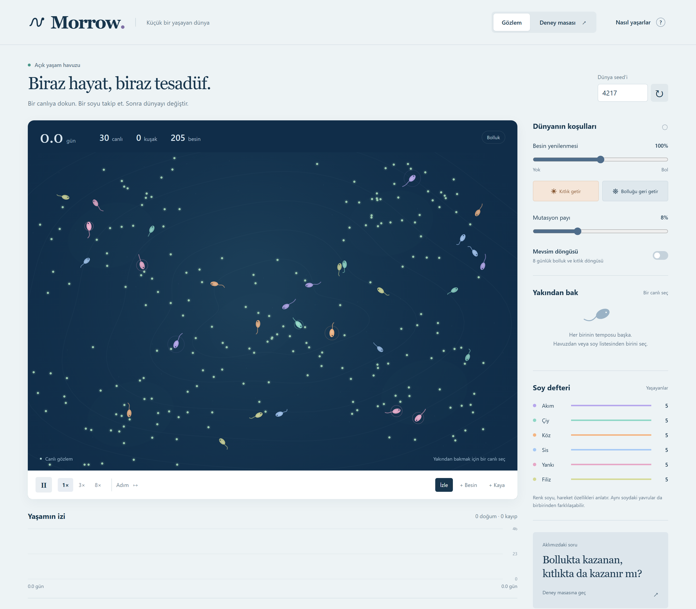

# Morrow

A small living world, built for Elmar and Sisyphos to explore together.
Watch organisms find food, spend energy, have offspring, and change across
generations. Then change the environment and test your prediction.

**[Read the case study](https://kulieff21.github.io/Morrow/) ·
[Open the pond](https://kulieff21.github.io/Morrow/pond.html) ·
[Read the article](docs/article/morrow-article.md)**

The case study and app default to English. Switch to Turkish with the EN/TR
selector; the choice follows links between them. A direct `?lang=tr` link opens
Turkish. Language changes preserve the current world, selection and experiment.
Original lineage names remain stable identifiers in both languages.

The app runs with no dependencies, accounts, API keys, analytics or external
fonts. GitHub Pages serves the static files; there is no application backend.
Local preview makes only same-origin requests for code and recorded evidence.



The original screenshot is a native lossless 2880 × 2520 PNG. The live version
adds the language selector and a separate case study.

## Run

Install Node.js 22 or newer, then run in this folder:

```powershell
npm start
```

Open the [case study](http://127.0.0.1:4317/) or the
[observation pond](http://127.0.0.1:4317/pond.html) on your computer.
No `npm install` step is required. To use another port in PowerShell:

```powershell
$env:PORT = '4318'
npm start
```

The preview binds only to `127.0.0.1`. Close it with Ctrl+C in its terminal.
The public site is deployed by GitHub Actions to GitHub Pages. See
[publication and website verification](docs/web-release.md) for the build,
preview and deployment procedure.

## Explore

- Select an organism in the pond, or select a lineage in the ledger. Repeated
  lineage clicks cycle through its living members. Selection follows an ID;
  the panel retains the last observation when that organism dies.
- Pause, move one simulated second with **Step**, or play at 1×, 3× or 8×.
  With focus outside controls, Space toggles playback and `.` advances one second.
- Change food renewal and mutation, bring a drought, or turn on the season cycle.
- Choose **+ Food** or **+ Rock**, then click the pond to intervene. There is a
  maximum of twelve non-overlapping rocks. Removing rocks requires a new world.
- Enter an integer seed and restart. The same seed **and the same intervention
  sequence** reproduce the same world. Restart retains current environment settings.
- Download a full observation snapshot or a completed experiment as JSON.

Worlds are in memory. Reloading the page starts over; there is no automatic save
or snapshot-import UI in version 0.1. Download before closing a world you care about.
Background tabs do not advance, and returning to a tab does not fast-forward it.
The observation world waits while the experiment view is open and resumes when
you return. Reduced-motion preference starts the observation paused.

## The first question

**Does the most numerous lineage in abundance remain a leader during scarcity?**

The experiment view starts a separate seeded world. It runs eight simulated days
in abundance, then copies the **complete checkpoint**, including existing food,
into two independent branches. One continues at 100% food renewal; the other drops
to 15%. Both run another eight days with mutation amplitude ±0.08 and seasons off.
Mutation adds a bounded numerical change to each inherited trait; it is not an
8% probability of mutation.

Leadership means the largest count of living descendants at the measurement time.
Ties remain ties. Leadership is undefined if no organisms survive. The hypothesis
counts as retained if any checkpoint leader is among the final drought leaders.
This definition does not require sole leadership or prove that the same organism
survived. The control branch is reported for comparison.

The initial twelve seeds (4217–4228) produced five retained and seven changed
leaders. These are descriptive results of this toy model, not biological evidence.
See [the recorded run](docs/first-experiment.md) and [model rules](docs/model.md).

```powershell
npm run experiment
npm run experiment -- 4217 4218 4219
```

The CLI prints full per-lineage reports as JSON; default is the twelve seeds above.

## What the paired branches reveal

Reanalyzing those same twelve reports, the baseline leader changes in 3 control
branches and 7 drought branches. At the final endpoint, leader sets are disjoint
in 9 pairs, identical in 2, and overlap partially in 1. The two marginal change
counts alone do not say which seeds changed only under drought; the paired
transition table preserves that distinction.

Mean population is 147.33 in the control and 13.50 in drought. Çiy's mean share
rises from 17.91% to 33.42%, while its mean count falls from 26.67 to 4.67. A larger
share of a smaller surviving population does not imply population growth.
Every seed has equal weight; these are descriptive outcomes of the twelve saved
runs, with no significance or general biological claim.

See the [paired analysis](docs/paired-analysis.md) for all six lineages, every seed,
ties, formulas and limitations. Analyze the saved batch without new experiment
trials:

```powershell
npm run analyze
npm run analyze -- --check
```

## Testing Çiy's thrift parameter

The next experiment forks each of the same twelve day-8 checkpoints into four
branches: abundance/drought crossed with natural thrift/thrift set once to 1.00
for the living Çiy cohort. Normal inheritance and mutation continue afterward.
The [protocol](docs/thrift-protocol.md) was committed before examining this batch.

Normalization reduces mean Çiy share by 5.46 percentage points in abundance and
17.86 in drought. The prespecified share interaction is −12.40 points on average,
with a median of −6.90; 8 seeds have the predicted sign and 4 the opposite sign.
Mean absolute-count losses are larger in abundance, so the relative-share result
must not be interpreted as a larger absolute loss under drought. Thrift also
changes movement, reproduction and lifespan; this is not an energy-only test.

These are twelve reused initial conditions, not 48 independent observations.
See the [four-arm results](docs/thrift-results.md) for every seed, both outcome
scales, complete raw checkpoints, fixed source hashes and interpretation limits.

```powershell
npm run analyze:thrift
npm run analyze:thrift -- --check
npm run experiment:thrift -- --replay
```

Analysis reads saved evidence. Replay reruns all four arms and checks the complete
recorded evidence without replacing it. The browser's original two-arm experiment
is unchanged; this follow-up runs through the CLI.

## Research article

The complete English [research article](docs/article/morrow-article.md) describes
the model, all three study stages, equations, every seed endpoint, both outcome
scales, limitations, references and reproducibility. A formatted
[Word version](docs/article/morrow-article.docx) accompanies the Markdown.
See [article tools and build instructions](docs/article/README.md) for the Python
converter, generated tables and figures, and numerical/document audits.

## Verify

```powershell
npm test
npm run check
```

Tests exercise seeded reproduction, step batching, checkpoint continuation,
inheritance, starvation, obstacle placement, population limits, paired branches,
ties/extinction, and loopback HTTP behavior. `check` verifies JavaScript syntax,
DOM targets, Pages-compatible asset references and frozen artifact freshness.
Tests also verify translations, the public build allowlist and nested preview
routes. GitHub Actions runs checks on push and PR; Pages deploys only checked
main-branch builds after the full 48-arm evidence replay.

See [verification](docs/verification.md), [design direction](docs/design.md),
and [session log](LOG.md).

## Source map

| File | Responsibility |
| --- | --- |
| `src/engine.js` | Seeded fixed-step model, snapshots and experiment protocol |
| `src/render.js` | Pond, organism anatomy and stacked population trace |
| `src/app.js` | Controls, observation state, experiments and JSON downloads |
| `pond.html`, `styles.css` | Accessible responsive bilingual app |
| `index.html`, `case.css`, `src/case.js` | Animated bilingual case study and evidence explorer |
| `src/i18n.js`, `src/translations.js` | View-only translation and language-aware links |
| `scripts/site-files.mjs`, `scripts/build-pages.mjs` | Explicit public asset list and static Pages build |
| `.github/workflows/pages.yml` | Checked main-branch deployment to GitHub Pages |
| `server.mjs` | Loopback-only static preview with explicit route allowlist |
| `scripts/experiment.mjs` | Repeatable multi-seed CLI |
| `scripts/analyze-batch.mjs` | Read-only paired analysis and reproducible reports |
| `scripts/thrift-experiment.mjs` | Four-arm gene intervention and full evidence replay |
| `scripts/analyze-thrift.mjs` | Prespecified factorial contrasts and generated report |
| `tests/` | Node built-in tests; no external test runner |

## Limits

This is an intentionally simple rule-based artificial-life model. Its outcomes
depend on the chosen energy costs, food layout, reproductive rules and time horizon.
Organisms do not think or use language models. There is no predation, mating,
neural learning or real genetics. Mutation is a bounded numerical perturbation.
Population is capped at 240, food at 420, and the chart retains 600 samples.
Playback under heavy load slows down rather than skipping ecological steps.

Built October 14, 2026. Public source; no open-source license granted.
The article preserves its pre-publication access statement; the repository and
recorded evidence were subsequently made public at Elmar's request.
