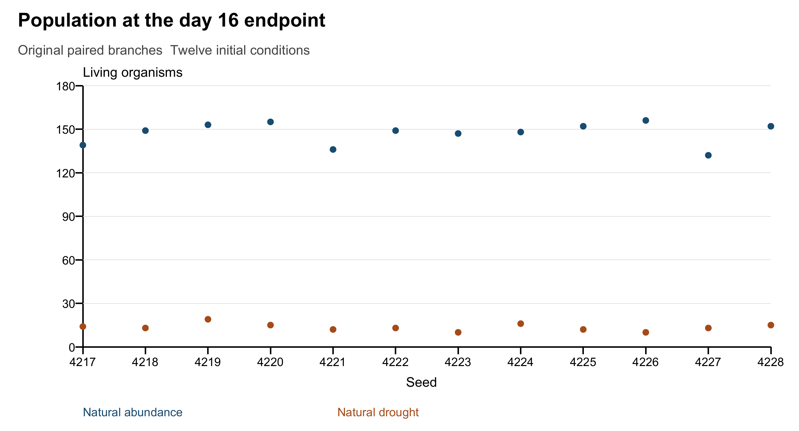
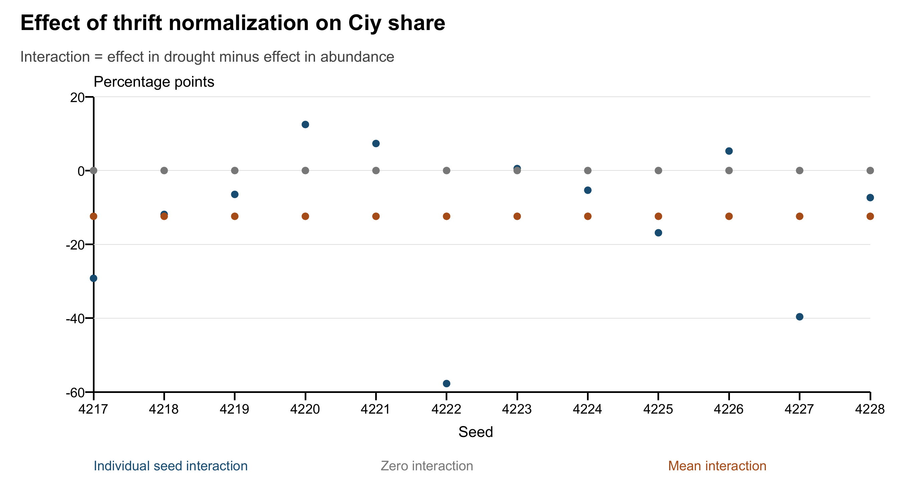

# Resource scarcity and lineage success in Morrow

A paired artificial life study with a targeted thrift intervention

Prepared for Elmar Quliyev • 14 October 2026

## Abstract

**Background.** Numerical dominance under one resource regime need not persist after an environmental change. A small artificial-life model can make this question experimentally accessible, provided that its rules, comparison units and limits are explicit. Morrow is a deterministic, spatial, individual-based sandbox in which organisms search for food, spend energy, reproduce with bounded trait mutation and die. It is an exploratory computational system without empirical biological calibration.

**Methods.** Twelve consecutive seeds, 4217–4228, each generated a world with six founder lineages and 30 organisms. After eight model days at full food renewal, the complete world state was cloned into abundance and drought branches, with renewal multipliers of 1.00 and 0.15. Both continued for eight days. An initial leadership question was followed by a post hoc paired analysis of counts and population shares. A subsequent protocol, committed before its four-arm batch outcomes were examined, crossed resource regime with a one-time intervention setting living Çiy organisms' thrift genes to 1.00 at the checkpoint. Normal descendant mutation continued. The primary follow-up outcome was the interaction between normalization and resource regime in final Çiy share; absolute count was secondary. All analyses were descriptive and equally weighted the twelve paired initial conditions.

**Results.** Baseline leadership persisted in 9/12 abundance branches and 5/12 drought branches. Mean total population was 147.33 versus 13.50. Çiy's mean share increased from 17.91% to 33.42%, although its mean count decreased from 26.67 to 4.67. Normalization changed mean Çiy share by −5.46 percentage points in abundance and −17.86 in drought. The mean share interaction was −12.40 points, the median −6.90, and the observed range −57.73 to +12.47; 8/12 seeds had the predicted negative sign. The corresponding mean count interaction was +6.50 organisms, reflecting larger absolute losses in abundance. Çiy disappeared in four normalized-drought branches and none of the natural-drought branches. No whole world became extinct.

**Conclusions.** The targeted intervention supports the predicted average relative-share effect within this fixed model, seed set and horizon. It does not establish a universal effect across worlds or isolate energy conservation: thrift simultaneously changes movement, reproduction thresholds, lifespan and checkpoint trait variation. Reused seeds and natural-arm replays provide no held-out validation. Complete endpoints, executable analyses, source hashes and a replay procedure make the result auditable by collaborators with repository access.

**Keywords:** artificial life; individual-based simulation; resource scarcity; paired experiment; lineage composition; reproducibility; gene intervention

## 1 Introduction

### 1.1 The question behind the pond

Morrow began as a practical question shared by a human project owner and an AI coding assistant: could a small local world produce an observation worth investigating? The resulting pond is a deliberately limited system. Organisms have positions, energy and three numerical traits. They compete indirectly through a shared food supply. Their descendants inherit perturbed traits, and their lineages can become more or less common without any organism reasoning about the environment.

The first question was whether the lineage with the most living descendants after a period of abundance would remain a leader after food renewal was reduced. This is a question about a change in numerical ranking at a specified endpoint. It is narrower than asking which lineage is universally fittest, whether organisms adapt intelligently, or whether the model reproduces a real ecosystem. Defining the question narrowly allows a complete answer from the recorded worlds.

The control branch is essential to that answer. A lineage can lose leadership during another eight days of abundance because of competition, inherited variation, movement and chance within the model. A drought endpoint alone cannot distinguish a change associated with scarcity from a change that would also have occurred under continued renewal. Cloning the same checkpoint supplies a direct within-world comparison.

### 1.2 From ranking to composition and intervention

The initial leadership results motivated two additional questions. First, how did abundance and drought differ in total population, lineage counts and lineage shares? This was answered by reanalyzing the saved two-arm records, without adding new recorded trials. Second, could one numerical trait associated with Çiy's initial profile help account for its relative representation under drought? That question led to a targeted four-arm intervention.

The distinction between count and share is central. A lineage may decline from many organisms to a few while becoming a larger fraction of the survivors. Conversely, an intervention may cause a larger loss of organisms in a large population but a larger loss of percentage points in a small population. Both descriptions can be correct. This article therefore reports the two scales separately and defines every contrast before interpreting it.

### 1.3 Reporting approach and contribution

The article uses an Introduction, Methods, Results and Discussion structure, borrowing general manuscript organization from ICMJE guidance [1]. The model description follows the purpose, state, scheduling and submodel logic of the ODD reporting protocol [2]. Explicit aims, generating rules and estimands are also informed by simulation-study guidance [3], although Morrow is an intervention study within a toy model rather than a comparison of statistical estimators. These are reporting aids, not claims of clinical relevance or external model validation.

The contribution is a fully traceable small computational case study. It connects an exploratory observation to a prospectively fixed follow-up, retains contrary seed-level outcomes, and demonstrates why the outcome scale matters. It also supplies enough detail to inspect the implementation rather than rely on the visual impression of an animated pond. No claim of theoretical novelty over the broader artificial-life literature is made; the cited literature was selected for reporting and reproducibility, not as a systematic survey of that field.

## 2 Materials and methods

### 2.1 Study stages and experimental units

The study has three stages. The original experiment generated twelve paired abundance–drought outcomes. The second stage described those same outcomes more fully. The third stage replayed the natural conditions and added the thrift intervention. The follow-up hypothesis was informed by the earlier results and reused all twelve original seeds.

**Table 1 Study chronology and evidential status**

| Stage | Question and action | Evidence status |
| --- | --- | --- |
| Initial paired experiment | Does day 8 leadership persist to day 16 under drought with an abundance comparison | Twelve paired worlds; original leadership question |
| Paired endpoint analysis | Compare leadership transitions, total population, all lineage counts and shares | Post hoc analysis of the same saved records; no new recorded trials |
| Four arm thrift experiment | Normalize living Çiy thrift once and cross that edit with renewal regime | Follow-up protocol committed before examining this batch; hypothesis and seeds came from earlier results |

The paired unit is one seeded initial world and its day-8 checkpoint. Four branches from one checkpoint are related outcomes of that unit. The follow-up contains 48 branch executions: 24 natural-arm replays and 24 treated branches. It does not provide 48 independent replicates. Combining the earlier experiment and later replay does not create additional independent initial conditions. The twelve seeds were consecutive integers, selected as a compact reproducible batch; they were not a probability sample of ecosystems or a held-out validation set.

### 2.2 Model purpose and scope

Morrow version 0.1 is an individual-based spatial model designed for observation and controlled perturbation. Its intended adequacy is operational: reproducible worlds, explicit energy and reproduction rules, branching from an identical checkpoint, and transparent accounting of outcomes. It has no calibration target, fitted biological parameter, measured species, physical energy unit or empirical environmental time series. Parameters were chosen by the developer to create an observable sandbox, not estimated from external data.

The browser application has a Turkish interface and runs locally without application dependencies, accounts, API keys, analytics, external fonts or network services. A Node.js server serves the files on loopback. The ecological engine is pure JavaScript and can also run headlessly. Organisms do not contain language models, neural networks or learning algorithms. AI assistance was used to build and analyze the software, not to decide the actions of simulated organisms.

### 2.3 Entities state variables and scales

Space is a 1000 × 650 rectangle in arbitrary model units. Body centers reflect at its walls and are clamped inside the boundary. A fixed tick advances 0.1 model seconds. One displayed day equals 12 model seconds, or 120 ticks. The checkpoint at day 8 is exactly tick 960, and the endpoint at day 16 is exactly tick 1920. A displayed day has no asserted correspondence to a biological day.

An organism has a persistent ID, parent ID, lineage ID, generation, three genes, position, heading, age, energy and bookkeeping fields. The latter record food eaten, children, most recent feeding time, next wandering change, wandering heading and birth time. Age and energy are individual state variables. A generation value describes genealogical depth; it does not advance synchronously across a population.

Food particles have a position and an availability flag. Fixed patch centers determine where new particles are concentrated. Optional circular rocks alter local geometry. World state includes the pseudo-random generator state, tick, time, next organism ID, organism and food arrays, obstacles, environmental options, spawn credit, cumulative births and deaths, patch locations, history and recent events. Array order is retained because it participates in deterministic scheduling.

Lineage is a permanent descent label. A child keeps its parent's label even if mutation changes all of its trait values substantially. Labels therefore are not species, behavioral classes or clusters recomputed from the current genes. Between-lineage composition and within-lineage trait evolution are distinct processes in this model.

### 2.4 Initialization and founder traits

Every world begins with five organisms in each of six lineages, for a total of 30. Table 2 gives the center of each founder trait distribution. Each founder gene receives an independent uniform perturbation between −0.06 and +0.06, then is clamped to the interval [0.45, 1.75]. Thus the table gives initialization centers rather than identical genes shared by all members of a lineage.

**Table 2 Founder trait centers**

| Lineage | Speed s | Sense q | Thrift h | Initial organisms |
| --- | --- | --- | --- | --- |
| Akım | 1.42 | 0.86 | 0.78 | 5 |
| Çiy | 0.78 | 1.12 | 1.35 | 5 |
| Köz | 1.12 | 1.25 | 0.92 | 5 |
| Sis | 0.90 | 1.45 | 1.08 | 5 |
| Yankı | 1.24 | 0.70 | 1.15 | 5 |
| Filiz | 0.95 | 0.92 | 1.20 | 5 |

Founders are placed uniformly inside an inset rectangle: x = 50 + 900U and y = 50 + 550U, where each U is a draw in [0, 1). Initial headings are uniform over a full circle. Initial energy is 58 + 28U, and age is zero. The first wandering update is scheduled at an offset below two model seconds. Initialization then generates 210 food particles. Founders and food are created in fixed loop order; changing that order would change which random draws are assigned to which entities.

### 2.5 Randomness and deterministic continuation

All model randomness is supplied by a Mulberry32 pseudo-random generator with unsigned 32-bit state. Input seeds are coerced to that range, and zero is a valid seed. Founder variation, positions, food placement, wandering and offspring mutation consume the same generator. The renderer consumes none of its draws, and the engine does not call `Math.random`.

A seed is sufficient only when the model version, options and intervention sequence are also fixed. An interactive food addition consumes random draws and changes later outcomes. A full checkpoint is stronger than a seed alone because it preserves the exact state reached after all earlier actions. Restoring a checkpoint makes a deep copy of every serialized field, without shared organism or food arrays.

Cloned branches begin with identical generator states. They do not maintain event-by-event common random numbers after divergence. For example, a different number of births or wandering events changes the number of consumed draws, and later food placement may then differ as well. The recorded contrast includes the full consequence of the intervention in this shared-stream implementation. It is not an energy-only effect under a separately fixed future sequence of food events.

### 2.6 Food renewal and spatial supply

With seasons disabled, the attempted renewal rate is 15R particles per model second, where R is the resource multiplier. Abundance uses R = 1.00, giving 15 attempts per second; drought uses R = 0.15, giving 2.25. A fractional spawn-credit accumulator receives rate × 0.1 each tick. While credit is at least one, an attempt is made and one credit is spent. This avoids rounding a fractional rate separately at each tick.

One of five patches is chosen uniformly for each attempted spawn. Patch centers are (170, 170), (740, 145), (460, 355), (210, 535) and (810, 490). The x offset is 215(U₁ + U₂ − 1), and the y offset is 180(U₃ + U₄ − 1). These triangular offsets concentrate food toward a patch center before coordinates are clamped at least 12 units from the world boundary. Clamping changes the distribution near edges; it is part of the implemented supply rule.

At most 420 food particles can exist. A capped attempt produces no new particle. An attempted point inside a rock's exclusion zone is rejected without retry, and its credit is still spent. Therefore the configured rate is an attempted supply rate, not a guarantee of realized additions. In the recorded experiments no rocks were present. Food has no expiration time and is removed only by consumption or a manual rock placement. Existing checkpoint food remains in all experimental branches: drought reduces renewal rather than instantaneously removing stored resources.

### 2.7 Sensing movement and sequential competition

Each tick, surviving organisms search for the nearest available food strictly within a radius of 70q. A spatial grid with 100-unit cells limits the search cost. The search uses the organism's position before movement. Distance ties follow the fixed iteration order because a candidate replaces the current nearest particle only when its squared distance is strictly smaller.

The organism turns toward the target by at most 0.42 radians per tick, using a wrapped angular difference. If there is no target and its wandering update is due, it chooses a wandering heading by adding (U − 0.5) × 2.6 radians to its current heading and schedules the next change 0.8 + 1.8U model seconds later. A target is not recomputed after movement during the same tick.

Movement speed is determined jointly by speed and thrift:

```equation
v(s,h) = 24s / (0.75 + 0.25h)
```

The per-tick displacement is v × 0.1 in the new heading. A wall collision reflects the relevant heading component and resets the wandering direction; the center is then clamped inside the world. Food is consumed only if the selected particle is still available and the moved organism is strictly less than 12 units away. Consumption adds 25 energy, capped at 150. At most the selected particle is eaten by that organism in a tick.

Agents are processed sequentially. Priority begins at the index tick modulo the old population size and then wraps through the old array. Food consumed by an earlier organism is immediately unavailable to later organisms. Survivors are collected in this processing order, followed by newborns, so array order evolves. This rotating priority avoids a permanent first-agent advantage but does not make the simulation simultaneous or eliminate all scheduling effects.

### 2.8 Energy reproduction inheritance and death

At the beginning of an organism's update its age increases by 0.1 and its energy decreases by 0.1 times the cost rate:

```equation
C(s,q,h) = (0.55 + 1.2s² + 0.30q²) / h
```

Speed and sense have quadratic costs, while thrift divides the total cost. An organism dies immediately if its energy is non-positive or its age reaches 130 + 30h model seconds. These checks occur before movement and feeding, so an organism that has already exhausted its energy cannot be rescued by nearby food later in the same tick.

After movement and any feeding, reproduction occurs if age is strictly above five model seconds, energy is strictly above 92 + 26h, and the population-cap check permits a birth. The parent loses 48 energy and the child starts with 40; reproduction therefore removes eight units of total energy. The child is placed 12 units from the parent in a random direction, then clamped and displaced from any rock. It begins at age zero, generation one above the parent and with a new unique ID. Newborns are not processed until the next tick.

Each offspring gene is inherited independently with a bounded additive perturbation:

```equation
g_child = clamp(g_parent + ε, 0.45, 1.75)
ε ∼ Uniform(−m, +m)
```

The mutation setting m = 0.08 is an absolute amplitude. It is not an 8% probability of mutation, an 8% proportional change, or a biological mutation rate. Every child samples a perturbation for each gene. Clamping at the bounds alters the resulting distribution near those bounds. There is no recombination, mating or exchange between parents.

The population cap is 240. Its conservative check uses the old population length plus the number of newborns already created in that tick. It does not subtract deaths encountered earlier in the tick. Some births may therefore wait until the next tick even if a death has freed space. At every completed step the accounting identity is living population = 30 + cumulative births − cumulative deaths.

Thrift has four direct consequences: higher h reduces energy expenditure, reduces movement speed at fixed s, raises the energy threshold for reproduction, and raises the age limit. It is therefore a trade-off parameter, not a pure efficiency coefficient. “Normalization” is the intervention's name for assigning h = 1.00, not a claim that 1.00 is biologically normal or statistically standardized.

### 2.9 Exact process schedule

The schedule below is part of the model specification. Reordering feeding, mortality or reproduction could change the results even with the same formulas.

1. Increment tick and derive time as tick × 0.1.
2. Add renewal credit, attempt food spawns and spend their credit.
3. Build the food grid from the current food array.
4. Choose the rotating processing offset from tick and old population length.
5. For each old organism in that order, increase age and debit energy.
6. Remove organisms that fail the energy or age test from further processing.
7. Find food, turn or wander, move, reflect at walls and resolve rocks.
8. Eat the selected food if the strict distance and availability tests pass.
9. Apply the reproduction rule and collect a newborn if permitted.
10. Replace the agent array with survivors followed by newborns; remove consumed food.
11. Record history every ten ticks, equivalent to one model second.

Population history retains the latest 600 samples. The event log retains twelve messages. These are observation limits rather than ecological population limits; the complete living state remains available in a snapshot. The tested 16-day horizon is 192 model seconds and therefore does not reach the history-retention limit.

### 2.10 Optional interactive mechanisms excluded from the study

The application can multiply renewal by a seasonal factor of 0.65 + 0.35 cos(day × π/4). Its period is eight displayed days, ranging from 1.00 at day 0 to 0.30 at day 4 and back to 1.00 at day 8. Seasons were disabled throughout the recorded experiments. Resource sliders support multipliers from 0 to 2, and the mutation slider supports amplitudes from 0 to 0.25; the experiment fixes these values rather than inheriting arbitrary observation-view settings.

Manual food placement makes 22 spawn attempts near a clicked point, using offsets up to 45 units in each direction. Rocks have radius 28, repel body centers to radius 35 and exclude food within radius 31. Their centers are clamped 40 units inside the boundary; at most twelve may be placed and their centers must be at least 70 units apart. Adding a rock removes food in its exclusion zone and displaces organisms. There is no global route planning, so a food-seeking organism can become locally trapped at a rock. No manual food, rock or mid-branch setting changes were used in the batch.

### 2.11 Initial paired protocol

For each seed, a fresh world runs for 960 ticks at R = 1.00, m = 0.08 and seasons off. At that checkpoint the entire snapshot is cloned. One branch continues at R = 1.00; the other uses R = 0.15. Each runs exactly 960 further ticks. This gives an equal branch duration, an identical starting food stock and identical pre-intervention genealogical history.

The leader set contains every lineage tied for the highest positive living count. Baseline leadership is retained when at least one day-8 leader belongs to the endpoint leader set. This is a set-intersection rule; it does not require sole leadership or the survival of a particular individual. A world with no living organisms has no leader and an undefined persistence outcome. The analysis preserves ties rather than breaking them alphabetically or by lineage index.

### 2.12 Post hoc paired estimands

Let n be a lineage's final count, N the final total population, i a seed, A abundance and D drought. Share in percent is 100n/N. A lineage absent from a living world has share zero. When N = 0, shares are undefined rather than forced to zero. In this batch every whole world survived, so all twelve pairs contribute to every reported share contrast.

```equation
p_i = 100n_i / N_i
Δp_i = p_i,D − p_i,A
Δn_i = n_i,D − n_i,A
```

Reported share means average each seed's share, giving each initial condition equal weight. They are not calculated by pooling organisms across worlds. Likewise, mean population reduction averages 100(1 − N_D/N_A) across seeds and is not the percentage reduction calculated from the two mean population sizes. The paired analysis also classifies endpoint leader sets as identical, partially overlapping or disjoint and cross-tabulates baseline-leader persistence in both branches.

These questions were formulated after the original outcomes were available. Their results are descriptive discoveries, not prospectively confirmed predictions. No p-values, confidence intervals, family-wise error corrections or optimized significance thresholds were introduced for this twelve-seed case study.

### 2.13 Four arm targeted thrift intervention

The follow-up protocol was committed as `4352cde6c77044e0fc1242ae66757940c1421403` before the current four-arm batch outcomes were examined. Its runner was frozen at execution revision `eceb3c6166f798688bde2cef23472f219861de7a`. The ecological engine remained unchanged. These records establish an ordering within the private repository; they are not an external registry or an independent replication.

For each original seed, the runner regenerates the day-8 checkpoint and creates four complete copies. In the two normalized branches it sets only `genes.thrift` of organisms whose permanent lineage is Çiy to exactly 1.00. The edit is applied once to the living checkpoint cohort. It does not affect founders retrospectively, resurrect dead members, edit another lineage, reset energy or erase food. It consumes no random draw. Mutation remains 0.08, so descendants can depart from 1.00 immediately through inheritance.

**Table 3 Four branch conditions after the checkpoint**

| Arm | Code | Renewal multiplier | Day 8 Çiy thrift edit |
| --- | --- | --- | --- |
| Natural abundance | A | 1.00 | None |
| Natural drought | D | 0.15 | None |
| Normalized abundance | XA | 1.00 | Set living cohort to 1.00 once |
| Normalized drought | XD | 0.15 | Set living cohort to 1.00 once |

Except for the declared resource setting and gene edits, the starting clones retain positions, headings, energy, ages, all other genes, organism ordering, IDs, food, renewal credit, counters and generator state. Both the mean and the variation of the edited cohort's thrift values change. The raw file saves the complete checkpoint, IDs and before/after gene values, checkpoint and arm-start hashes, all final full statistics and final-state hashes.

### 2.14 Primary interaction and secondary outcomes

The primary follow-up outcome is final Çiy share in percentage points. For each seed, normalization effect means normalized minus natural within the same environment. The interaction subtracts the abundance effect from the drought effect:

```equation
E_A,i = p_XA,i − p_A,i
E_D,i = p_XD,i − p_D,i
I_i = E_D,i − E_A,i
```

A negative interaction means the intervention lowers share more, or raises it less, in drought than in abundance. It does not mean that drought has a negative effect on share in every arm, or that all individual worlds share the same mechanism. The prespecified directional prediction was a negative average share interaction.

The same contrasts are calculated separately for absolute Çiy count. Total population, target-lineage extinction and whole-world extinction provide additional context. Means, medians, observed ranges and counts of negative, zero and positive contrasts are reported. Undefined shares would be excluded with explicit denominators, while count outcomes would remain defined. Here all twelve interactions are defined. An observed range is not a confidence interval, and a sign count is not reported as a probability of replication.

### 2.15 Software verification and evidence preservation

The application and scientific runners use Node.js 22 or newer without an npm installation step. The test suite at the evidence revision contains 30 tests. It checks seeded continuation, seed zero, fixed-step batching, snapshot independence, inheritance bounds, starvation, population accounting, obstacle behavior, seasons, branch timing, ties, extinction rules and the loopback server. Follow-up tests check that clones differ only as declared, the edit is applied once, mutation continues, contrast signs are correct, evidence tampering is rejected, and natural arms reproduce the original records.

The source check validates thirteen JavaScript modules, eighty unique DOM targets and local assets. It also rejects stale generated analysis files. The full follow-up replay reconstructs all twelve checkpoints and all four arms and compares the saved evidence, including the original natural-arm statistics. The runner refuses to replace the raw evidence during ordinary generation. An independent Python recalculation checked hashes, edits, endpoints, contrasts and summary statistics against the saved records.

These procedures support computational consistency. They do not verify that an ecological assumption is realistic, show that every possible implementation bug is absent, or validate a real biological mechanism. A successful GitHub Actions run on Linux additionally demonstrates replay in that configured environment, rather than universal bitwise portability across every future JavaScript engine.

## 3 Results

### 3.1 Baseline leadership and subsequent transitions

At day 16, baseline leadership persisted in nine abundance branches and five drought branches. Thus leadership changed in three abundance branches and seven drought branches. The difference between those marginal change counts is four, but it is not the number of worlds in which drought alone changed the outcome. The paired transition table shows why.

**Table 4 Baseline leadership persistence in paired branches**

| Abundance outcome | Drought retained | Drought changed | Row total |
| --- | --- | --- | --- |
| Retained | 2 | 7 | 9 |
| Changed | 3 | 0 | 3 |
| Column total | 5 | 7 | 12 |

Seven seeds retained baseline leadership only in abundance, while three retained it only in drought. Two retained it in both branches, and none lost it in both. The direction of a comparison therefore depends on its paired definition, not just on subtracting totals. For example, seed 4217 began with Filiz leading, ended with Yankı leading in abundance, and retained Filiz in drought.

The final abundance and drought leader sets were disjoint in nine pairs, identical in two and partially overlapping in one. Seed 4228 had an abundance tie between Yankı and Filiz and a drought lead for Filiz, producing partial overlap. Seed 4221 began with a tie between Köz and Filiz; its drought lead for Köz satisfies the stated retention rule. Appendix A preserves the complete leader ledger.

### 3.2 Population reduction and lineage composition

Mean total population was 147.33 in abundance and 13.50 in drought, a mean paired difference of −133.83 organisms. Drought population was lower in all twelve seeds. The mean within-pair percentage reduction was 90.83%. This is a comparison of the twelve recorded endpoints, not an estimated carrying capacity or a long-run extinction rate.



Figure 1. Each point is a day-16 population from one original branch. Blue denotes abundance and brown drought. The horizontal axis identifies initial conditions, not time; points are deliberately unconnected. All twelve drought populations are below their paired abundance values. The same natural endpoints recur in the four-arm replay and are not additional replicates.

**Table 5 Mean lineage counts and equal seed mean shares**

| Lineage | A count | D count | A share % | D share % | D minus A pp |
| --- | --- | --- | --- | --- | --- |
| Akım | 3.50 | 0.00 | 2.41 | 0.00 | −2.41 |
| Çiy | 26.67 | 4.67 | 17.91 | 33.42 | +15.51 |
| Köz | 17.50 | 0.92 | 12.12 | 7.86 | −4.27 |
| Sis | 11.42 | 1.00 | 7.75 | 7.23 | −0.51 |
| Yankı | 41.58 | 1.42 | 28.32 | 11.12 | −17.21 |
| Filiz | 46.67 | 5.50 | 31.49 | 40.37 | +8.89 |

All six lineages had a lower mean absolute count in drought. Çiy and Filiz nevertheless gained mean share, by 15.51 and 8.89 percentage points respectively. Çiy had a higher drought share in ten seeds and a lower share in two. Filiz had a higher share in eight. Akım had no surviving members in any drought endpoint, while it was already absent from two abundance endpoints. These are lineage extinctions within surviving worlds, not whole-world extinctions.

For Çiy, the key observation is simultaneous absolute loss and relative gain: mean count 26.67 to 4.67, mean share 17.91% to 33.42%. A description such as “Çiy grew under drought” would therefore be incorrect. Its representation among survivors increased on average while the entire population contracted sharply.

### 3.3 Four arm endpoints

Every natural follow-up endpoint matched its original full recorded statistics. This equality is a replay check and also means the natural endpoints cannot be counted again as new evidence. The normalized arms produced the endpoints summarized in Table 6.

**Table 6 Four arm Çiy endpoints with equal seed weighting**

| Arm | Mean total N | Mean Çiy n | Mean Çiy share % | Çiy extinctions |
| --- | --- | --- | --- | --- |
| A | 147.33 | 26.67 | 17.91 | 0 of 12 |
| D | 13.50 | 4.67 | 33.42 | 0 of 12 |
| XA | 141.83 | 17.75 | 12.46 | 0 of 12 |
| XD | 13.00 | 2.25 | 15.56 | 4 of 12 |

Mean total population decreased by 5.50 organisms in normalized abundance and 0.50 in normalized drought. The normalized-drought total of 13.00 illustrates that a substantial target-lineage change can occur with a much smaller change in whole-world population. Other lineages can occupy a larger fraction of that remaining population. No whole-world extinction occurred in any of the 48 branches.

### 3.4 Primary share contrasts

Normalization lowered mean Çiy share by 5.46 points in abundance and 17.86 points in drought. The difference of those effects was −12.40 points. The corresponding median interaction was −6.90 points, with individual interactions extending from −57.73 to +12.47. Eight seeds had a negative interaction and four a positive one; none were exactly zero.

**Table 7 Normalization effects on Çiy share in percentage points**

| Contrast | Mean | Median | Minimum | Maximum | Negative | Zero | Positive |
| --- | --- | --- | --- | --- | --- | --- | --- |
| XA minus A | −5.46 | −5.50 | −13.86 | +1.16 | 10 | 0 | 2 |
| XD minus D | −17.86 | −13.00 | −61.54 | +6.67 | 11 | 0 | 1 |
| Interaction | −12.40 | −6.90 | −57.73 | +12.47 | 8 | 0 | 4 |



Figure 2. Blue points show the primary interaction for each seed. Gray points mark zero and brown points the mean interaction of −12.40 percentage points. The predicted direction is below zero. The references are levels, not uncertainty limits; no confidence interval is shown. Seeds are categorical initial conditions represented by their integer identifiers. The spread and four positive interactions qualify the negative mean.

The natural drought–abundance share difference was +15.51 points, while the normalized difference was +3.10. Their difference is the same −12.40-point interaction. It would be inappropriate to divide these values and report a fraction of drought advantage “explained” by thrift: the intervention changes multiple mechanisms and variance, interacts with the ecosystem, and operates on a compositional outcome. No mediation estimand was specified or identified.

### 3.5 Secondary counts and the denominator effect

The count results differ from the share results. Normalization lowered mean Çiy count by 8.92 organisms in abundance and 2.42 in drought. Consequently the count interaction was +6.50 organisms, with a median of +8.00 and observed range −7.00 to +23.00. Nine count interactions were positive and three negative.

**Table 8 Normalization effects on Çiy count in organisms**

| Contrast | Mean | Median | Minimum | Maximum | Negative | Zero | Positive |
| --- | --- | --- | --- | --- | --- | --- | --- |
| XA minus A | −8.92 | −10.00 | −23.00 | +2.00 | 10 | 0 | 2 |
| XD minus D | −2.42 | −2.50 | −8.00 | 0.00 | 7 | 5 | 0 |
| Interaction | +6.50 | +8.00 | −7.00 | +23.00 | 3 | 0 | 9 |

Seed 4220 gives a concrete denominator example. Natural drought ended with four Çiy organisms out of fifteen, or 26.67%. Normalized drought also ended with four Çiy, but out of twelve, or 33.33%. The count effect is zero while the share effect is +6.67 points. In that same seed, the full share interaction is +12.47 points, opposite to the primary prediction. Preserving this world in the report prevents an average negative effect from being mistaken for an invariant response.

### 3.6 Target lineage extinction and heterogeneity

Çiy disappeared in normalized drought for seeds 4217, 4222, 4225 and 4227. Natural drought retained Çiy in all twelve seeds, and neither abundance arm lost the target lineage. A zero target count contributes a zero share because another lineage still survives; these four outcomes are not missing data.

The most negative share interaction occurred at seed 4222, at −57.73 points. Its natural drought endpoint contained eight Çiy among thirteen organisms, while normalized drought contained none. The mean interaction is therefore accompanied by a noticeably less negative median. Both measures are reported without trimming or removing extreme worlds. The four opposite-sign interactions at seeds 4220, 4221, 4223 and 4226 also remain in every summary. Appendix B gives every arm and contrast, including the edited cohort sizes and endpoint thrift means.

## 4 Discussion

### 4.1 What the experiment establishes within its rules

The first stage shows that numerical leadership after eight days of abundance does not guarantee leadership after another eight days of scarcity. The control comparison adds that leadership can also change during continued abundance. The paired records locate these changes in individual worlds rather than treating the marginal retention totals as causal case counts.

The post hoc composition analysis identifies Çiy as a lineage whose representation among drought survivors increased on average. The follow-up then changes an actual state variable rather than merely correlating a lineage's original profile with its outcome. With all other checkpoint state preserved, setting the living Çiy cohort's thrift to 1.00 changes later outcomes. This supports a causal statement about that implemented intervention within these deterministic worlds, including subsequent ecological feedback and divergence of random-event paths.

The primary predicted average interaction is present: the share effect is more negative under drought. The evidence is conditional on the frozen engine, chosen initial conditions, one-time edit and eight-day branch horizon. The median and seed-level directions show that the effect is heterogeneous. The experiment supplies an average pattern in the recorded worlds, not a guarantee for an arbitrary new seed.

### 4.2 Why thrift cannot be reduced to energy conservation

At fixed speed and sense, lowering thrift increases expenditure. That gives a plausible route to a lower target population when food is scarce. However, the same edit also increases movement speed, lowers the reproduction energy threshold and lowers the age limit. Those consequences can oppose one another over different parts of a trajectory. Normalization also removes all thrift variation among the treated checkpoint organisms while retaining variation in other traits.

The current design does not distinguish these channels. An energy-only mechanism would require an explicit model modification or a carefully specified alternative intervention, followed by a new protocol. Nor does the experiment establish that high thrift is necessary or sufficient for drought leadership. Çiy retains a particular history, sense and speed distribution, spatial arrangement and competitor community. A different lineage with the same thrift value is not tested by this intervention.

Mutating descendants further complicate a simple static explanation. The treatment is a reset of a living cohort at day 8, not a permanent prohibition on higher thrift. Endpoint means in normalized arms can differ from 1.00 because descendants mutate and surviving members are selected by the model. That fact is evidence about how the intervention was implemented; the present article does not infer a separate adaptive optimum from those endpoint averages.

### 4.3 Why outcome scale changes the conclusion

Share and count answer different questions. The primary share outcome asks how strongly Çiy is represented in the surviving community. The count outcome asks how many Çiy organisms remain. Because drought populations are much smaller, losing a few organisms can produce a large share change, whereas losing more organisms in abundance can produce a smaller change in percentage points.

The positive mean count interaction and negative mean share interaction are therefore not a contradiction. They show that “thrift matters more in drought” is underspecified. The statement is supported here for the average normalization effect on relative share, but the absolute count loss is larger in abundance. Leadership is a third outcome, based on a rank set rather than either effect size. Reporting all three avoids converting one definition of success into another after observing the results.

Shares are also compositional: the six values sum to 100% in every living world. A target's share can change because its count changes, because competitors change, or both. The total-population outcome and seed 4220 example make the denominator visible. Treating a higher share as evidence of growth would discard that information.

### 4.4 Seed reuse and protocol timing

The four-arm protocol was fixed before examining its batch, which limits opportunities to change the target, horizon or primary contrast in response to those outcomes. It does not erase the exploratory history. Çiy was selected after its share gain was observed, and the same twelve initial conditions were reused. A prospective intervention on previously studied worlds is more structured than a wholly post hoc explanation, but it is not an independent confirmation on unseen worlds.

No formal sampling model was specified for selecting these twelve consecutive seeds. The reported means describe them exactly up to numerical rounding. Confidence intervals or significance language could suggest a broader population of worlds without defining how that population was sampled. We therefore retain descriptive summaries and complete seed-level results. A larger future study should define its seed-selection mechanism and desired Monte Carlo precision before running its confirmatory batch.

### 4.5 Structural and numerical limitations

The model omits predation, sexual reproduction, recombination, immigration, disease, learning and an explicit genotype-to-phenotype developmental process. Genes are bounded numerical controls connected directly to equations. Lineage labels remain fixed even when descendants change traits. Consequently, persistence of a label cannot be equated with conservation of its founder phenotype.

Spatial structure is imposed through five fixed food patches and reflecting boundaries. Patch clamping, food and population caps, strict distance thresholds, sequential processing and the conservative birth check can all influence competition. The rotating schedule moderates one ordering issue without demonstrating neutrality to all alternative schedules. A 0.1-second tick is fixed for reproducibility, but no step-size convergence study has been conducted.

The endpoint is a transient measurement at day 16. It does not establish equilibrium, long-term carrying capacity, eventual fixation or a lifetime fitness ranking. Existing food carries over into drought, and resource renewal changes while other environmental properties remain constant. This intervention represents one model of scarcity rather than every possible resource shock. Seasonality and physical obstacles are available in the interface but absent from the study, so the results say nothing directly about those conditions.

Reproducible execution does not make these assumptions empirically correct. Tests and hashes answer whether the recorded computation can be reconstructed and whether internal constraints hold. Biological validation would require a defined real target, relevant observations, a calibration strategy and out-of-sample checks. No such validation is part of Morrow 0.1, and no economic or trading prediction follows from it.

### 4.6 Future work derived from the present limits

The first useful extension would be a held-out seed batch using the unchanged primary contrast and a predeclared seed-generation procedure. It should preserve all outcomes, choose a replication count based on a stated precision goal and distinguish the original exploratory worlds from the new validation worlds. Expanding the number of seeds alone would not test sensitivity to the model's structural assumptions.

A second extension could separate thrift's pathways by changing the energy divisor independently from movement, reproduction and lifespan. Such a change would define a new model and would need its own explicit estimand. Another design could preserve the treated cohort's thrift variance while shifting its mean, or compare interventions at multiple checkpoint times. These would answer different questions from a one-time assignment to 1.00.

Sensitivity studies could examine tick size, branch duration, spatial supply, mutation amplitude, population caps and alternative scheduling rules. A multistream generator could hold particular environmental event streams aligned across branches, but that would alter the stochastic coupling and would need separate interpretation. None of these proposed studies has been run or is claimed as evidence in this article.

## 5 Reproducibility and access

### 5.1 Evidence package and immutable identifiers

The evidence is stored in the private repository [kulieff21 Morrow](https://github.com/kulieff21/Morrow). The final pre-article explanatory revision is `75cbe6901fcdfa604d8f0b357035ce74e1809961`. The model, original batch and follow-up inputs have the identifiers in Table 9. SHA-256 values identify bytes; a changed line ending or formatting byte will change a digest even when a reader considers the content equivalent.

**Table 9 Frozen evidence identifiers**

| Artifact | Repository path | SHA256 |
| --- | --- | --- |
| Ecological engine | src/engine.js | 132e0bd255913caba45f38a98dc9e23f700502402cc6b21304c99e52f66b79c7 |
| Original paired batch | docs/initial-batch.json | 5576ea15805262502465348b160ef4ff4c56e7cdf5de8122bd04f437e284ba18 |
| Follow-up protocol | docs/thrift-protocol.md | bb2c7d2da5dac4109e9e3c4b12a778a53b04b303820572789f14e23c29273919 |
| Complete follow-up evidence | docs/thrift-raw.json | 88a55655488c95447dc283a4af58b42151578e7062441a5b19cb152ad473d9c8 |

The pre-article CI run [38539248610](https://github.com/kulieff21/Morrow/actions/runs/38539248610) passed tests, generated-artifact checks and the complete four-arm replay. Access to the run and repository may require authorization. No public dataset DOI, open-source license or public hosting has been created. The materials can be inspected by collaborators granted repository access; a reader without that access cannot independently fetch them from the private link.

Machine-readable files, version control, checksums and executable analyses follow practical reproducibility principles [4]. They improve provenance but do not by themselves establish full FAIR compliance [5]. In particular, this package currently has restricted discovery and access and no public archival identifier. Any future public release would need a deliberate access and licensing decision by the project owner.

### 5.2 Executable replay sequence

From an authorized local checkout with Node.js 22 or newer, the following commands verify the model and regenerate or check its scientific analyses. The analysis commands read the saved evidence; the replay command reruns all four arms without replacing the raw record.

```powershell
npm test
npm run check
npm run analyze -- --check
npm run analyze:thrift -- --check
npm run experiment:thrift -- --replay
```

To inspect a newly printed two-arm experiment without modifying the stored original file, use `npm run experiment -- 4217 4218 4219`. The CLI's standard output can be saved to a new filename chosen by the investigator. The original twelve-seed file should remain preserved rather than silently replaced by a later execution.

The browser can be started with `npm start` and opened at `http://127.0.0.1:4317/`. It is an observation interface, not the authoring environment for the four-arm batch. The browser experiment remains the original two-arm protocol. The follow-up intervention and audit evidence are provided by the CLI scripts.

### 5.3 Software responsibilities

**Table 10 Source map for inspection and replay**

| Component | Responsibility |
| --- | --- |
| src/engine.js | World state, generator, fixed-step rules, snapshots and original paired protocol |
| src/app.js and src/render.js | Turkish controls, view state, playback, observation and canvas rendering |
| server.mjs | Loopback-only static server with explicit route allowlist |
| scripts/experiment.mjs | Original multi-seed two-arm runner |
| scripts/analyze-batch.mjs | Validated paired endpoints and generated reports |
| scripts/thrift-experiment.mjs | One-time edit, four-arm execution, evidence and replay |
| scripts/analyze-thrift.mjs | Follow-up contrasts, validation and report generation |
| tests | Built-in Node tests for engine, server, analysis and intervention |
| scripts/build-article-evidence.py | Article appendix tables and data figures from saved JSON |
| scripts/md-to-docx.py | Reusable conversion from the article Markdown to Word |

### 5.4 Interface behavior and practical constraints

Playback speed changes how quickly fixed ticks are requested, not their mathematical size. The observation view supports pause, one-second stepping and 1×, 3× and 8× playback. Hidden tabs and inactive views do not advance; returning to the page does not fast-forward missed time. Under heavy load, playback slows rather than skipping ecological steps. Reduced-motion preference starts observation paused.

Selecting an organism follows its ID, and a selected lineage can be cycled through living members. The panel retains the last observation after that individual dies. History shows lineage composition; it is not an additional experimental record. Worlds live in memory and reset on reload. JSON exports are user initiated, and version 0.1 has no snapshot-import interface or automatic persistence. Export button execution was observed during interface verification, but saved-file delivery was not independently verified in that browser environment.

The original README image was replaced by a native 2880 × 2520 lossless PNG after a compressed preview proved blurry. That screenshot documents the interface only. Counts and figures in this article come from the JSON records rather than image measurements. The screenshot and the UI's decorative organism shapes do not supply independent observations.

The project source, Git repository, evidence and article outputs are located on the owner's D drive. This does not imply that the whole work session wrote nothing to C. Initial npm commands created small cache logs there, and the coding application's runtime and session storage use the Windows user profile. Later project npm checks direct their cache into ignored project-local storage on D. No complete before-and-after C-drive measurement exists, so a total storage footprint cannot be inferred. This operational distinction is included for provenance and does not affect the ecological outcomes.

## 6 Conclusions

In twelve paired Morrow worlds, scarcity changed lineage composition and frequently changed leadership while sharply reducing total population. Çiy became a larger mean fraction of the survivors despite having fewer living descendants. A one-time reset of its checkpoint thrift genes to 1.00 produced a negative mean environment interaction in share, as predicted, but a positive interaction in absolute count. The different signs reflect different outcome scales and must remain separate in interpretation.

The experiment illustrates a disciplined progression from observation to saved-data analysis to a fixed intervention protocol. Its strength is traceability within a clearly specified computational system. Its limits are equally specific: a toy ecology, coupled trait mechanisms, twelve reused initial conditions, no held-out worlds, no empirical calibration and one finite endpoint. The resulting claims concern the implemented model under the reported conditions.

## 7 Contributions and declarations

### 7.1 Human direction and AI assistance

Elmar Quliyev authorized the project, its private repository and successive investigations, tested the interactive application, provided feedback and requested this article. The coding assistant used in the project, referred to in the conversation as Sisyphos and operating in Codex, proposed and implemented the sandbox and follow-up analyses, executed checks, researched reporting guidance, drafted the manuscript and built its document conversion tools under that direction.

AI assistance is disclosed because substantial software and writing work was AI generated. The assistant is not listed as an accountable scientific author. Consistent with general authorship guidance [6], human review of the final claims, attribution and submission decisions remains necessary before any external submission. This document does not assert that such a submission review has already occurred. Primary evidence is the recorded model computation and cited sources, not the assistant's conversational descriptions.

### 7.2 Ethical scope

The experiment uses simulated entities and does not include human participants, animals, clinical data or an external biological dataset. The private evidence package contains generated world states rather than observations about identifiable people. The scientific claims are restricted to the implemented rules and recorded computational outcomes. Repository access and any external release of the code, data or manuscript remain under the project owner's control.

## References

[1] International Committee of Medical Journal Editors. Preparing a Manuscript for Submission to a Medical Journal. Accessed 14 October 2026. [Manuscript preparation guidance](https://icmje.org/recommendations/browse/manuscript-preparation/preparing-for-submission.html).

[2] Grimm V, Railsback SF, Vincenot CE, Berger U, Gallagher C, DeAngelis DL, et al. The ODD Protocol for Describing Agent-Based and Other Simulation Models: A Second Update to Improve Clarity, Replication, and Structural Realism. Journal of Artificial Societies and Social Simulation. 2020;23(2):7. [doi 10.18564/jasss.4259](https://doi.org/10.18564/jasss.4259).

[3] Morris TP, White IR, Crowther MJ. Using simulation studies to evaluate statistical methods. 2019. Author manuscript revised 2018. [Author manuscript](https://arxiv.org/abs/1712.03198); [published article doi 10.1002/sim.8086](https://doi.org/10.1002/sim.8086).

[4] Sandve GK, Nekrutenko A, Taylor J, Hovig E. Ten Simple Rules for Reproducible Computational Research. PLOS Computational Biology. 2013;9(10):e1003285. [doi 10.1371/journal.pcbi.1003285](https://doi.org/10.1371/journal.pcbi.1003285).

[5] Wilkinson MD, Dumontier M, Aalbersberg IJJ, Appleton G, Axton M, Baak A, et al. The FAIR Guiding Principles for scientific data management and stewardship. Scientific Data. 2016;3:160018. [doi 10.1038/sdata.2016.18](https://doi.org/10.1038/sdata.2016.18).

[6] International Committee of Medical Journal Editors. Use of AI by Authors. Accessed 14 October 2026. [AI disclosure and authorship guidance](https://www.icmje.org/recommendations/browse/artificial-intelligence/ai-use-by-authors.html).

<!-- BEGIN GENERATED EVIDENCE -->

## Appendix A Complete paired endpoint ledger

These tables reproduce the saved endpoints. Counts are integers; shares and contrasts are rounded only for display. A comma separates tied leaders. No branch is excluded.


**Table A1 Population and lineage leadership**

| Seed | Day 8 N | A N | D N | Day 8 leaders | A leaders | D leaders |
| --- | --- | --- | --- | --- | --- | --- |
| 4217 | 162 | 139 | 14 | Filiz | Yankı | Filiz |
| 4218 | 150 | 149 | 13 | Yankı | Yankı | Çiy |
| 4219 | 172 | 153 | 19 | Çiy | Filiz | Çiy |
| 4220 | 161 | 155 | 15 | Filiz | Filiz | Filiz |
| 4221 | 163 | 136 | 12 | Köz, Filiz | Yankı | Köz |
| 4222 | 177 | 149 | 13 | Filiz | Filiz | Çiy |
| 4223 | 169 | 147 | 10 | Filiz | Filiz | Filiz |
| 4224 | 162 | 148 | 16 | Filiz | Filiz | Çiy |
| 4225 | 177 | 152 | 12 | Yankı | Yankı | Filiz |
| 4226 | 166 | 156 | 10 | Yankı | Yankı, Filiz | Çiy |
| 4227 | 155 | 132 | 13 | Yankı | Yankı | Filiz |
| 4228 | 156 | 152 | 15 | Yankı | Yankı, Filiz | Filiz |


**Table A2 Day 8 checkpoint lineage counts**

| Seed | Akım | Çiy | Köz | Sis | Yankı | Filiz |
| --- | --- | --- | --- | --- | --- | --- |
| 4217 | 13 | 17 | 37 | 24 | 32 | 39 |
| 4218 | 22 | 16 | 19 | 25 | 40 | 28 |
| 4219 | 19 | 43 | 18 | 28 | 27 | 37 |
| 4220 | 7 | 29 | 29 | 14 | 35 | 47 |
| 4221 | 10 | 22 | 40 | 18 | 33 | 40 |
| 4222 | 10 | 39 | 17 | 35 | 29 | 47 |
| 4223 | 11 | 16 | 25 | 16 | 49 | 52 |
| 4224 | 9 | 22 | 28 | 15 | 41 | 47 |
| 4225 | 7 | 19 | 34 | 16 | 55 | 46 |
| 4226 | 12 | 30 | 30 | 19 | 38 | 37 |
| 4227 | 19 | 19 | 30 | 25 | 34 | 28 |
| 4228 | 9 | 23 | 24 | 12 | 56 | 32 |


**Table A3 Natural abundance at day 16 lineage counts**

| Seed | Akım | Çiy | Köz | Sis | Yankı | Filiz |
| --- | --- | --- | --- | --- | --- | --- |
| 4217 | 1 | 8 | 26 | 10 | 54 | 40 |
| 4218 | 3 | 15 | 10 | 17 | 61 | 43 |
| 4219 | 12 | 47 | 9 | 9 | 27 | 49 |
| 4220 | 1 | 32 | 25 | 10 | 32 | 55 |
| 4221 | 0 | 20 | 36 | 8 | 43 | 29 |
| 4222 | 4 | 39 | 8 | 18 | 19 | 61 |
| 4223 | 1 | 20 | 5 | 8 | 51 | 62 |
| 4224 | 2 | 31 | 19 | 10 | 34 | 52 |
| 4225 | 0 | 22 | 19 | 13 | 50 | 48 |
| 4226 | 4 | 36 | 11 | 15 | 45 | 45 |
| 4227 | 12 | 19 | 28 | 12 | 34 | 27 |
| 4228 | 2 | 31 | 14 | 7 | 49 | 49 |


**Table A4 Natural drought at day 16 lineage counts**

| Seed | Akım | Çiy | Köz | Sis | Yankı | Filiz |
| --- | --- | --- | --- | --- | --- | --- |
| 4217 | 0 | 4 | 2 | 1 | 2 | 5 |
| 4218 | 0 | 7 | 0 | 1 | 2 | 3 |
| 4219 | 0 | 9 | 0 | 2 | 0 | 8 |
| 4220 | 0 | 4 | 0 | 1 | 0 | 10 |
| 4221 | 0 | 1 | 6 | 0 | 2 | 3 |
| 4222 | 0 | 8 | 0 | 1 | 0 | 4 |
| 4223 | 0 | 1 | 1 | 1 | 2 | 5 |
| 4224 | 0 | 5 | 0 | 3 | 4 | 4 |
| 4225 | 0 | 3 | 0 | 1 | 0 | 8 |
| 4226 | 0 | 3 | 2 | 1 | 2 | 2 |
| 4227 | 0 | 5 | 0 | 0 | 2 | 6 |
| 4228 | 0 | 6 | 0 | 0 | 1 | 8 |


## Appendix B Complete four arm endpoint ledger

A means natural abundance, D natural drought, XA normalized abundance and XD normalized drought. Each row is one paired initial condition. N denotes total living population; n denotes living Çiy descendants.


**Table B1 Total population in every arm**

| Seed | A N | D N | XA N | XD N |
| --- | --- | --- | --- | --- |
| 4217 | 139 | 14 | 141 | 16 |
| 4218 | 149 | 13 | 140 | 17 |
| 4219 | 153 | 19 | 141 | 14 |
| 4220 | 155 | 15 | 155 | 12 |
| 4221 | 136 | 12 | 142 | 17 |
| 4222 | 149 | 13 | 152 | 7 |
| 4223 | 147 | 10 | 137 | 14 |
| 4224 | 148 | 16 | 144 | 13 |
| 4225 | 152 | 12 | 142 | 13 |
| 4226 | 156 | 10 | 141 | 14 |
| 4227 | 132 | 13 | 135 | 4 |
| 4228 | 152 | 15 | 132 | 15 |


**Table B2 Çiy counts in every arm**

| Seed | A n | D n | XA n | XD n |
| --- | --- | --- | --- | --- |
| 4217 | 8 | 4 | 9 | 0 |
| 4218 | 15 | 7 | 13 | 7 |
| 4219 | 47 | 9 | 36 | 5 |
| 4220 | 32 | 4 | 23 | 4 |
| 4221 | 20 | 1 | 7 | 1 |
| 4222 | 39 | 8 | 34 | 0 |
| 4223 | 20 | 1 | 14 | 1 |
| 4224 | 31 | 5 | 15 | 2 |
| 4225 | 22 | 3 | 9 | 0 |
| 4226 | 36 | 3 | 13 | 3 |
| 4227 | 19 | 5 | 21 | 0 |
| 4228 | 31 | 6 | 19 | 4 |


**Table B3 Çiy shares in every arm in percent**

| Seed | A | D | XA | XD |
| --- | --- | --- | --- | --- |
| 4217 | 5.76 | 28.57 | 6.38 | 0.00 |
| 4218 | 10.07 | 53.85 | 9.29 | 41.18 |
| 4219 | 30.72 | 47.37 | 25.53 | 35.71 |
| 4220 | 20.65 | 26.67 | 14.84 | 33.33 |
| 4221 | 14.71 | 8.33 | 4.93 | 5.88 |
| 4222 | 26.17 | 61.54 | 22.37 | 0.00 |
| 4223 | 13.61 | 10.00 | 10.22 | 7.14 |
| 4224 | 20.95 | 31.25 | 10.42 | 15.38 |
| 4225 | 14.47 | 25.00 | 6.34 | 0.00 |
| 4226 | 23.08 | 30.00 | 9.22 | 21.43 |
| 4227 | 14.39 | 38.46 | 15.56 | 0.00 |
| 4228 | 20.39 | 40.00 | 14.39 | 26.67 |


**Table B4 Normalization share effects in percentage points**

| Seed | XA minus A | XD minus D | Interaction |
| --- | --- | --- | --- |
| 4217 | +0.63 | -28.57 | -29.20 |
| 4218 | -0.78 | -12.67 | -11.89 |
| 4219 | -5.19 | -11.65 | -6.47 |
| 4220 | -5.81 | +6.67 | +12.47 |
| 4221 | -9.78 | -2.45 | +7.33 |
| 4222 | -3.81 | -61.54 | -57.73 |
| 4223 | -3.39 | -2.86 | +0.53 |
| 4224 | -10.53 | -15.87 | -5.34 |
| 4225 | -8.14 | -25.00 | -16.86 |
| 4226 | -13.86 | -8.57 | +5.29 |
| 4227 | +1.16 | -38.46 | -39.62 |
| 4228 | -6.00 | -13.33 | -7.33 |


**Table B5 Normalization count effects in organisms**

| Seed | XA minus A | XD minus D | Interaction |
| --- | --- | --- | --- |
| 4217 | +1.00 | -4.00 | -5.00 |
| 4218 | -2.00 | +0.00 | +2.00 |
| 4219 | -11.00 | -4.00 | +7.00 |
| 4220 | -9.00 | +0.00 | +9.00 |
| 4221 | -13.00 | +0.00 | +13.00 |
| 4222 | -5.00 | -8.00 | -3.00 |
| 4223 | -6.00 | +0.00 | +6.00 |
| 4224 | -16.00 | -3.00 | +13.00 |
| 4225 | -13.00 | -3.00 | +10.00 |
| 4226 | -23.00 | +0.00 | +23.00 |
| 4227 | +2.00 | -5.00 | -7.00 |
| 4228 | -12.00 | -2.00 | +10.00 |


**Table B6 Treated checkpoint cohort and inherited thrift at the endpoint**

| Seed | Edited n | Day 8 mean h | XA mean h | XD mean h |
| --- | --- | --- | --- | --- |
| 4217 | 17 | 1.3482 | 1.0022 | Undefined |
| 4218 | 16 | 1.3108 | 0.9891 | 1.0218 |
| 4219 | 43 | 1.3441 | 1.0032 | 1.0429 |
| 4220 | 29 | 1.3116 | 1.0164 | 0.9911 |
| 4221 | 22 | 1.3270 | 1.0066 | 1.0000 |
| 4222 | 39 | 1.3803 | 0.9937 | Undefined |
| 4223 | 16 | 1.3586 | 0.9758 | 0.9205 |
| 4224 | 22 | 1.3637 | 0.9983 | 0.9919 |
| 4225 | 19 | 1.3322 | 1.0008 | Undefined |
| 4226 | 30 | 1.3854 | 1.0159 | 1.0107 |
| 4227 | 19 | 1.3429 | 0.9982 | Undefined |
| 4228 | 23 | 1.3632 | 0.9900 | 1.0090 |


Endpoint thrift averages describe surviving descendants, not a new mechanistic analysis. Their departure from 1.0000 confirms that normalization was not maintained as a permanent clamp. Undefined means no Çiy remained in that arm.


<!-- END GENERATED EVIDENCE -->

## Appendix C Parameter ledger and implementation boundaries

**Table C1 Fixed values relevant to the recorded experiment**

| Quantity | Value | Meaning |
| --- | --- | --- |
| World size | 1000 × 650 | Arbitrary spatial units |
| Tick duration | 0.1 | Model seconds |
| Displayed day | 12 | Model seconds |
| Checkpoint and endpoint | 960 and 1920 | Exact ticks |
| Initial population | 30 | Five per lineage |
| Initial food and food cap | 210 and 420 | Particles |
| Population cap | 240 | Conservative birth check |
| Renewal attempts | 15R per second | R = 1.00 or 0.15 |
| Founder variation | Uniform ±0.06 | Each gene independently |
| Offspring mutation | Uniform ±0.08 | Additive amplitude |
| Gene bounds | 0.45 to 1.75 | Clamp after variation |
| Founder energy | 58 + 28U | U in [0, 1) |
| Feeding gain and energy cap | 25 and 150 | Energy units |
| Feeding radius | Strictly below 12 | After movement |
| Sensing radius | Strictly below 70q | Before movement |
| Search grid cell size | 100 | Spatial acceleration |
| Maximum turning | 0.42 per tick | Radians |
| Wander delay | 0.8 + 1.8U | Model seconds |
| Wander heading perturbation | (U − 0.5) × 2.6 | Radians |
| Minimum reproduction age | Strictly above 5 | Model seconds |
| Reproduction threshold | Strictly above 92 + 26h | Energy units |
| Parent cost and child energy | 48 and 40 | Net energy loss 8 |
| Age limit | 130 + 30h | Model seconds |
| Child placement offset | 12 | Before boundary correction |
| History interval and retention | 10 ticks and 600 samples | Observation only |
| Seasons and manual interventions | Off and none | All recorded branches |
| Follow-up treatment | Living Çiy h set once to 1.00 | At day 8 only |

### C1 Design concepts and their implementation

**Emergence.** Population size, lineage ranking, spatial crowding and surviving trait distributions arise from local rules. No rule declares Çiy a drought winner or forces a particular endpoint leader. The observed pattern nevertheless depends on the hand-selected trait centers and equations.

**Adaptation and objectives.** Organisms turn toward food according to a fixed rule. They do not calculate expected fitness, remember prior shortages or optimize a policy. Population change through differential survival and reproduction can be described as selection within the model; it should not be confused with individual learning.

**Interaction and sensing.** Agents interact through depletion of shared particles, not explicit fighting, predation or mating. Sensing reveals food positions within a radius but no competitor state. Body overlap between organisms is not prohibited. Food particles do not actively respond to organisms.

**Stochasticity.** Every draw comes from the seeded world generator. The trajectory is deterministic conditional on complete state and interventions. Calling a world stochastic refers to its generating mechanism over seeds, not unexplained randomness during a fixed replay.

**Collectives and observation.** Permanent lineages are genealogical bookkeeping groups; there is no group-level agent, coordinated action or group reproduction. Statistics count living descendants and summarize genes among those survivors. History is sampled at fixed model times and rendering adds no model events.

### C2 Checks that are distinct from scientific validation

The birth–death identity detects accounting inconsistencies. Clone-independence checks detect accidental shared references. Seeded replay detects unintended changes to ordering, random draws or transition rules. Hash checks detect changed source bytes. Generated-artifact checks detect disagreement between raw input and derived reports. None of these checks alone establishes external validity, and the thirty automated tests are not thirty independent ecological replications.

### C3 Document reproduction

The complete Markdown file is `docs/article/morrow-article.md`. Tables A1–A4 and B1–B6 are regenerated from frozen JSON by `scripts/build-article-evidence.py`, which also builds two ReportLab SVG plots. The PNG copies embedded in Word retain sufficient resolution for the document width. The article converter requires Python and `python-docx`; the separate evidence builder additionally requires `reportlab`. These authoring dependencies are separate from the dependency-free Morrow application.

```powershell
python scripts/md-to-docx.py docs/article/morrow-article.md `
  --output docs/article/morrow-article.docx
```

The converter resolves images relative to the Markdown source, writes actual Word headings, hyperlinks, repeated table headers and editable Office Math objects, and fails on unsupported block syntax. The generated Word document is a presentation of this Markdown source rather than an additional experimental data record. Pagination depends on fonts and the Word renderer, while the source numbers and definitions remain the same.
