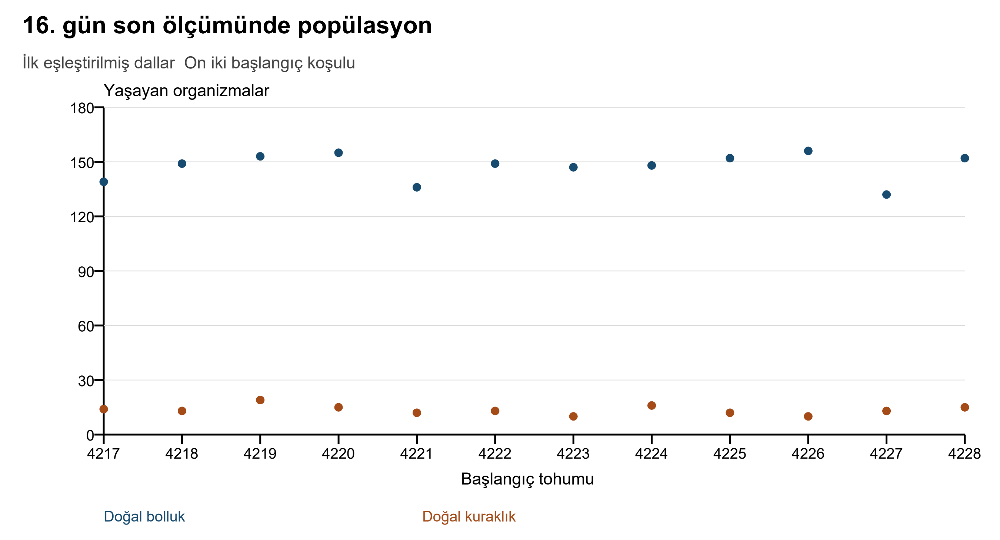
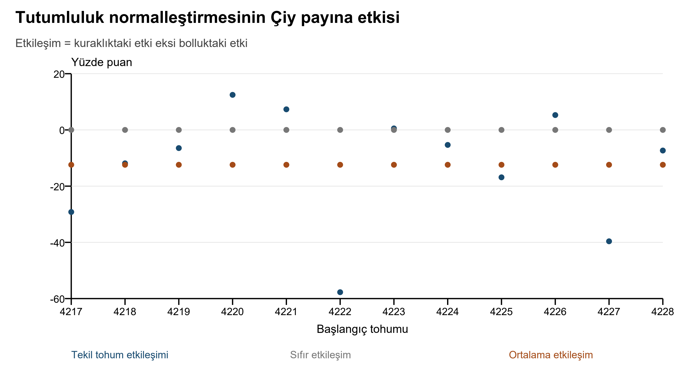
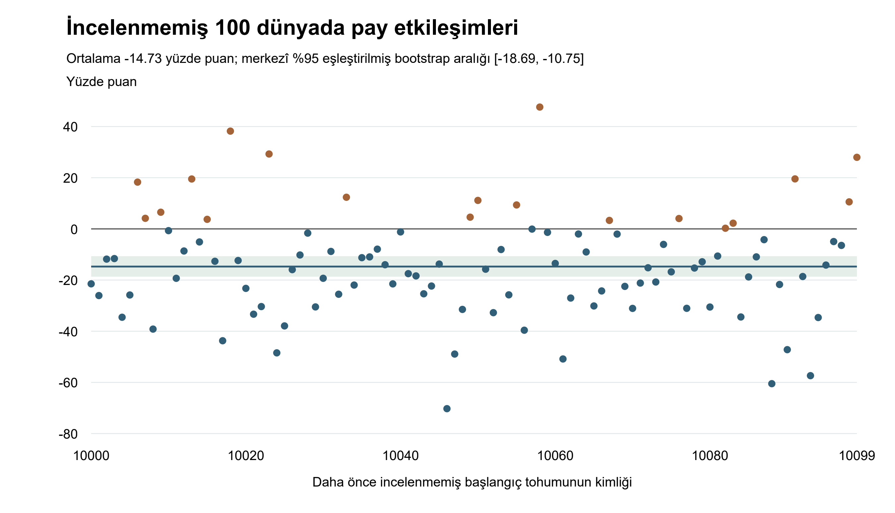

# Morrow’da kaynak kıtlığı ve soyların başarısı

Hedefli bir müdahale ve daha önce incelenmemiş başlangıç tohumlarında yineleme içeren eşleştirilmiş bir yapay yaşam çalışması

Elmar Quliyev için hazırlanmıştır • Güncelleme 14 Ekim 2026 • Sürüm 2

## Özet

**Arka plan.** Bir kaynak rejimindeki sayısal üstünlük, çevresel bir değişiklikten sonra sürmek zorunda değildir. Küçük bir yapay yaşam modeli, kuralları, karşılaştırma birimleri ve sınırları açıkça belirtildiğinde bu soruyu deneysel olarak incelenebilir hâle getirebilir. Morrow; organizmaların besin aradığı, enerji harcadığı, sınırlandırılmış özellik mutasyonlarıyla ürediği ve öldüğü deterministik, mekânsal ve birey tabanlı bir deney ortamıdır. Ampirik biyolojik kalibrasyonu olmayan, keşif amaçlı bir hesaplamalı sistemdir.

**Yöntemler.** İlk çalışmada 4217–4228 arasındaki on iki başlangıç tohumu kullanıldı. 8. günün eksiksiz kontrol noktaları bolluk ve kuraklık dallarına kopyalandı ve 16. güne kadar izlendi. Sonuçlar görüldükten sonra yapılan sayı/pay analizi, yenilenme rejimi ile yaşayan Çiy bireylerinin tutumluluğunun bir defalığına 1.00 değerine ayarlanmasını çaprazlayan dört kollu bir müdahaleye gerekçe oluşturdu. Ardından ayrı bir commit ile kaydedilen yineleme protokolü, aynı motor, müdahale ve zaman ufkuyla daha önce incelenmemiş 100 başlangıç tohumunu, 10000–10099 aralığını sabitledi. Birincil sonuç, kuraklıktaki normalleştirme etkisinden bolluktaki etkinin çıkarılmasıyla tanımlanan ortalama pay etkileşimiydi; sayı ikincil sonuçtu. İleriye dönük yineleme ölçütü, 100 pay etkileşiminin de tanımlı olmasını, ortalamanın negatif olmasını ve eşleştirilmiş tohumlar üzerinden yüzdelik bootstrap yöntemiyle hesaplanan merkezî %95 aralığın bütünüyle sıfırın altında kalmasını gerektiriyordu. Yirmi bin yeniden örnekleme önceden sabitlendi. Ardışık tohum aralığı, olası bütün dünyaların olasılıklı bir örneklemi değildir.

**Bulgular.** İlk on iki dünyada liderlik, bolluk dallarının 9/12’sinde ve kuraklık dallarının 5/12’sinde sürdü. Çiy’in ortalama payı %17.91’den %33.42’ye yükselirken sayısı 26.67’den 4.67’ye düştü. İlk çalışmanın ortalama pay ve sayı etkileşimleri −12.40 yüzde puan ve +6.50 organizmaydı. Yeni 100 eşleştirilmiş dünyada pay etkileşiminin ortalaması −14.73 puan, bootstrap aralığı [−18.69, −10.75], medyanı −14.67 ve gözlenen aralığı [−70.27, +47.61] oldu. Etkileşim 81 tohumda negatif, 19 tohumda pozitifti; 100’ünün tamamı tanımlıydı. Önceden belirlenen ölçüt karşılandı. Sayı etkileşiminin ortalaması +4.78 organizma, aralığı [+3.01, +6.56] oldu. Doğal bolluk/kuraklık koşullarında Çiy sayılarının ortalamaları 28.28/6.34, paylarının ortalamaları %19.25/%42.25’ti. Normalleştirilmiş kuraklık dallarının onunda Çiy yok oldu; hiçbir dünyada bütün organizmalar yok olmadı.

**Sonuçlar.** Öngörülen ortalama göreli pay örüntüsü, model değiştirilmeden, daha önce incelenmemiş başlangıç koşullarında yeniden görüldü. Bu, ilk on iki dünyaya bağımlılığı azaltır; ancak evrensel bir etkiyi ortaya koymaz veya enerji tasarrufunu diğer mekanizmalardan ayırmaz. Ters yöndeki on dokuz etkileşim, sabit ardışık tohum aralığı, birbirine bağlı tutumluluk mekanizmaları ve tek bir son ölçüm noktası yorumu sınırlar. Bootstrap aralıkları bu dünya topluluğunun yeniden örneklenmesini betimler; daha geniş bir örnekleme için kapsama özelliği ortaya konmuş değildir. İlk ve yeni kanıtlar ayrı tutulur; eksiksiz kontrol noktaları, bütün tohumların son ölçümleri, kaynak dosyalarının özet değerleri ve çalıştırılabilir yeniden yürütme araçlarıyla herkes tarafından denetlenebilir.

**Anahtar kelimeler:** yapay yaşam; birey tabanlı simülasyon; kaynak kıtlığı; eşleştirilmiş deney; soy bileşimi; yeniden üretilebilirlik; gen müdahalesi; daha önce incelenmemiş başlangıç tohumlarında yineleme

## 1 Giriş

### 1.1 Göletin ardındaki soru

Morrow, insan bir proje sahibi ile bir yapay zekâ kodlama asistanının paylaştığı pratik bir soruyla başladı: küçük bir yerel dünya, araştırmaya değer bir gözlem üretebilir miydi? Ortaya çıkan gölet, bilinçli olarak sınırlandırılmış bir sistemdir. Organizmaların konumları, enerjileri ve üç sayısal özellikleri vardır. Ortak bir besin kaynağı üzerinden dolaylı olarak rekabet ederler. Yavruları, değişime uğramış özellikleri kalıtır; hiçbir organizma çevre hakkında akıl yürütmeden de soylarının yaygınlığı artabilir veya azalabilir.

İlk soru, bir bolluk döneminden sonra en fazla yaşayan toruna sahip soyun, besin yenilenmesi azaltıldıktan sonra da lider kalıp kalmayacağıydı. Bu, belirli bir son ölçüm noktasındaki sayısal sıralamanın değişmesiyle ilgili bir sorudur. Hangi soyun evrensel olarak en yüksek uyum başarısına sahip olduğunu, organizmaların zekice uyum sağlayıp sağlamadığını veya modelin gerçek bir ekosistemi yeniden üretip üretmediğini sormaktan daha dardır. Soruyu dar biçimde tanımlamak, kaydedilen dünyalardan eksiksiz bir yanıt elde etmeyi sağlar.

Bu yanıt için kontrol dalı zorunludur. Bir soy; rekabet, kalıtsal çeşitlilik, hareket ve model içindeki rastlantı nedeniyle, bolluğun sürdüğü sekiz günlük ek sürede de liderliğini kaybedebilir. Tek başına bir kuraklık son ölçümü, kıtlıkla ilişkili bir değişimi, yenilenme sürseydi de gerçekleşecek bir değişimden ayıramaz. Aynı kontrol noktasını klonlamak, dünya içinde doğrudan bir karşılaştırma sağlar.

### 1.2 Sıralamadan bileşime ve müdahaleye

İlk liderlik sonuçları iki ek soruya yol açtı. Birincisi, bolluk ve kuraklık; toplam popülasyon, soy sayıları ve soy payları bakımından nasıl farklılaşıyordu? Bu soru, yeni kaydedilmiş denemeler eklenmeden, saklanan iki kollu kayıtların yeniden analiz edilmesiyle yanıtlandı. İkincisi, Çiy’in başlangıç profiliyle ilişkili sayısal bir özellik, kuraklık altındaki göreli temsilini açıklamaya yardımcı olabilir miydi? Bu soru, hedefli dört kollu müdahaleye yol açtı.

Sayı ile pay arasındaki ayrım temel önemdedir. Bir soy, çok sayıda organizmadan birkaçına düşerken hayatta kalanlar içinde daha büyük bir kesim hâline gelebilir. Tersine, bir müdahale büyük bir popülasyonda daha fazla organizma kaybına, küçük bir popülasyonda ise daha fazla yüzde puan kaybına yol açabilir. Her iki betimleme de doğru olabilir. Bu nedenle makale iki ölçeği ayrı ayrı raporlar ve her karşıtlığı yorumlamadan önce tanımlar.

### 1.3 Raporlama yaklaşımı ve katkı

Makale, genel metin düzenini ICMJE rehberinden [1] alarak Giriş, Yöntemler, Bulgular ve Tartışma yapısını kullanır. Model açıklaması, ODD raporlama protokolünün [2] amaç, durum, işlem sırası ve alt model mantığını izler. Açık amaçların, üretim kurallarının ve hedeflenen büyüklüklerin tanımlanmasında simülasyon çalışmaları rehberinden [3] de yararlanılmıştır; ancak Morrow, istatistiksel tahmin edicilerin karşılaştırılması değil, basitleştirilmiş bir model içinde yapılan bir müdahale çalışmasıdır. Bunlar raporlamayı destekleyen araçlardır; klinik önem veya modelin dış geçerliliğinin doğrulandığı iddiaları değildir.

Katkı, bütünüyle izlenebilir küçük bir hesaplamalı vaka çalışmasıdır. Keşif amaçlı bir gözlemi, ileriye dönük olarak sabitlenmiş bir takip çalışmasına bağlar, tohum düzeyindeki karşıt sonuçları korur ve sonuç ölçeğinin neden önemli olduğunu gösterir. Ayrıca, hareketli bir göletin görsel izlenimine dayanmak yerine uygulamayı incelemek için yeterli ayrıntıyı sağlar. Daha geniş yapay yaşam literatürüne göre kuramsal yenilik iddiası yoktur; atıf yapılan literatür, alanın sistematik bir taraması olarak değil, raporlama ve yeniden üretilebilirlik amacıyla seçilmiştir.

## 2 Gereç ve yöntemler

### 2.1 Çalışma aşamaları ve deney birimleri

Çalışmanın dört aşaması vardır. İlk deney, on iki eşleştirilmiş bolluk–kuraklık sonucu üretti. İkinci aşamada aynı kayıtlar analiz edildi. Üçüncü aşamada doğal koşullar yeniden yürütüldü ve ilk tohumlara tutumluluk müdahalesi eklendi. Dördüncü aşamada önceden belirlenmiş birincil karşıtlık, daha önce incelenmemiş 100 tohum üzerinde sınandı. İlk ve yeni dünya toplulukları ayrı raporlanır; yeni başlangıç koşulları, bağımsız araştırmacılar veya farklı bir model anlamına gelmez.

**Tablo 1 Çalışma kronolojisi ve kanıt durumu**

| Aşama | Soru ve eylem | Kanıt durumu |
| --- | --- | --- |
| İlk eşleştirilmiş deney | Bolluk karşılaştırmasıyla, 8. gün liderliği kuraklıkta 16. güne kadar sürüyor mu | On iki eşleştirilmiş dünya; ilk liderlik sorusu |
| Eşleştirilmiş son ölçüm analizi | Liderlik geçişlerini, toplam popülasyonu, bütün soyların sayılarını ve paylarını karşılaştır | Aynı saklanan kayıtların sonuç sonrası analizi; yeni kaydedilmiş deneme yok |
| Dört kollu tutumluluk deneyi | Yaşayan Çiy tutumluluğunu bir kez normalleştir ve bu düzenlemeyi yenilenme rejimiyle çaprazla | Takip protokolü bu grup incelenmeden önce commit edildi; hipotez ve tohumlar önceki sonuçlardan geldi |
| Daha önce incelenmemiş tohumlarda yineleme | Değişmeyen dört kollu tasarımı 10000–10099 tohumlarında yinele | Protokol ve uygulama yeni sonuçlardan önce commit edildi; 100 yeni eşleştirilmiş birim ve 400 dal |

Eşleştirilmiş birim, bir tohumla başlatılan tek bir dünya ve onun 8. gün kontrol noktasıdır. Tek kontrol noktasından çıkan dört dal, o birimin birbiriyle ilişkili sonuçlarıdır. Takip çalışması 48 dal yürütmesi içerir: 24 doğal kolun yeniden yürütülmesi ve 24 müdahale uygulanmış dal. Bu, 48 bağımsız yineleme sağlamaz. Önceki deney ile sonraki yeniden yürütmeyi birleştirmek, ek bağımsız başlangıç koşulları oluşturmaz. On iki tohum, küçük ve yeniden üretilebilir bir grup olarak seçilmiş ardışık tamsayılardı; ekosistemlerin olasılıklı bir örneklemi veya daha önce kullanılmamış bir doğrulama kümesi değillerdi.

### 2.2 Modelin amacı ve kapsamı

Morrow sürüm 0.1, gözlem ve kontrollü değişiklik için tasarlanmış birey tabanlı mekânsal bir modeldir. Hedeflenen yeterliliği işlevseldir: yeniden üretilebilir dünyalar, açık enerji ve üreme kuralları, özdeş bir kontrol noktasından dallanma ve sonuçların şeffaf biçimde hesaplanması. Kalibrasyon hedefi, veriye uydurulmuş biyolojik parametresi, ölçülmüş türü, fiziksel enerji birimi veya ampirik çevresel zaman serisi yoktur. Parametreler dış verilerden tahmin edilmemiş; geliştirici tarafından gözlemlenebilir bir deney ortamı oluşturmak için seçilmiştir.

Tarayıcı uygulaması ve vaka sayfası varsayılan olarak İngilizcedir ve Türkçeye geçiş sunar. Uygulama bağımlılıkları, hesaplar, API anahtarları, analitik veya dış yazı tipleri olmadan çalışırlar. Bir Node.js sunucusu yerel döngü adresinde önizleme sağlar; GitHub Pages ise herkese açık statik sürümü barındırır. Dil değişiklikleri, simülasyon durumunu veya ekolojik rastgeleliği değil görünümü etkiler. Ekolojik motor saf JavaScript’tir ve grafik arayüz olmadan da çalışabilir. Organizmalar dil modeli, sinir ağı veya öğrenme algoritması içermez. Yapay zekâ desteği, simüle edilen organizmaların eylemlerine karar vermek için değil, yazılımı oluşturmak ve analiz etmek için kullanılmıştır.

### 2.3 Varlıklar durum değişkenleri ve ölçekler

Uzay, keyfî model birimleriyle 1000 × 650 boyutunda bir dikdörtgendir. Gövde merkezleri duvarlarda yansır ve sınırların içinde tutulur. Sabit bir zaman adımı 0.1 model saniyesi ilerletir. Gösterilen bir gün, 12 model saniyesine veya 120 adıma eşittir. 8. gün kontrol noktası tam olarak 960. adım, 16. gün son ölçümü ise tam olarak 1920. adımdır. Gösterilen bir günün biyolojik bir güne karşılık geldiği öne sürülmez.

Bir organizmanın kalıcı kimliği, ebeveyn kimliği, soy kimliği, nesli, üç geni, konumu, yönelimi, yaşı, enerjisi ve kayıt alanları vardır. Sonuncular; tüketilen besini, yavruları, son beslenme zamanını, bir sonraki gezinme değişimini, gezinme yönünü ve doğum zamanını kaydeder. Yaş ve enerji bireysel durum değişkenleridir. Nesil değeri, soy ağacındaki derinliği tanımlar; bütün popülasyonda eşzamanlı olarak ilerlemez.

Besin parçacıklarının konumu ve kullanılabilirlik işareti vardır. Sabit besin yaması merkezleri, yeni parçacıkların nerelerde yoğunlaşacağını belirler. İsteğe bağlı dairesel kayalar yerel geometriyi değiştirir. Dünya durumu; sözde rastgele sayı üretecinin durumunu, adımı, zamanı, sonraki organizma kimliğini, organizma ve besin dizilerini, engelleri, çevresel seçenekleri, üretim kredisini, birikimli doğumları ve ölümleri, yama konumlarını, geçmişi ve son olayları içerir. Dizi sırası deterministik işlem sırasına katıldığı için korunur.

Soy, kalıcı bir köken etiketidir. Mutasyon bütün özellik değerlerini önemli ölçüde değiştirse bile yavru, ebeveyninin etiketini korur. Dolayısıyla etiketler tür, davranış sınıfı veya güncel genlerden yeniden hesaplanan kümeler değildir. Soylar arası bileşim ile soy içindeki özellik evrimi, bu modelde farklı süreçlerdir.

### 2.4 Başlatma ve kurucu özellikleri

Her dünya, altı soyun her birinde beş organizmayla, toplam 30 bireyle başlar. Tablo 2, her kurucu özellik dağılımının merkezini verir. Her kurucu genine −0.06 ile +0.06 arasında bağımsız, tekdüze dağılımdan çekilen bir değişim eklenir; ardından değer [0.45, 1.75] aralığında sınırlandırılır. Dolayısıyla tablo, bir soyun bütün üyelerinin paylaştığı özdeş genleri değil, başlatma merkezlerini verir.

**Tablo 2 Kurucu özellik merkezleri**

| Soy | Hız s | Algılama q | Tutumluluk h | Başlangıç bireyleri |
| --- | --- | --- | --- | --- |
| Akım | 1.42 | 0.86 | 0.78 | 5 |
| Çiy | 0.78 | 1.12 | 1.35 | 5 |
| Köz | 1.12 | 1.25 | 0.92 | 5 |
| Sis | 0.90 | 1.45 | 1.08 | 5 |
| Yankı | 1.24 | 0.70 | 1.15 | 5 |
| Filiz | 0.95 | 0.92 | 1.20 | 5 |

Kurucular, içeri alınmış bir dikdörtgen içinde tekdüze dağılımla yerleştirilir: x = 50 + 900U ve y = 50 + 550U; burada her U, [0, 1) aralığından bir çekiliştir. Başlangıç yönelimleri tam bir çember üzerinde tekdüzedir. Başlangıç enerjisi 58 + 28U, yaş ise sıfırdır. İlk gezinme güncellemesi, iki model saniyesinden küçük bir zaman farkıyla planlanır. Başlatma daha sonra 210 besin parçacığı üretir. Kurucular ve besin sabit döngü sırasıyla oluşturulur; bu sırayı değiştirmek, hangi rastgele çekilişlerin hangi varlıklara atandığını değiştirir.

### 2.5 Rastgelelik ve deterministik devam

Modeldeki bütün rastgelelik, işaretsiz 32 bit duruma sahip bir Mulberry32 sözde rastgele sayı üretecinden sağlanır. Girilen tohumlar bu aralığa dönüştürülür; sıfır da geçerli bir tohumdur. Kurucu çeşitliliği, konumlar, besin yerleşimi, gezinme ve yavru mutasyonları aynı üreteci tüketir. Görselleştirici bu üreteçten hiçbir çekiliş kullanmaz ve motor `Math.random` çağırmaz.

Bir tohum, ancak model sürümü, seçenekler ve müdahale sırası da sabit olduğunda yeterlidir. Etkileşimli besin ekleme, rastgele çekilişler tüketir ve sonraki sonuçları değiştirir. Eksiksiz bir kontrol noktası, önceki bütün eylemlerden sonra ulaşılan kesin durumu koruduğu için tek başına bir tohumdan daha güçlüdür. Bir kontrol noktasını geri yüklemek, ortak organizma veya besin dizileri bırakmadan, serileştirilmiş her alanın derin kopyasını oluşturur.

Klonlanan dallar özdeş üreteç durumlarıyla başlar. Ayrışmadan sonra olay bazında ortak rastgele sayıları korumazlar. Örneğin, farklı sayıda doğum veya gezinme olayı tüketilen çekiliş sayısını değiştirir; bunun ardından sonraki besin yerleşimi de farklılaşabilir. Kaydedilen karşıtlık, ortak rastgele sayı akışı kullanan bu uygulamada müdahalenin bütün sonuçlarını içerir. Ayrı olarak sabitlenmiş gelecekteki bir besin olayları dizisi altında yalnızca enerjiye ait bir etki değildir.

### 2.6 Besin yenilenmesi ve mekânsal arz

Mevsimler kapalıyken, denenen yenilenme hızı model saniyesi başına 15R parçacıktır; R kaynak çarpanıdır. Bollukta R = 1.00 kullanılır ve saniyede 15 deneme yapılır; kuraklıkta R = 0.15 kullanılır ve bu değer 2.25’tir. Kesirli üretim kredisi biriktiricisine her adımda hız × 0.1 eklenir. Kredi en az bir olduğu sürece bir deneme yapılır ve bir kredi harcanır. Böylece kesirli bir hızın her adımda ayrı ayrı yuvarlanması önlenir.

Her üretim denemesinde beş yamadan biri eşit olasılıkla seçilir. Yama merkezleri (170, 170), (740, 145), (460, 355), (210, 535) ve (810, 490)’dır. x yönündeki sapma 215(U₁ + U₂ − 1), y yönündeki sapma ise 180(U₃ + U₄ − 1)’dir. Bu üçgensel sapmalar, koordinatlar dünya sınırından en az 12 birim uzakta tutulmadan önce besini bir yama merkezine doğru yoğunlaştırır. Sınırlandırma, kenarlara yakın dağılımı değiştirir; uygulanan arz kuralının bir parçasıdır.

En fazla 420 besin parçacığı bulunabilir. Üst sınırdayken yapılan bir deneme yeni parçacık üretmez. Bir kayanın dışlama bölgesinin içine düşen deneme noktası yeniden denenmeden reddedilir ve kredisi yine de harcanır. Dolayısıyla ayarlanan hız, gerçekleşen eklemelerin garantisi değil, denenen arz hızıdır. Kaydedilen deneylerde kaya yoktu. Besinin son kullanma süresi yoktur; yalnızca tüketimle veya elle kaya yerleştirilmesiyle kaldırılır. Kontrol noktasında mevcut olan besin bütün deney dallarında kalır: kuraklık, depolanmış kaynakları anında kaldırmak yerine yenilenmeyi azaltır.

### 2.7 Algılama hareket ve sıralı rekabet

Her adımda hayatta kalan organizmalar, uzaklığı kesin olarak 70q yarıçapından küçük olan en yakın kullanılabilir besini arar. 100 birimlik hücrelerden oluşan mekânsal bir ızgara, arama maliyetini sınırlar. Aramada organizmanın hareket öncesi konumu kullanılır. Bir aday, mevcut en yakın parçacığın yerini yalnızca uzaklığının karesi kesin olarak daha küçükse aldığından, eşit uzaklıklarda sabit yineleme sırası belirleyicidir.

Organizma, çevrimsel açı farkını kullanarak her adımda hedefe doğru en fazla 0.42 radyan döner. Hedef yoksa ve gezinme güncellemesinin zamanı gelmişse, mevcut yönelimine (U − 0.5) × 2.6 radyan ekleyerek bir gezinme yönü seçer ve sonraki değişimi 0.8 + 1.8U model saniyesi sonrasına planlar. Aynı adımda hareketten sonra hedef yeniden hesaplanmaz.

Hareket hızı, hız ve tutumluluk özellikleri tarafından birlikte belirlenir:

```equation
v(s,h) = 24s / (0.75 + 0.25h)
```

Adım başına yer değiştirme, yeni yönde v × 0.1’dir. Duvar çarpışması ilgili yön bileşenini yansıtır ve gezinme yönünü sıfırlar; ardından merkez dünya sınırları içinde tutulur. Besin ancak seçilen parçacık hâlâ kullanılabilir olduğunda ve hareket eden organizma ona kesin olarak 12 birimden daha yakınsa tüketilir. Tüketim 25 enerji ekler; üst sınır 150’dir. Organizma, bir adımda en fazla seçilmiş olan parçacığı yer.

Ajanlar sırayla işlenir. Öncelik, adım sayısının eski popülasyon büyüklüğüne göre moduyla belirlenen indeksten başlar ve eski dizinin sonundan başına dönerek ilerler. Önce işlenen bir organizmanın tükettiği besin, sonraki organizmalar için hemen kullanılamaz hâle gelir. Hayatta kalanlar bu işlenme sırasıyla toplanır ve ardından yeni doğanlar eklenir; böylece dizi sırası değişir. Bu dönen öncelik, ilk ajana kalıcı bir avantaj verilmesini önler; ancak simülasyonu eşzamanlı yapmaz veya işlem sırasının bütün etkilerini ortadan kaldırmaz.

### 2.8 Enerji üreme kalıtım ve ölüm

Bir organizmanın güncellemesinin başında yaşı 0.1 artar ve enerjisi maliyet hızının 0.1 katı kadar azalır:

```equation
C(s,q,h) = (0.55 + 1.2s² + 0.30q²) / h
```

Hız ve algılamanın maliyetleri kareseldir; tutumluluk ise toplam maliyeti böler. Enerjisi pozitif değilse veya yaşı 130 + 30h model saniyesine ulaşırsa organizma hemen ölür. Bu kontroller hareket ve beslenmeden önce gerçekleşir; dolayısıyla enerjisini zaten tüketmiş bir organizma, aynı adımın devamında yakındaki besinle kurtarılamaz.

Hareket ve varsa beslenmeden sonra; yaş kesin olarak beş model saniyesinin üzerindeyse, enerji kesin olarak 92 + 26h değerinin üzerindeyse ve popülasyon üst sınırı kontrolü doğuma izin veriyorsa üreme gerçekleşir. Ebeveyn 48 enerji kaybeder ve yavru 40 enerjiyle başlar; dolayısıyla üreme toplam enerjiden sekiz birim eksiltir. Yavru, ebeveyninden 12 birim uzakta rastgele bir yönde yerleştirilir; ardından sınırlar içinde tutulur ve varsa kayalardan uzaklaştırılır. Sıfır yaşında, ebeveyninden bir yüksek nesil değeriyle ve yeni, benzersiz bir kimlikle başlar. Yeni doğanlar bir sonraki adıma kadar işlenmez.

Her yavru geni, sınırlandırılmış toplamsal bir değişimle bağımsız olarak kalıtılır:

```equation
g_child = clamp(g_parent + ε, 0.45, 1.75)
ε ∼ Uniform(−m, +m)
```

Mutasyon ayarı m = 0.08, mutlak bir genliktir. %8 mutasyon olasılığı, %8 oransal değişim veya biyolojik mutasyon hızı değildir. Her yavru, her gen için bir değişim örnekler. Sınırlarda kırpma yapılması, ortaya çıkan dağılımı bu sınırlara yakın yerlerde değiştirir. Ebeveynler arasında rekombinasyon, çiftleşme veya alışveriş yoktur.

Popülasyon üst sınırı 240’tır. İhtiyatlı kontrol, eski popülasyon uzunluğuna o adımda zaten oluşturulmuş yeni doğanların sayısını ekler. Adımın önceki bölümünde karşılaşılan ölümleri çıkarmaz. Bu nedenle, bir ölüm yer açmış olsa bile bazı doğumlar sonraki adıma kadar bekleyebilir. Tamamlanan her adımda şu hesap özdeşliği geçerlidir: yaşayan popülasyon = 30 + birikimli doğumlar − birikimli ölümler.

Tutumluluğun doğrudan dört sonucu vardır: daha yüksek h enerji harcamasını azaltır, s sabitken hareket hızını düşürür, üreme için gereken enerji eşiğini yükseltir ve yaş sınırını artırır. Dolayısıyla saf bir verimlilik katsayısı değil, ödünleşim parametresidir. “Normalleştirme”, müdahalede h = 1.00 atamasına verilen addır; 1.00’ın biyolojik olarak normal veya istatistiksel olarak standartlaştırılmış olduğu iddiası değildir.

### 2.9 Kesin işlem sırası

Aşağıdaki sıra, model tanımının bir parçasıdır. Beslenme, ölüm veya üremenin sırasını değiştirmek, aynı formüller kullanılsa bile sonuçları değiştirebilir.

1. Adım sayısını artır ve zamanı adım × 0.1 olarak türet.
2. Yenilenme kredisi ekle, besin üretimini dene ve ilgili krediyi harca.
3. Mevcut besin dizisinden besin ızgarasını oluştur.
4. Adım sayısı ve eski popülasyon uzunluğundan dönen işleme başlangıcını seç.
5. Eski organizmaların her biri için bu sırayla yaşı artır ve enerjiyi azalt.
6. Enerji veya yaş testini geçemeyen organizmaları sonraki işlemlerden çıkar.
7. Besin bul, dön veya gezin, hareket et, duvarlarda yansıt ve kayalarla etkileşimi çöz.
8. Kesin uzaklık ve kullanılabilirlik testleri geçilirse seçilen besini tüket.
9. Üreme kuralını uygula ve izin veriliyorsa yeni doğanı topla.
10. Ajan dizisini önce hayatta kalanlar, ardından yeni doğanlar olacak biçimde değiştir; tüketilen besini kaldır.
11. Bir model saniyesine karşılık gelen her on adımda geçmişi kaydet.

Popülasyon geçmişi son 600 örneği tutar. Olay günlüğü on iki iletiyi tutar. Bunlar ekolojik popülasyon sınırları değil, gözlem sınırlarıdır; yaşayanların eksiksiz durumu bir anlık görüntüde erişilebilir kalır. Sınanan 16 günlük zaman ufku, 192 model saniyesidir; dolayısıyla geçmiş saklama sınırına ulaşmaz.

### 2.10 Çalışmaya alınmayan isteğe bağlı etkileşimli mekanizmalar

Uygulama yenilenmeyi 0.65 + 0.35 cos(day × π/4) mevsimsel çarpanıyla çarpabilir. Bunun dönemi gösterilen sekiz gündür; 0. günde 1.00’dan 4. günde 0.30’a iner ve 8. günde yeniden 1.00’a çıkar. Kaydedilen deneylerin tamamında mevsimler kapalıydı. Kaynak kaydırıcıları 0 ile 2 arasındaki çarpanları, mutasyon kaydırıcısı ise 0 ile 0.25 arasındaki genlikleri destekler; deney, gözlem görünümündeki herhangi bir ayarı devralmak yerine bu değerleri sabitler.

Elle besin yerleştirme, tıklanan noktanın yakınında her yönde en fazla 45 birim sapmayla 22 üretim denemesi yapar. Kayaların yarıçapı 28’dir; gövde merkezlerini 35 yarıçapına iter ve 31 yarıçapı içinde besini dışlarlar. Merkezleri sınırın 40 birim içinde tutulur; en fazla on iki kaya yerleştirilebilir ve merkezleri arasında en az 70 birim bulunmalıdır. Kaya eklemek, dışlama bölgesindeki besini kaldırır ve organizmaları yerinden uzaklaştırır. Küresel rota planlaması yoktur; bu nedenle besine yönelen bir organizma bir kayada yerel olarak sıkışabilir. Deney grubunda elle besin, kaya veya dal sürerken ayar değişikliği kullanılmadı.

### 2.11 İlk eşleştirilmiş protokol

Her tohum için yeni bir dünya, R = 1.00, m = 0.08 ve mevsimler kapalıyken 960 adım çalışır. Bu kontrol noktasında anlık görüntünün tamamı klonlanır. Bir dal R = 1.00 ile devam eder; diğeri R = 0.15 kullanır. Her biri tam 960 ek adım çalışır. Böylece dal süreleri eşit, başlangıç besin stoku özdeş ve müdahale öncesi soy geçmişi aynı olur.

Lider kümesi, pozitif yaşayan sayısında en yüksek değeri paylaşan bütün soyları içerir. 8. gün liderlerinden en az biri son ölçümün lider kümesine aitse başlangıç liderliği korunmuş sayılır. Bu bir küme kesişimi kuralıdır; tek başına liderliği veya belirli bir bireyin hayatta kalmasını gerektirmez. Yaşayan organizması olmayan bir dünyanın lideri yoktur ve liderliğin sürmesi sonucu tanımsızdır. Analiz, eşitlikleri alfabetik sıraya veya soy indeksine göre bozmak yerine korur.

### 2.12 Sonuçlar görüldükten sonra tanımlanan eşleştirilmiş hedef büyüklükler

n bir soyun son sayısı, N son toplam popülasyon, i bir tohum, A bolluk ve D kuraklık olsun. Yüzde olarak pay 100n/N’dir. Yaşamın sürdüğü bir dünyada bulunmayan soyun payı sıfırdır. N = 0 olduğunda paylar sıfıra zorlanmaz, tanımsızdır. Bu grupta bütün dünyalarda yaşam sürdüğünden, on iki çiftin tamamı raporlanan her pay karşıtlığına katkı verir.

```equation
p_i = 100n_i / N_i
Δp_i = p_i,D − p_i,A
Δn_i = n_i,D − n_i,A
```

Raporlanan pay ortalamaları, her tohumun payının ortalamasını alır ve her başlangıç koşuluna eşit ağırlık verir. Dünyalar arasındaki organizmalar havuzlanarak hesaplanmazlar. Benzer biçimde, ortalama popülasyon azalması, tohumlar üzerinden 100(1 − N_D/N_A) ortalamasıdır; iki ortalama popülasyon büyüklüğünden hesaplanan azalma yüzdesi değildir. Eşleştirilmiş analiz ayrıca son lider kümelerini özdeş, kısmen örtüşen veya ayrık olarak sınıflandırır ve her iki dalda başlangıç liderliğinin sürmesini çapraz tablolar.

Bu sorular, ilk sonuçlar elde edildikten sonra oluşturuldu. Sonuçları, ileriye dönük olarak doğrulanmış öngörüler değil, betimleyici keşiflerdir. Bu on iki tohumlu vaka çalışmasına p değerleri, güven aralıkları, aile düzeyinde hata düzeltmeleri veya optimize edilmiş anlamlılık eşikleri eklenmedi.

### 2.13 Dört kollu hedefli tutumluluk müdahalesi

Takip protokolü, mevcut dört kollu grubun sonuçları incelenmeden önce `4352cde6c77044e0fc1242ae66757940c1421403` commit’iyle kaydedildi. Çalıştırıcısı, yürütme sürümü `eceb3c6166f798688bde2cef23472f219861de7a` noktasında donduruldu. Ekolojik motor değişmedi. Bu kayıtlar, başlangıçta özel olan ve daha sonra herkese açılan depodaki sıralamayı ortaya koyar; haricî bir kayıt sistemi değildir. Daha sonraki, incelenmemiş tohumlarda yineleme çalışmasının ayrı bir protokolü ve kanıt dosyası vardır.

Çalıştırıcı, her ilk tohum için 8. gün kontrol noktasını yeniden üretir ve dört eksiksiz kopya oluşturur. Normalleştirilmiş iki dalda, kalıcı soyu Çiy olan organizmaların yalnızca `genes.thrift` alanını tam olarak 1.00’a ayarlar. Düzenleme, kontrol noktasında yaşayan kohorta bir kez uygulanır. Kurucuları geriye dönük etkilemez, ölmüş üyeleri diriltmez, başka soyu düzenlemez, enerjiyi sıfırlamaz veya besini silmez. Hiçbir rastgele çekiliş tüketmez. Mutasyon 0.08 olarak kalır; dolayısıyla torunlar, kalıtım sırasında hemen 1.00’dan uzaklaşabilir.

**Tablo 3 Kontrol noktasından sonraki dört dalın koşulları**

| Kol | Kod | Yenilenme çarpanı | 8. gün Çiy tutumluluk düzenlemesi |
| --- | --- | --- | --- |
| Doğal bolluk | A | 1.00 | Yok |
| Doğal kuraklık | D | 0.15 | Yok |
| Normalleştirilmiş bolluk | XA | 1.00 | Yaşayan kohortu bir kez 1.00’a ayarla |
| Normalleştirilmiş kuraklık | XD | 0.15 | Yaşayan kohortu bir kez 1.00’a ayarla |

Bildirilen kaynak ayarı ve gen düzenlemeleri dışında başlangıç klonları; konumları, yönelimleri, enerjiyi, yaşları, diğer bütün genleri, organizma sırasını, kimlikleri, besini, yenilenme kredisini, sayaçları ve üreteç durumunu korur. Düzenlenen kohortun tutumluluk değerlerinin hem ortalaması hem de çeşitliliği değişir. Ham dosya; eksiksiz kontrol noktasını, kimlikleri ve düzenleme öncesi/sonrası gen değerlerini, kontrol noktası ile kol başlangıçlarının özet değerlerini, son ölçümün bütün istatistiklerini ve son durum özet değerlerini kaydeder.

### 2.14 Birincil etkileşim ve ikincil sonuçlar

Birincil takip sonucu, son Çiy payının yüzde puan cinsinden değeridir. Her tohum için normalleştirme etkisi, aynı çevrede normalleştirilmiş değerden doğal değerin çıkarılmasıdır. Etkileşim, kuraklık etkisinden bolluk etkisini çıkarır:

```equation
E_A,i = p_XA,i − p_A,i
E_D,i = p_XD,i − p_D,i
I_i = E_D,i − E_A,i
```

Negatif bir etkileşim, müdahalenin payı kuraklıkta bolluğa göre daha fazla düşürdüğü veya daha az yükselttiği anlamına gelir. Kuraklığın her kolda pay üzerinde negatif etkisi olduğu veya bütün tekil dünyaların aynı mekanizmayı paylaştığı anlamına gelmez. Önceden belirlenen yön öngörüsü, negatif ortalama pay etkileşimiydi.

Aynı karşıtlıklar, mutlak Çiy sayısı için ayrıca hesaplanır. Toplam popülasyon, hedef soyun yok oluşu ve bütün dünyadaki yaşamın yok oluşu ek bağlam sağlar. Ortalamalar, medyanlar, gözlenen aralıklar ve negatif, sıfır ve pozitif karşıtlıkların sayıları raporlanır. Tanımsız paylar, paydalar açıkça belirtilerek dışlanırken sayı sonuçları tanımlı kalacaktı. Burada on iki etkileşimin tamamı tanımlıdır. Gözlenen bir aralık güven aralığı değildir ve işaret sayısı, yineleme olasılığı olarak raporlanmaz.

### 2.15 Yazılım doğrulaması ve kanıtların korunması

Bağımlılıksız uygulama ve bilimsel çalıştırıcılar Node.js 22 veya daha yenisini kullanır. Genişletilmiş test kümesi 41 test içerir; bunlar arasında yeni çalıştırıcının özgün 4217 tohumu kontrol noktasının tamamı ve dört son ölçümün tümüyle karşılaştırılması, deterministik eşleştirilmiş yeniden örnekleme, kesin karar sınırları, tanımsız paylar ve değiştirilmiş kayıtların reddi bulunur. İlk yineleme çalıştırmasından önceki testlerde bilinen eski sonuçlar ve sentetik doğrulama örnekleri kullanıldı; 10000–10099 tohumlarından hiçbiri çalıştırılmadı.

Kaynak kontrolleri JavaScript sözdizimini, her iki sayfanın DOM hedeflerini, herkese açık dosya yollarını ve üretilen raporların güncelliğini doğrular. İlk çalıştırıcı ve yineleme çalıştırıcısı ham dosyanın üzerine yazmayı reddeder. Tam yeniden yürütme; 48 ilk ve 400 yeni dal sonucunu, eksiksiz kontrol noktalarını, düzenlemeleri, başlangıç özet değerlerini ve son durum özet değerlerini yeniden oluşturur. Standart kütüphaneye dayanan ayrı bir Python denetimi; yeni son ölçümleri, etkileşimleri, özetleri ve 20,000 yeniden örneklemeli iki aralığı ekolojik motoru çalıştırmadan yeniden hesaplar. CI, dağıtımdan önce doğrulamayı tekrarlar.

Bu kontroller; ekolojik gerçekçiliği, olası her hatanın yokluğunu veya biyolojik mekanizmayı değil, hesaplamalı tutarlılığı destekler. Platformlar arası CI yeniden yürütmesi, yapılandırıldığı ortamda çalışmayı gösterir; gelecekteki her JavaScript uygulamasında bit düzeyinde taşınabilirliği garanti etmez.

### 2.16 Daha önce incelenmemiş dünyalarda ileriye dönük yineleme

Yineleme protokolü, herhangi bir yeni dünya çalıştırılmadan veya incelenmeden önce `2158e085b706c647829637182d51829231b8ff77` commit’iyle sabitlendi ve uzak depoya gönderildi. Uygulama ve testler, ham grupta yürütme sürümü olarak kaydedilen `274454f164f9ecb8474c25856cee2be4a3adad8f` noktasında commit edildi. 10000’dan 10099’a kadar her iki uç dâhil tam 100 tohum artan sırayla çalıştırıldı. Bu tohumlarda pilot çalışma, değiştirme, isteğe bağlı durdurma, eşik değişikliği veya parametre araması yapılmadı. 100 sayısı, güç veya kesinlik hesabının çıktısı değil, sabit pratik bir tasarım tercihiydi. Birincil tahminde eski dünyalarla havuzlama yapılmadan 100 yeni eşleştirilmiş birim ve 400 dal sağlar.

Motor ve mevcut kontrol noktası/dallandırma işlevleri değişmedi. Her tohum, Tablo 3’teki koşullarla 960 ortak hazırlık adımı ve dal başına 960 adım geçirdi. 100 eksiksiz kontrol noktasının tamamı, düzenlenen kimlikler ve öncesi/sonrası değerler, başlangıç özet değerleri, son ölçümün bütün istatistikleri ve son nokta özet değerleri ayrı olarak kaydedildi. Özet değerleri; protokolü, çalıştırıcıyı, ilk yardımcıyı ve ilk karşıtlık uygulamasını tanımlar. Tohumlar bu protokolden önce kullanılmayarak önceki araştırmadan ayrı tutulmuştur; ardışık bir tamsayı aralığı, bütün uint32 tohumları üzerinden rastgele örnekleme değildir.

Ortalama pay etkileşimi birincil tahmindi. İleriye dönük ölçüt, 100 pay etkileşiminin de tanımlı olmasını, ortalamanın negatif olmasını ve merkezî %95 yüzdelik bootstrap aralığının üst ucunun sıfırın altında kalmasını gerektiriyordu. Sıfırı kesen veya sıfıra değen bir aralık, ölçüt açısından kesin sonuca ulaşılamaması anlamına gelecekti; bütünüyle pozitif bir aralık ise bu kurala göre ters yönü destekleyecekti. Herhangi bir tanımsız pay etkileşimi birincil ölçütü kesin sonuca bağlanamaz hâle getirecek, ancak uygun tahminler ve sayı sonuçları yine raporlanacaktı. Yaşamın sürdüğü bir dünyada Çiy soyunun bulunmaması sıfır pay demektir; dünyadaki yaşamın bütünüyle yok olması ise payı tanımsız kılar. Yaşayan Çiy içermeyen bir kontrol noktası, sıfır düzenlemeyle müdahale niyetine göre analiz edilen birim olarak kalacaktı.

Raporlanan her etkileşim sonucu için, her biri uygun örneklem büyüklüğünde olan 20,000 bootstrap örneklemi, eşleştirilmiş tohum kayıtlarının tamamını yerine koyarak çekti. Organizmalar ve tekil kollar hiçbir zaman ayrı ayrı yeniden örneklenmedi. Ayrı bir Mulberry32 analiz üreteci, her sonuç için 20261014 tohumuna sıfırlandı ve ekolojik rastgele sayı üretecinin durumuna hiç dokunmadı. Sıralanmış bootstrap ortalamaları, tip-7 kantilleri [7] kullanılarak (19999 × 0.025) ve (19999 × 0.975) indekslerinde ara değerleme ile hesaplandı. İkincil sonuçlar için p değerleri, çoklu karşılaştırmalara ilişkin iddialar veya yeni çıkarımsal karar eşikleri getirilmedi.

Aralık, seçilmiş bu topluluktaki yeniden örnekleme değişkenliğini ölçer. Bir popülasyon güven aralığı olarak yorumlanması, temsili ve değiştirilebilir tohum sonuçları gerektirir; sabit ardışık aralık bunu ortaya koymaz. Yüzdelik aralıkların sonlu örneklemde nominal kapsama düzeyine sahip olması da zorunlu değildir [8]. Dolayısıyla bildirilen ölçütün karşılanması, biyolojik bir test veya keyfî başlangıç koşulları için garanti değil, koşullu bir yineleme sonucudur. İlk on iki tohumun sonuçları betimleyici kalır ve bunlara geriye dönük güven aralığı eklenmez.

İkincil özetler; sayı etkilerini, bütün kolların popülasyon/sayı/pay ortalamalarını, işaret sayılarını, gözlenen aralıkları, hedef soyun ve bütün dünyanın yok oluşlarını, doğal kuraklık eksi bolluk karşıtlıklarını ve liderliğin korunmasını içerir. Yeni son ölçümlerin eksiksiz dökümleri Ek D’de yer alır. Uç veya ters yönlü dünyalar yalnızca birincil analizden sonra incelenir ve betimleyici olarak etiketlenir.

## 3 Bulgular

### 3.1 Başlangıç liderliği ve sonraki geçişler

16. günde başlangıç liderliği dokuz bolluk dalında ve beş kuraklık dalında sürdü. Dolayısıyla liderlik üç bolluk dalında ve yedi kuraklık dalında değişti. Bu marjinal değişim sayıları arasındaki fark dörttür; ancak bu, yalnızca kuraklığın sonucu değiştirdiği dünya sayısı değildir. Eşleştirilmiş geçiş tablosu bunun nedenini gösterir.

**Tablo 4 Eşleştirilmiş dallarda başlangıç liderliğinin sürmesi**

| Bolluk sonucu | Kuraklıkta korundu | Kuraklıkta değişti | Satır toplamı |
| --- | --- | --- | --- |
| Korundu | 2 | 7 | 9 |
| Değişti | 3 | 0 | 3 |
| Sütun toplamı | 5 | 7 | 12 |

Yedi tohumda başlangıç liderliği yalnızca bollukta, üç tohumda ise yalnızca kuraklıkta korundu. İkisinde her iki dalda da korundu ve hiçbirinde iki dalda birden kaybedilmedi. Dolayısıyla bir karşılaştırmanın yönü yalnızca toplamları çıkarmaya değil, eşleştirilmiş tanımına bağlıdır. Örneğin 4217 tohumu Filiz liderliğinde başladı, bollukta Yankı liderliğiyle sona erdi ve kuraklıkta Filiz liderliğini korudu.

Son bolluk ve kuraklık lider kümeleri dokuz çiftte ayrık, ikisinde özdeş ve birinde kısmen örtüşüyordu. 4228 tohumunda bollukta Yankı ile Filiz berabereydi ve kuraklıkta Filiz öndeydi; bu, kısmi örtüşme oluşturdu. 4221 tohumu Köz ile Filiz beraberliğiyle başladı; kuraklıkta Köz’ün liderliği belirtilen korunma kuralını karşılar. Ek A, eksiksiz lider dökümünü korur.

### 3.2 Popülasyon azalması ve soy bileşimi

Ortalama toplam popülasyon bollukta 147.33, kuraklıkta 13.50 idi; ortalama eşleştirilmiş fark −133.83 organizmaydı. On iki tohumun tamamında kuraklık popülasyonu daha düşüktü. Çift içindeki ortalama azalma yüzdesi %90.83’tü. Bu, tahmin edilmiş bir taşıma kapasitesi veya uzun dönemli yok oluş oranı değil, kaydedilen on iki son ölçümün karşılaştırmasıdır.



Şekil 1. Her nokta, ilk dallardan birinin 16. gün popülasyonudur. Mavi bolluğu, kahverengi kuraklığı gösterir. Yatay eksen zamanı değil başlangıç koşullarını tanımlar; noktalar bilinçli olarak birbirine bağlanmamıştır. On iki kuraklık popülasyonunun tamamı, eşleştirilmiş bolluk değerlerinin altındadır. Aynı doğal son ölçümler dört kollu yeniden yürütmede tekrar yer alır ve ek yinelemeler değildir.

**Tablo 5 Ortalama soy sayıları ve tohumlara eşit ağırlık veren ortalama paylar**

| Soy | A sayısı | D sayısı | A payı % | D payı % | D eksi A yüzde puan |
| --- | --- | --- | --- | --- | --- |
| Akım | 3.50 | 0.00 | 2.41 | 0.00 | −2.41 |
| Çiy | 26.67 | 4.67 | 17.91 | 33.42 | +15.51 |
| Köz | 17.50 | 0.92 | 12.12 | 7.86 | −4.27 |
| Sis | 11.42 | 1.00 | 7.75 | 7.23 | −0.51 |
| Yankı | 41.58 | 1.42 | 28.32 | 11.12 | −17.21 |
| Filiz | 46.67 | 5.50 | 31.49 | 40.37 | +8.89 |

Altı soyun tamamının ortalama mutlak sayısı kuraklıkta daha düşüktü. Buna rağmen Çiy ve Filiz’in ortalama payları sırasıyla 15.51 ve 8.89 yüzde puan arttı. Çiy’in kuraklık payı on tohumda daha yüksek, ikisinde daha düşüktü. Filiz’in payı sekiz tohumda daha yüksekti. Akım hiçbir kuraklık son ölçümünde yaşayan üyeye sahip değildi; iki bolluk son ölçümünde ise zaten yoktu. Bunlar yaşamın sürdüğü dünyalarda soy yok oluşlarıdır; bütün dünyadaki yaşamın yok oluşu değildir.

Çiy açısından temel gözlem, mutlak kayıp ile göreli kazancın eşzamanlı olmasıdır: ortalama sayı 26.67’den 4.67’ye, ortalama pay %17.91’den %33.42’ye geçti. Dolayısıyla “Çiy kuraklık altında büyüdü” gibi bir betimleme yanlış olurdu. Popülasyonun tamamı keskin biçimde küçülürken, hayatta kalanlar içindeki temsili ortalama olarak arttı.

### 3.3 Dört kollu son ölçümler

Takip çalışmasındaki her doğal son ölçüm, ilk kaydın bütün istatistikleriyle eşleşti. Bu eşitlik bir yeniden yürütme kontrolüdür; aynı zamanda doğal son ölçümlerin yeniden yeni kanıt olarak sayılamayacağı anlamına gelir. Normalleştirilmiş kollar, Tablo 6’da özetlenen son ölçümleri üretti.

**Tablo 6 Tohumlara eşit ağırlık verilen dört kollu Çiy son ölçümleri**

| Kol | Ortalama toplam N | Ortalama Çiy n | Ortalama Çiy payı % | Çiy yok oluşları |
| --- | --- | --- | --- | --- |
| A | 147.33 | 26.67 | 17.91 | 12 içinde 0 |
| D | 13.50 | 4.67 | 33.42 | 12 içinde 0 |
| XA | 141.83 | 17.75 | 12.46 | 12 içinde 0 |
| XD | 13.00 | 2.25 | 15.56 | 12 içinde 4 |

Normalleştirilmiş bollukta ortalama toplam popülasyon 5.50 organizma, normalleştirilmiş kuraklıkta ise 0.50 organizma azaldı. Normalleştirilmiş kuraklığın 13.00 olan toplamı, hedef soyda önemli bir değişimin bütün dünya popülasyonundaki çok daha küçük bir değişimle gerçekleşebileceğini gösterir. Diğer soylar, kalan bu popülasyonun daha büyük bir bölümünü oluşturabilir. 48 dalın hiçbirinde bütün dünyadaki yaşam yok olmadı.

### 3.4 Birincil pay karşıtlıkları

Normalleştirme, ortalama Çiy payını bollukta 5.46 puan, kuraklıkta 17.86 puan düşürdü. Bu etkilerin farkı −12.40 puandı. Buna karşılık gelen medyan etkileşim −6.90 puandı; tekil etkileşimler −57.73 ile +12.47 arasında uzanıyordu. Sekiz tohumun etkileşimi negatif, dördününki pozitifti; hiçbiri tam sıfır değildi.

**Tablo 7 Normalleştirmenin Çiy payı üzerindeki yüzde puan cinsinden etkileri**

| Karşıtlık | Ortalama | Medyan | En küçük | En büyük | Negatif | Sıfır | Pozitif |
| --- | --- | --- | --- | --- | --- | --- | --- |
| XA eksi A | −5.46 | −5.50 | −13.86 | +1.16 | 10 | 0 | 2 |
| XD eksi D | −17.86 | −13.00 | −61.54 | +6.67 | 11 | 0 | 1 |
| Etkileşim | −12.40 | −6.90 | −57.73 | +12.47 | 8 | 0 | 4 |



Şekil 2. Mavi noktalar her tohumun birincil etkileşimini gösterir. Gri noktalar sıfırı, kahverengi noktalar −12.40 yüzde puanlık ortalama etkileşimi işaretler. Öngörülen yön sıfırın altıdır. Referanslar belirsizlik sınırları değil, düzeylerdir; güven aralığı gösterilmemiştir. Tohumlar, tamsayı kimlikleriyle gösterilen kategorik başlangıç koşullarıdır. Dağılım genişliği ve dört pozitif etkileşim, negatif ortalamanın yorumunu sınırlar.

Doğal kuraklık–bolluk pay farkı +15.51 puan, normalleştirilmiş fark +3.10 puandı. Bunların farkı aynı −12.40 puanlık etkileşimdir. Bu değerleri bölüp kuraklık avantajının tutumluluk tarafından “açıklanan” bir bölümünü raporlamak uygun olmazdı: müdahale birden fazla mekanizmayı ve varyansı değiştirir, ekosistemle etkileşir ve bileşimsel bir sonuç üzerinde işler. Herhangi bir aracılık hedef büyüklüğü belirtilmedi veya tanımlanabilir hâle getirilmedi.

### 3.5 İkincil sayılar ve payda etkisi

Sayı sonuçları pay sonuçlarından farklıdır. Normalleştirme, ortalama Çiy sayısını bollukta 8.92 organizma, kuraklıkta 2.42 organizma düşürdü. Bu nedenle sayı etkileşimi +6.50 organizma, medyanı +8.00 ve gözlenen aralığı −7.00 ile +23.00 oldu. Dokuz sayı etkileşimi pozitif, üçü negatifti.

**Tablo 8 Normalleştirmenin Çiy sayısı üzerindeki organizma cinsinden etkileri**

| Karşıtlık | Ortalama | Medyan | En küçük | En büyük | Negatif | Sıfır | Pozitif |
| --- | --- | --- | --- | --- | --- | --- | --- |
| XA eksi A | −8.92 | −10.00 | −23.00 | +2.00 | 10 | 0 | 2 |
| XD eksi D | −2.42 | −2.50 | −8.00 | 0.00 | 7 | 5 | 0 |
| Etkileşim | +6.50 | +8.00 | −7.00 | +23.00 | 3 | 0 | 9 |

4220 tohumu, payda için somut bir örnek verir. Doğal kuraklık on beş organizma içinde dört Çiy ile, yani %26.67 ile sona erdi. Normalleştirilmiş kuraklık da dört Çiy ile sona erdi; ancak toplam on iki organizma içindeydi, yani %33.33’tü. Sayı etkisi sıfırken pay etkisi +6.67 puandır. Aynı tohumda tam pay etkileşimi, birincil öngörünün tersine, +12.47 puandır. Bu dünyayı raporda korumak, ortalama negatif etkinin değişmez bir tepkiyle karıştırılmasını önler.

### 3.6 Hedef soyun yok oluşu ve heterojenlik

Çiy, 4217, 4222, 4225 ve 4227 tohumlarında normalleştirilmiş kuraklıkta kayboldu. Doğal kuraklık on iki tohumun tamamında Çiy’i korudu; bolluk kollarının hiçbirinde hedef soy kaybedilmedi. Başka bir soy yaşamayı sürdürdüğü için hedef sayısının sıfır olması sıfır pay olarak katkı verir; bu dört sonuç eksik veri değildir.

En negatif pay etkileşimi 4222 tohumunda −57.73 puanla görüldü. Doğal kuraklık son ölçümü on üç organizma içinde sekiz Çiy içerirken normalleştirilmiş kuraklık hiç Çiy içermiyordu. Dolayısıyla ortalama etkileşime, belirgin biçimde daha az negatif bir medyan eşlik eder. Her iki ölçü de uç dünyalar kırpılmadan veya çıkarılmadan raporlanır. 4220, 4221, 4223 ve 4226 tohumlarındaki dört ters işaretli etkileşim de her özette kalır. Ek B, düzenlenen kohort büyüklükleri ve son ölçümdeki tutumluluk ortalamaları dâhil her kolu ve karşıtlığı verir.

### 3.7 Daha önce incelenmemiş 100 tohumda yineleme

İleriye dönük ölçüt karşılandı: 100 pay etkileşiminin tamamı tanımlıydı, ortalamaları −14.73 yüzde puandı ve [−18.69, −10.75] bootstrap aralığı sıfırın altındaydı. Medyan −14.67, gözlenen aralık −70.27 ile +47.61 idi. Seksen bir etkileşim negatif, hiçbiri sıfır ve on dokuzu pozitifti. Bu, önemli heterojenliği korurken ayrık bir başlangıç koşulları kümesinde ortalama yönü yeniden üretir.

**Tablo 9 Yinelemede 16. gün kol ortalamaları**

| Kol | Ortalama toplam N | Ortalama Çiy n | Ortalama pay yüzdesi | Çiy yok oluşları |
| --- | --- | --- | --- | --- |
| A | 146.01 | 28.28 | 19.25 | 100 içinde 0 |
| D | 14.73 | 6.34 | 42.25 | 100 içinde 0 |
| XA | 140.96 | 20.29 | 14.35 | 100 içinde 0 |
| XD | 13.90 | 3.13 | 22.63 | 100 içinde 10 |

Doğal kuraklık, ortalama Çiy sayısını 28.28’den 6.34’e düşürürken ortalama payı %19.25’ten %42.25’e yükseltti. Eşit ağırlıklı ortalama pay farkı +23.00 puandı; 97 dünyada pay artışı, üçünde kayıp vardı. Doğal koşullardaki sayı 99 dünyada düştü, birinde arttı. Böylece ilk ortalama sayı/pay örüntüsü yeniden görüldü; ancak yeni kümede daha düşük sayı evrensel değildi. Ortalama toplam popülasyon doğal bollukta 146.01, doğal kuraklıkta 14.73’tü.

**Tablo 10 Yineleme etkileşimleri ve eşleştirilmiş bootstrap aralıkları**

| Sonuç | Ortalama | Medyan | En küçük | En büyük | %95 alt | %95 üst |
| --- | --- | --- | --- | --- | --- | --- |
| Pay yüzde puan | -14.73 | -14.67 | -70.27 | 47.61 | -18.69 | -10.75 |
| Sayı n | 4.78 | 4.00 | -18.00 | 29.00 | 3.01 | 6.56 |

Sayı etkileşiminin ortalaması +4.78 organizma, medyanı +4.00, aralığı −18 ile +29 ve bootstrap aralığı [+3.01, +6.56] oldu. Otuzu negatif, üçü sıfır ve 67’si pozitifti. Normalleştirme ortalama sayıyı bollukta −7.99, kuraklıkta −3.21 değiştirdi; buna karşılık gelen pay etkileri −4.90 ve −19.63 puandı. Dolayısıyla iki sonuç ölçeği arasındaki işaret farkı sürdü. Bu sayı tahminleri, ikinci bir birincil başarı ölçütü değil, ikincil betimleyici bağlamdır.



Şekil 3. Her nokta, yeni bir tohumun pay etkileşimidir. Mavi, öngörülen negatif yönü; kahverengi ters yönü gösterir. Koyu yatay çizgi ortalamadır; açık renkli bant, ortalamanın merkezî %95 eşleştirilmiş bootstrap aralığıdır ve gri sıfırı işaretler. Bant, ortalamanın yeniden örnekleme belirsizliğini betimler; tekil sonuçlar için bir aralık veya olası bütün tohumlar genelinde doğrulanmış bir kapsama değildir. Tohum kimlikleri zaman boyunca bir gidişatı değil, başlangıç koşullarını temsil eder.

**Tablo 11 Ayrı tutulan ilk ve daha önce incelenmemiş dünya toplulukları**

| Grup | Pay etkileşimi | Sayı etkileşimi | Negatif pay etkileşimleri |
| --- | --- | --- | --- |
| İlk 12 tohum | −12.40 yüzde puan | +6.50 n | 12 içinde 8 |
| İncelenmemiş 100 tohum | −14.73 yüzde puan | +4.78 n | 100 içinde 81 |

Yeni kolların hiçbirinde bütün dünyadaki yaşam yok olmadı. Çiy, normalleştirilmiş kuraklık dallarının 10’unda kayboldu; diğer üç kolun hiçbirinde kaybolmadı. Kontrol noktalarındaki bütün hedef kohortlar analizde tutuldu. Başlangıç liderleri doğal bolluk dallarının 64/100’ünde, doğal kuraklık dallarının 35/100’ünde korundu. Son doğal lider kümeleri 59 dünyada ayrık, 37’sinde özdeş ve dördünde kısmen örtüşüyordu. Bunlar ek betimleyici sonuçlardır.

En güçlü negatif etkileşim, −70.27 puanla 10046 tohumuydu: doğal kuraklık 14 organizma içinde 10 Çiy korurken normalleştirilmiş kuraklık 15 içinde bir Çiy korudu. En büyük pozitif etkileşim +47.61 puanla 10058 tohumuydu: bolluktaki normalleştirme etkisi −12.19 puan, kuraklıktaki etkisi ise +35.42 puandı. Doğal kuraklıkta 15 içinde beş Çiy, normalleştirilmiş kuraklıkta 16 içinde on bir Çiy vardı. Sonuçlar görüldükten sonra incelenen bu uç örnekler, karşıt sonuçların negatif bir ortalamayla nasıl bağdaşabildiğini gösterir; yeni mekanizma testleri veya dışlama gerekçeleri değildir.

## 4 Tartışma

### 4.1 Deneyin kendi kuralları içinde ortaya koyduğu şey

İlk aşama, sekiz günlük bolluktan sonraki sayısal liderliğin, sekiz günlük ek kıtlıktan sonra liderliği garanti etmediğini gösterir. Kontrol karşılaştırması, liderliğin bolluk sürerken de değişebileceğini ekler. Eşleştirilmiş kayıtlar, marjinal korunma toplamlarını nedensel vaka sayıları olarak ele almak yerine bu değişimlerin hangi tekil dünyalarda gerçekleştiğini gösterir.

Sonuçlar görüldükten sonra yapılan bileşim analizi, Çiy’i kuraklıkta hayatta kalanlar içindeki temsili ortalama olarak artan bir soy olarak belirler. Takip çalışması daha sonra, bir soyun özgün profilini sonucuyla yalnızca ilişkilendirmek yerine gerçek bir durum değişkenini değiştirir. Kontrol noktasındaki diğer bütün durum korunurken yaşayan Çiy kohortunun tutumluluğunu 1.00’a ayarlamak, sonraki sonuçları değiştirir. Bu, sonraki ekolojik geri bildirimler ve rastgele olay yollarının ayrışması da dâhil olmak üzere, bu deterministik dünyalarda uygulanmış olan müdahaleye ilişkin nedensel bir ifadeyi destekler.

Öngörülen birincil ortalama etkileşim vardır: pay etkisi kuraklıkta daha negatiftir. Kanıt; dondurulmuş motora, seçilen başlangıç koşullarına, bir defalık düzenlemeye ve sekiz günlük dal ufkuna koşulludur. Medyan ve tohum düzeyindeki yönler, etkinin heterojen olduğunu gösterir. Deney, keyfî yeni bir tohum için garanti değil, kaydedilen dünyalarda ortalama bir örüntü sağlar.

### 4.2 Tutumluluk neden enerji tasarrufuna indirgenemez

Hız ve algılama sabitken tutumluluğu düşürmek harcamayı artırır. Bu, besin kıtken hedef popülasyonun azalması için makul bir yol sunar. Ancak aynı düzenleme hareket hızını da artırır, üreme enerji eşiğini düşürür ve yaş sınırını azaltır. Bu sonuçlar, bir gidişatın farklı kısımlarında birbirine karşı çalışabilir. Normalleştirme ayrıca, diğer özelliklerdeki çeşitliliği korurken müdahale uygulanan kontrol noktası organizmalarındaki bütün tutumluluk çeşitliliğini kaldırır.

Mevcut tasarım bu kanalları ayırt etmez. Yalnızca enerjiye dayalı bir mekanizma, açık bir model değişikliği veya dikkatle tanımlanmış alternatif bir müdahale ve ardından yeni bir protokol gerektirir. Deney, yüksek tutumluluğun kuraklık liderliği için gerekli veya yeterli olduğunu da ortaya koymaz. Çiy belirli bir geçmişi, algılama ve hız dağılımını, mekânsal düzeni ve rakip topluluğunu korur. Aynı tutumluluk değerine sahip farklı bir soy bu müdahaleyle sınanmamıştır.

Mutasyona uğrayan torunlar basit, durağan bir açıklamayı daha da karmaşıklaştırır. Müdahale, yüksek tutumluluğun kalıcı olarak yasaklanması değil, 8. günde yaşayan bir kohortun sıfırlanmasıdır. Normalleştirilmiş kollardaki son ortalamalar, torunlar mutasyona uğradığı ve hayatta kalan üyeler model tarafından seçildiği için 1.00’dan farklı olabilir. Bu olgu, müdahalenin nasıl uygulandığına ilişkin kanıttır; mevcut makale bu son ortalamalardan ayrı bir uyumsal optimum çıkarmaz.

### 4.3 Sonuç ölçeği yargıyı neden değiştirir

Pay ve sayı farklı soruları yanıtlar. Birincil pay sonucu, Çiy’in hayatta kalan toplulukta ne kadar güçlü temsil edildiğini sorar. Sayı sonucu, kaç Çiy organizmasının kaldığını sorar. Kuraklık popülasyonları çok daha küçük olduğundan, birkaç organizma kaybetmek büyük bir pay değişimi üretebilir; bollukta daha fazla organizma kaybetmek ise yüzde puan cinsinden daha küçük bir değişim üretebilir.

Dolayısıyla pozitif ortalama sayı etkileşimi ile negatif ortalama pay etkileşimi çelişki değildir. Bunlar, “tutumluluk kuraklıkta daha önemlidir” ifadesinin yeterince tanımlanmadığını gösterir. İfade burada, normalleştirmenin göreli pay üzerindeki ortalama etkisi için desteklenir; ancak mutlak sayı kaybı bollukta daha büyüktür. Liderlik, iki etki büyüklüğünden biri yerine bir sıralama kümesine dayanan üçüncü bir sonuçtur. Üçünü de raporlamak, sonuçları gördükten sonra bir başarı tanımının başka bir tanıma dönüştürülmesini önler.

Paylar aynı zamanda bileşimseldir: yaşamın sürdüğü her dünyada altı değer %100’e toplamlanır. Hedefin payı; kendi sayısı değiştiği, rakipleri değiştiği veya her ikisi olduğu için değişebilir. Toplam popülasyon sonucu ve 4220 tohumu örneği paydayı görünür kılar. Daha yüksek bir payı büyüme kanıtı olarak ele almak, bu bilgiyi göz ardı eder.

### 4.4 Tohumların yeniden kullanımı ve protokolün zamanlaması

Dört kollu protokol, kendi grubunun sonuçları incelenmeden önce sabitlendi; bu, o sonuçlara yanıt olarak hedefi, zaman ufkunu veya birincil karşıtlığı değiştirme fırsatlarını sınırlar. Keşif geçmişini ortadan kaldırmaz. Çiy, pay artışı gözlemlendikten sonra seçildi ve aynı on iki başlangıç koşulu yeniden kullanıldı. Önceden çalışılmış dünyalarda ileriye dönük bir müdahale, bütünüyle sonuç sonrası bir açıklamadan daha yapılandırılmıştır; ancak daha önce incelenmemiş dünyalarda bağımsız bir doğrulama değildir.

Bu on iki ardışık tohumun seçimi için biçimsel bir örnekleme modeli belirtilmedi. Raporlanan ortalamalar, sayısal yuvarlama dışında onları tam olarak betimler. Güven aralıkları veya anlamlılık dili, o popülasyonun nasıl örneklendiğini tanımlamadan daha geniş bir dünya popülasyonunu ima edebilir. Bu nedenle betimleyici özetleri ve tohum düzeyindeki eksiksiz sonuçları koruyoruz. Sonraki 100 tohumlu yineleme; aralığını, örneklem büyüklüğünü, belirsizlik yöntemini ve ölçütünü yürütmeden önce sabitledi. 19 ters yönlü sonuç kalmasına rağmen o ölçütü karşıladı. Örneklem büyüklüğü, kesinlikten türetilmek yerine pratikti; seçilen aralık da olasılıklı örneklemeyi ortaya koymaz. Bu nedenle bootstrap aralığı, ilk on iki dünyayı geriye dönük olarak doğrulayıcı saymak yerine, Bölüm 2.16’daki sınırlı yorumla raporlanır.

### 4.5 Yapısal ve sayısal sınırlılıklar

Model; avlanmayı, eşeyli üremeyi, rekombinasyonu, göçü, hastalığı, öğrenmeyi ve açık bir genotipten fenotipe gelişim sürecini içermez. Genler, doğrudan denklemlere bağlanan sınırlandırılmış sayısal kontrollerdir. Torunların özellikleri değişse bile soy etiketleri sabit kalır. Dolayısıyla bir etiketin sürmesi, kurucu fenotipinin korunmasıyla eşitlenemez.

Mekânsal yapı, beş sabit besin yaması ve yansıtıcı sınırlarla dayatılır. Yamalardaki sınırlandırma, besin ve popülasyon üst sınırları, kesin uzaklık eşikleri, sıralı işleme ve ihtiyatlı doğum kontrolü rekabeti etkileyebilir. Dönen işlem sırası, bütün alternatif işlem sıralarına karşı tarafsızlık göstermeden, sıralamayla ilgili bir sorunu hafifletir. Yeniden üretilebilirlik için 0.1 saniyelik adım sabitlenmiştir; ancak adım büyüklüğü yakınsama çalışması yapılmamıştır.

Son ölçüm noktası, 16. gündeki geçici bir ölçümdür. Dengeyi, uzun dönemli taşıma kapasitesini, nihai sabitlenmeyi veya yaşam boyu uyum başarısı sıralamasını ortaya koymaz. Mevcut besin kuraklığa taşınır ve diğer çevresel özellikler sabit kalırken kaynak yenilenmesi değişir. Bu müdahale, olası her kaynak şokunu değil, kıtlığın bir modelini temsil eder. Mevsimsellik ve fiziksel engeller arayüzde vardır ancak çalışmada yoktur; dolayısıyla sonuçlar bu koşullar hakkında doğrudan bir şey söylemez.

Yeniden üretilebilir yürütme, bu varsayımları ampirik olarak doğru yapmaz. Testler ve özet değerleri, kaydedilen hesaplamanın yeniden oluşturulup oluşturulamadığını ve iç kısıtların geçerli olup olmadığını yanıtlar. Biyolojik doğrulama, tanımlanmış gerçek bir hedef, ilgili gözlemler, bir kalibrasyon stratejisi ve örneklem dışı kontroller gerektirir. Morrow 0.1’in parçası olarak böyle bir doğrulama yoktur ve buradan herhangi bir ekonomik veya alım satıma ilişkin öngörü çıkmaz.

### 4.6 Mevcut sınırlardan türeyen gelecek çalışmalar

Daha önce incelenmemiş tohum grubu bir genişletmeyi tamamlar: değişmeyen karşıtlığı ilk on iki dünyanın ötesinde sınamak. Başka bir çalışma, rastgele tohum örneklemesi ve kesinliğe dayalı örneklem büyüklüğü belirleyebilir veya ayrık dünya topluluklarını bağımsız olarak yineleyebilir. Yalnızca tohum sayısını artırmak, modelin yapısal varsayımlarına duyarlılığı sınamaz.

İkinci bir genişletme, enerji bölenini hareket, üreme ve yaşam süresinden bağımsız değiştirerek tutumluluğun yollarını ayırabilir. Böyle bir değişiklik yeni bir model tanımlar ve kendine ait açık bir hedef büyüklük gerektirir. Başka bir tasarım, müdahale uygulanan kohortun tutumluluk ortalamasını kaydırırken varyansını koruyabilir veya birden fazla kontrol noktası zamanındaki müdahaleleri karşılaştırabilir. Bunlar, 1.00’a bir defalık atamadan farklı soruları yanıtlar.

Duyarlılık çalışmaları; adım büyüklüğünü, dal süresini, mekânsal arzı, mutasyon genliğini, popülasyon üst sınırlarını ve alternatif işlem sırası kurallarını inceleyebilir. Çok akışlı bir üreteç, belirli çevresel olay akışlarını dallar arasında hizalı tutabilir; ancak bu, rastlantısal bağlanmayı değiştirir ve ayrı yorum gerektirir. Önerilen bu çalışmaların hiçbiri yürütülmemiştir ve bu makalede kanıt olarak ileri sürülmez.

## 5 Yeniden üretilebilirlik ve erişim

### 5.1 Kanıt paketi ve değişmez tanımlayıcılar

Kanıtlar, herkese açık [kulieff21 Morrow](https://github.com/kulieff21/Morrow) deposunda saklanır. Makale öncesi son açıklayıcı sürüm `75cbe6901fcdfa604d8f0b357035ce74e1809961`’dir. Model, ilk deney grubu ve takip girdileri Tablo 12’deki tanımlayıcılara sahiptir. SHA-256 değerleri baytları tanımlar; okuyucu içeriği eşdeğer saysa bile değişen bir satır sonu veya biçimlendirme baytı, özet değerini değiştirir.

**Tablo 12 Dondurulmuş kanıt tanımlayıcıları**

| Dosya | Depo yolu | SHA256 |
| --- | --- | --- |
| Ekolojik motor | src/engine.js | 132e0bd255913caba45f38a98dc9e23f700502402cc6b21304c99e52f66b79c7 |
| İlk eşleştirilmiş grup | docs/initial-batch.json | 5576ea15805262502465348b160ef4ff4c56e7cdf5de8122bd04f437e284ba18 |
| Takip protokolü | docs/thrift-protocol.md | bb2c7d2da5dac4109e9e3c4b12a778a53b04b303820572789f14e23c29273919 |
| Eksiksiz takip kanıtları | docs/thrift-raw.json | 88a55655488c95447dc283a4af58b42151578e7062441a5b19cb152ad473d9c8 |
| İncelenmemiş tohum protokolü | docs/replication-protocol.md | 536e2a8ce51b8c037ef8d80cdbac435fe5f09b501d4b69a9b4a9dfd4c84e71bd |
| İncelenmemiş tohumların ham kanıtları | docs/replication-raw.json | 321feaa61e0eeffb05a4e964521dfd8559d5a0372e04347baa6785af5befabaa |
| İncelenmemiş tohum uygulaması | scripts/replication.mjs | b7604dfb1c248d089ac140e32c83bb70198202082f58a79f33a68bb576d48587 |

Makale öncesindeki [38539248610](https://github.com/kulieff21/Morrow/actions/runs/38539248610) CI çalıştırması, ilk kontrolleri ve yeniden yürütmeyi geçti. Elmar daha sonra, 14 Ekim 2026’da herkese açık görünürlüğe ve GitHub Pages’a izin verdi. [Herkese açık vaka sayfası](https://kulieff21.github.io/Morrow/), etkileşimli uygulamaya, kanıtlara ve makale indirmesine bağlantı verir. c1409cc sürümündeki ilk makale özel erişim bildirimini koruyordu; bu ikinci sürüm erişimi günceller ve ayrı tanımlanan yinelemeyi ekler. Veri kümesi DOI’si, açık kaynak lisansı, dergiye gönderim veya hakem değerlendirmesi iddia edilmez.

Makinece okunabilir dosyalar, sürüm kontrolü, sağlama toplamları ve çalıştırılabilir analizler, pratik yeniden üretilebilirlik ilkelerini [4] izler. Köken izlenebilirliğini iyileştirirler; ancak tek başlarına tam FAIR uyumunu [5] ortaya koymazlar. Herkese açık Git erişimi bulunabilirliği ve erişimi iyileştirir; ancak herkese açık bir arşiv tanımlayıcısı veya açık kaynak lisansı atanmamıştır. Tek başına herkese açık barındırma, tam FAIR uyumunu veya uzun vadeli arşiv korumasını ortaya koymaz.

### 5.2 Çalıştırılabilir yeniden yürütme sırası

Node.js 22 veya daha yenisine sahip yerel bir depo kopyasında aşağıdaki komutlar modeli doğrular ve bilimsel analizlerini yeniden üretir veya kontrol eder. Analiz komutları kaydedilmiş kanıtları okur; yeniden yürütme komutu ham kaydı değiştirmeden dört kolun tamamını yeniden çalıştırır.

```powershell
npm test
npm run check
npm run analyze -- --check
npm run analyze:thrift -- --check
npm run experiment:thrift -- --replay
node scripts/replication.mjs --check
python scripts/check-replication.py
npm run experiment:replication -- --replay
```

Kaydedilmiş ilk dosyayı değiştirmeden yeni yazdırılan iki kollu bir deneyi incelemek için `npm run experiment -- 4217 4218 4219` kullanın. CLI’nin standart çıktısı, araştırmacının seçtiği yeni bir dosya adına kaydedilebilir. İlk on iki tohumlu dosya, sonraki bir yürütmeyle sessizce değiştirilmek yerine korunmalıdır.

Tarayıcı `npm start` ile başlatılabilir ve `http://127.0.0.1:4317/pond.html` adresinde açılabilir; vaka sayfası köktedir. Dört kollu grubu oluşturma ortamı değil, bir gözlem arayüzüdür. Tarayıcı deneyi özgün iki kollu protokol olarak kalır. Takip müdahalesi ve denetim kanıtları CLI betikleriyle sağlanır.

### 5.3 Yazılım bileşenlerinin sorumlulukları

**Tablo 13 İnceleme ve yeniden yürütme için kaynak haritası**

| Bileşen | Sorumluluk |
| --- | --- |
| src/engine.js | Dünya durumu, üreteç, sabit adım kuralları, anlık görüntüler ve ilk eşleştirilmiş protokol |
| src/app.js ve src/render.js | İki dilli kontroller, görünüm durumu, oynatma, gözlem ve tuval çizimi |
| server.mjs | Açık rota izin listesiyle yalnızca yerel döngü adresinde çalışan statik sunucu |
| scripts/experiment.mjs | İlk çok tohumlu iki kollu çalıştırıcı |
| scripts/analyze-batch.mjs | Doğrulanmış eşleştirilmiş son ölçümler ve üretilen raporlar |
| scripts/thrift-experiment.mjs | Bir defalık düzenleme, dört kollu yürütme, kanıt ve yeniden yürütme |
| scripts/analyze-thrift.mjs | Takip karşıtlıkları, doğrulama ve rapor üretimi |
| scripts/replication.mjs | Dondurulmuş incelenmemiş tohum çalıştırıcısı, eşleştirilmiş bootstrap, raporlar ve yeniden yürütme |
| scripts/check-replication.py | Standart Python kütüphanesiyle bağımsız sayısal denetim |
| src/case.js ve index.html | İki dilli vaka sayfası, ilk yeniden yürütme ve yineleme inceleyicisi |
| tests | Motor, sunucu, analiz ve müdahale için yerleşik Node testleri |
| scripts/build-article-evidence.py | Kaydedilmiş JSON’dan makale ek tabloları ve veri şekilleri |
| scripts/md-to-docx.py | Makale Markdown’ından Word’e yeniden kullanılabilir dönüşüm |

### 5.4 Arayüz davranışı ve pratik kısıtlar

Oynatma hızı, sabit adımların matematiksel büyüklüğünü değil, ne kadar hızlı talep edildiğini değiştirir. Gözlem görünümü duraklatmayı, bir saniyelik ilerlemeyi ve 1×, 3× ve 8× oynatmayı destekler. Gizli sekmeler ve etkin olmayan görünümler ilerlemez; sayfaya dönmek, kaçırılan zamanı hızlandırarak işlemez. Ağır yük altında oynatma, ekolojik adımları atlamak yerine yavaşlar. Azaltılmış hareket tercihi, gözlemi duraklatılmış başlatır.

Bir organizmayı seçmek onun kimliğini izler; seçili bir soyun yaşayan üyeleri arasında sırayla dolaşılabilir. Panel, o birey öldükten sonra son gözlemi korur. Geçmiş, soy bileşimini gösterir; ek bir deney kaydı değildir. Dünyalar bellekte yaşar ve sayfa yeniden yüklendiğinde sıfırlanır. JSON dışa aktarımları kullanıcı tarafından başlatılır; sürüm 0.1’de anlık görüntü içe aktarma arayüzü veya otomatik kalıcılık yoktur. Arayüz doğrulamasında dışa aktarma düğmesinin çalışması gözlendi; ancak o tarayıcı ortamında kaydedilen dosyanın teslimi bağımsız olarak doğrulanmadı.

Sıkıştırılmış önizlemenin bulanık olduğunun görülmesinden sonra özgün README görseli, doğal çözünürlüğü 2880 × 2520 olan kayıpsız bir PNG ile değiştirildi. Bu ekran görüntüsü yalnızca arayüzü belgeler. Bu makaledeki sayılar ve şekiller, görüntü ölçümlerinden değil JSON kayıtlarından gelir. Ekran görüntüsü ve arayüzün dekoratif organizma şekilleri bağımsız gözlem sağlamaz.

Proje kaynağı, Git deposu, kanıtlar ve makale çıktıları sahibinin D sürücüsünde bulunur. Bu, bütün çalışma oturumunda C’ye hiçbir şey yazılmadığı anlamına gelmez. İlk npm komutları orada küçük önbellek günlükleri oluşturdu; kodlama uygulamasının çalışma zamanı ve oturum depolaması da Windows kullanıcı profilini kullanır. Sonraki proje npm kontrolleri, önbelleklerini D’deki, sürüm kontrolü dışında tutulan proje içi depolamaya yönlendirir. C sürücüsünün eksiksiz bir öncesi/sonrası ölçümü yoktur; dolayısıyla toplam depolama ayak izi çıkarılamaz. Bu işleyiş ayrımı köken izlenebilirliği için eklenmiştir ve ekolojik sonuçları etkilemez.

## 6 Sonuçlar

İlk on iki dünya, kıtlığı değişen soy bileşimi ve liderlikle ilişkilendirdi ve Çiy tutumluluğunun bir defalık normalleştirilmesi altında negatif bir ortalama pay etkileşimi belirledi. Daha önce incelenmemiş 100 tohumda ileriye dönük yineleme, ortalama yönü yeniden üretti: merkezî %95 eşleştirilmiş bootstrap aralığı [−18.69, −10.75] ile −14.73 yüzde puan. 100 pay etkileşiminin tamamı tanımlı olduğundan önceden belirlenen ölçüt karşılandı. Sayı etkileşimi +4.78 organizmayla pozitif kaldı; göreli temsil ve mutlak olarak varlığını sürdürme farklı sonuçlar olmaya devam eder.

Yeni kanıt, kuralları değiştirmeden sonucu ilk keşif dünyalarının ötesine taşır. Tepkiyi evrensel yapmaz: on dokuz etkileşim ters işaret aldı ve gözlenen aralık genişti. Sabit tohum aralığı, topluluğa dayalı bootstrap yorumu, birbirine bağlı özellik mekanizmaları, tek bir zaman ufku ve ampirik kalibrasyon eksikliği önemli sınırlar olarak kalır. Katkı, biyolojik bir genelleme değil; eksiksiz, herkese açık kanıtlarla gözlemden sabit bir müdahaleye ve oradan ayrı tanımlanmış bir yinelemeye uzanan izlenebilir bir ilerlemedir.

## 7 Katkılar ve beyanlar

### 7.1 İnsan yönlendirmesi ve yapay zekâ desteği

Elmar Quliyev; projeye, başlangıçta özel olan deposuna, daha sonra herkese açılmasına ve 100 tohumlu yineleme dâhil birbirini izleyen araştırmalara izin verdi; etkileşimli uygulamayı denedi, geri bildirim sağladı ve bu makaleyi istedi. Projede kullanılan, konuşmada Sisyphos olarak anılan ve Codex içinde çalışan kodlama asistanı; bu yönlendirme altında deney ortamını ve takip analizlerini önerip uyguladı, kontrolleri çalıştırdı, raporlama rehberlerini araştırdı, makale taslağını yazdı ve belge dönüştürme araçlarını oluşturdu.

Yazılım ve metin çalışmalarının önemli bir bölümü yapay zekâ tarafından üretildiği için yapay zekâ desteği açıklanır. Asistan, hesap verebilir bir bilimsel yazar olarak listelenmez. Genel yazarlık rehberiyle [6] uyumlu olarak, dışarıya yapılacak herhangi bir gönderimden önce son iddiaların, atıfların ve gönderim kararlarının insan tarafından incelenmesi gerekir. Bu belge, böyle bir gönderim incelemesinin zaten yapıldığını ileri sürmez. Birincil kanıt, asistanın konuşma içindeki açıklamaları değil, kaydedilmiş model hesaplaması ve atıf yapılan kaynaklardır.

### 7.2 Etik kapsam

Deney, simüle edilmiş varlıklar kullanır; insan katılımcı, hayvan, klinik veri veya haricî biyolojik veri kümesi içermez. Herkese açık kanıt paketi, kimliği belirlenebilir kişiler hakkındaki gözlemler yerine üretilmiş dünya durumlarını içerir. Bilimsel iddialar, uygulanmış kurallar ve kaydedilmiş hesaplama sonuçlarıyla sınırlıdır. Depo erişimi ve kodun, verilerin veya makalenin dışarıya yayımlanması proje sahibinin kontrolündedir.

## Kaynaklar

[1] International Committee of Medical Journal Editors. Preparing a Manuscript for Submission to a Medical Journal. Erişim 14 Ekim 2026. [Makale hazırlama rehberi](https://icmje.org/recommendations/browse/manuscript-preparation/preparing-for-submission.html).

[2] Grimm V, Railsback SF, Vincenot CE, Berger U, Gallagher C, DeAngelis DL, et al. The ODD Protocol for Describing Agent-Based and Other Simulation Models: A Second Update to Improve Clarity, Replication, and Structural Realism. Journal of Artificial Societies and Social Simulation. 2020;23(2):7. [doi 10.18564/jasss.4259](https://doi.org/10.18564/jasss.4259).

[3] Morris TP, White IR, Crowther MJ. Using simulation studies to evaluate statistical methods. 2019. Yazar nüshası 2018’de gözden geçirilmiştir. [Yazar nüshası](https://arxiv.org/abs/1712.03198); [yayımlanmış makale doi 10.1002/sim.8086](https://doi.org/10.1002/sim.8086).

[4] Sandve GK, Nekrutenko A, Taylor J, Hovig E. Ten Simple Rules for Reproducible Computational Research. PLOS Computational Biology. 2013;9(10):e1003285. [doi 10.1371/journal.pcbi.1003285](https://doi.org/10.1371/journal.pcbi.1003285).

[5] Wilkinson MD, Dumontier M, Aalbersberg IJJ, Appleton G, Axton M, Baak A, et al. The FAIR Guiding Principles for scientific data management and stewardship. Scientific Data. 2016;3:160018. [doi 10.1038/sdata.2016.18](https://doi.org/10.1038/sdata.2016.18).

[6] International Committee of Medical Journal Editors. Use of AI by Authors. Erişim 14 Ekim 2026. [Yapay zekâ açıklaması ve yazarlık rehberi](https://www.icmje.org/recommendations/browse/artificial-intelligence/ai-use-by-authors.html).

[7] NIST cmomy belgeleri. Yeniden örneklenmiş istatistiklerden bootstrap güven aralıkları. Erişim 14 Ekim 2026. [Yüzdelik aralık yöntemi](https://pages.nist.gov/cmomy/reference/generated/cmomy.confidence_interval.html).

[8] Hesterberg TC. What Teachers Should Know about the Bootstrap: Resampling in the Undergraduate Statistics Curriculum. 2014. [Yazar nüshası](https://arxiv.org/abs/1411.5279).

<!-- BEGIN GENERATED EVIDENCE -->

## Ek A Eşleştirilmiş son ölçümlerin eksiksiz dökümü

Bu tablolar kaydedilen son ölçümleri yeniden verir. Sayılar tamsayıdır; paylar ve karşıtlıklar yalnızca gösterim için yuvarlanmıştır. Virgül, berabere liderleri ayırır. Hiçbir dal dışlanmamıştır.


**Tablo A1 Popülasyon ve soy liderliği**

| Tohum | 8. gün N | A N | D N | 8. gün liderleri | A liderleri | D liderleri |
| --- | --- | --- | --- | --- | --- | --- |
| 4217 | 162 | 139 | 14 | Filiz | Yankı | Filiz |
| 4218 | 150 | 149 | 13 | Yankı | Yankı | Çiy |
| 4219 | 172 | 153 | 19 | Çiy | Filiz | Çiy |
| 4220 | 161 | 155 | 15 | Filiz | Filiz | Filiz |
| 4221 | 163 | 136 | 12 | Köz, Filiz | Yankı | Köz |
| 4222 | 177 | 149 | 13 | Filiz | Filiz | Çiy |
| 4223 | 169 | 147 | 10 | Filiz | Filiz | Filiz |
| 4224 | 162 | 148 | 16 | Filiz | Filiz | Çiy |
| 4225 | 177 | 152 | 12 | Yankı | Yankı | Filiz |
| 4226 | 166 | 156 | 10 | Yankı | Yankı, Filiz | Çiy |
| 4227 | 155 | 132 | 13 | Yankı | Yankı | Filiz |
| 4228 | 156 | 152 | 15 | Yankı | Yankı, Filiz | Filiz |


**Tablo A2 8. gün kontrol noktasındaki soy sayıları**

| Tohum | Akım | Çiy | Köz | Sis | Yankı | Filiz |
| --- | --- | --- | --- | --- | --- | --- |
| 4217 | 13 | 17 | 37 | 24 | 32 | 39 |
| 4218 | 22 | 16 | 19 | 25 | 40 | 28 |
| 4219 | 19 | 43 | 18 | 28 | 27 | 37 |
| 4220 | 7 | 29 | 29 | 14 | 35 | 47 |
| 4221 | 10 | 22 | 40 | 18 | 33 | 40 |
| 4222 | 10 | 39 | 17 | 35 | 29 | 47 |
| 4223 | 11 | 16 | 25 | 16 | 49 | 52 |
| 4224 | 9 | 22 | 28 | 15 | 41 | 47 |
| 4225 | 7 | 19 | 34 | 16 | 55 | 46 |
| 4226 | 12 | 30 | 30 | 19 | 38 | 37 |
| 4227 | 19 | 19 | 30 | 25 | 34 | 28 |
| 4228 | 9 | 23 | 24 | 12 | 56 | 32 |


**Tablo A3 16. günde doğal bolluktaki soy sayıları**

| Tohum | Akım | Çiy | Köz | Sis | Yankı | Filiz |
| --- | --- | --- | --- | --- | --- | --- |
| 4217 | 1 | 8 | 26 | 10 | 54 | 40 |
| 4218 | 3 | 15 | 10 | 17 | 61 | 43 |
| 4219 | 12 | 47 | 9 | 9 | 27 | 49 |
| 4220 | 1 | 32 | 25 | 10 | 32 | 55 |
| 4221 | 0 | 20 | 36 | 8 | 43 | 29 |
| 4222 | 4 | 39 | 8 | 18 | 19 | 61 |
| 4223 | 1 | 20 | 5 | 8 | 51 | 62 |
| 4224 | 2 | 31 | 19 | 10 | 34 | 52 |
| 4225 | 0 | 22 | 19 | 13 | 50 | 48 |
| 4226 | 4 | 36 | 11 | 15 | 45 | 45 |
| 4227 | 12 | 19 | 28 | 12 | 34 | 27 |
| 4228 | 2 | 31 | 14 | 7 | 49 | 49 |


**Tablo A4 16. günde doğal kuraklıktaki soy sayıları**

| Tohum | Akım | Çiy | Köz | Sis | Yankı | Filiz |
| --- | --- | --- | --- | --- | --- | --- |
| 4217 | 0 | 4 | 2 | 1 | 2 | 5 |
| 4218 | 0 | 7 | 0 | 1 | 2 | 3 |
| 4219 | 0 | 9 | 0 | 2 | 0 | 8 |
| 4220 | 0 | 4 | 0 | 1 | 0 | 10 |
| 4221 | 0 | 1 | 6 | 0 | 2 | 3 |
| 4222 | 0 | 8 | 0 | 1 | 0 | 4 |
| 4223 | 0 | 1 | 1 | 1 | 2 | 5 |
| 4224 | 0 | 5 | 0 | 3 | 4 | 4 |
| 4225 | 0 | 3 | 0 | 1 | 0 | 8 |
| 4226 | 0 | 3 | 2 | 1 | 2 | 2 |
| 4227 | 0 | 5 | 0 | 0 | 2 | 6 |
| 4228 | 0 | 6 | 0 | 0 | 1 | 8 |


## Ek B Dört kollu son ölçümlerin eksiksiz dökümü

A doğal bolluk, D doğal kuraklık, XA normalleştirilmiş bolluk ve XD normalleştirilmiş kuraklık anlamına gelir. Her satır, eşleştirilmiş tek bir başlangıç koşuludur. N toplam yaşayan popülasyonu; n yaşayan Çiy torunlarını gösterir.


**Tablo B1 Her kolda toplam popülasyon**

| Tohum | A N | D N | XA N | XD N |
| --- | --- | --- | --- | --- |
| 4217 | 139 | 14 | 141 | 16 |
| 4218 | 149 | 13 | 140 | 17 |
| 4219 | 153 | 19 | 141 | 14 |
| 4220 | 155 | 15 | 155 | 12 |
| 4221 | 136 | 12 | 142 | 17 |
| 4222 | 149 | 13 | 152 | 7 |
| 4223 | 147 | 10 | 137 | 14 |
| 4224 | 148 | 16 | 144 | 13 |
| 4225 | 152 | 12 | 142 | 13 |
| 4226 | 156 | 10 | 141 | 14 |
| 4227 | 132 | 13 | 135 | 4 |
| 4228 | 152 | 15 | 132 | 15 |


**Tablo B2 Her kolda Çiy sayıları**

| Tohum | A n | D n | XA n | XD n |
| --- | --- | --- | --- | --- |
| 4217 | 8 | 4 | 9 | 0 |
| 4218 | 15 | 7 | 13 | 7 |
| 4219 | 47 | 9 | 36 | 5 |
| 4220 | 32 | 4 | 23 | 4 |
| 4221 | 20 | 1 | 7 | 1 |
| 4222 | 39 | 8 | 34 | 0 |
| 4223 | 20 | 1 | 14 | 1 |
| 4224 | 31 | 5 | 15 | 2 |
| 4225 | 22 | 3 | 9 | 0 |
| 4226 | 36 | 3 | 13 | 3 |
| 4227 | 19 | 5 | 21 | 0 |
| 4228 | 31 | 6 | 19 | 4 |


**Tablo B3 Her kolda yüzde olarak Çiy payları**

| Tohum | A | D | XA | XD |
| --- | --- | --- | --- | --- |
| 4217 | 5.76 | 28.57 | 6.38 | 0.00 |
| 4218 | 10.07 | 53.85 | 9.29 | 41.18 |
| 4219 | 30.72 | 47.37 | 25.53 | 35.71 |
| 4220 | 20.65 | 26.67 | 14.84 | 33.33 |
| 4221 | 14.71 | 8.33 | 4.93 | 5.88 |
| 4222 | 26.17 | 61.54 | 22.37 | 0.00 |
| 4223 | 13.61 | 10.00 | 10.22 | 7.14 |
| 4224 | 20.95 | 31.25 | 10.42 | 15.38 |
| 4225 | 14.47 | 25.00 | 6.34 | 0.00 |
| 4226 | 23.08 | 30.00 | 9.22 | 21.43 |
| 4227 | 14.39 | 38.46 | 15.56 | 0.00 |
| 4228 | 20.39 | 40.00 | 14.39 | 26.67 |


**Tablo B4 Normalleştirmenin yüzde puan cinsinden pay etkileri**

| Tohum | XA eksi A | XD eksi D | Etkileşim |
| --- | --- | --- | --- |
| 4217 | +0.63 | -28.57 | -29.20 |
| 4218 | -0.78 | -12.67 | -11.89 |
| 4219 | -5.19 | -11.65 | -6.47 |
| 4220 | -5.81 | +6.67 | +12.47 |
| 4221 | -9.78 | -2.45 | +7.33 |
| 4222 | -3.81 | -61.54 | -57.73 |
| 4223 | -3.39 | -2.86 | +0.53 |
| 4224 | -10.53 | -15.87 | -5.34 |
| 4225 | -8.14 | -25.00 | -16.86 |
| 4226 | -13.86 | -8.57 | +5.29 |
| 4227 | +1.16 | -38.46 | -39.62 |
| 4228 | -6.00 | -13.33 | -7.33 |


**Tablo B5 Normalleştirmenin organizma cinsinden sayı etkileri**

| Tohum | XA eksi A | XD eksi D | Etkileşim |
| --- | --- | --- | --- |
| 4217 | +1.00 | -4.00 | -5.00 |
| 4218 | -2.00 | +0.00 | +2.00 |
| 4219 | -11.00 | -4.00 | +7.00 |
| 4220 | -9.00 | +0.00 | +9.00 |
| 4221 | -13.00 | +0.00 | +13.00 |
| 4222 | -5.00 | -8.00 | -3.00 |
| 4223 | -6.00 | +0.00 | +6.00 |
| 4224 | -16.00 | -3.00 | +13.00 |
| 4225 | -13.00 | -3.00 | +10.00 |
| 4226 | -23.00 | +0.00 | +23.00 |
| 4227 | +2.00 | -5.00 | -7.00 |
| 4228 | -12.00 | -2.00 | +10.00 |


**Tablo B6 Müdahale uygulanan kontrol noktası kohortu ve son ölçümde kalıtılmış tutumluluk**

| Tohum | Düzenlenen n | 8. gün ort. h | XA ort. h | XD ort. h |
| --- | --- | --- | --- | --- |
| 4217 | 17 | 1.3482 | 1.0022 | Tanımsız |
| 4218 | 16 | 1.3108 | 0.9891 | 1.0218 |
| 4219 | 43 | 1.3441 | 1.0032 | 1.0429 |
| 4220 | 29 | 1.3116 | 1.0164 | 0.9911 |
| 4221 | 22 | 1.3270 | 1.0066 | 1.0000 |
| 4222 | 39 | 1.3803 | 0.9937 | Tanımsız |
| 4223 | 16 | 1.3586 | 0.9758 | 0.9205 |
| 4224 | 22 | 1.3637 | 0.9983 | 0.9919 |
| 4225 | 19 | 1.3322 | 1.0008 | Tanımsız |
| 4226 | 30 | 1.3854 | 1.0159 | 1.0107 |
| 4227 | 19 | 1.3429 | 0.9982 | Tanımsız |
| 4228 | 23 | 1.3632 | 0.9900 | 1.0090 |


Son ölçümdeki tutumluluk ortalamaları, hayatta kalan torunları betimler; yeni bir mekanizma analizi değildir. 1.0000’dan sapmaları, normalleştirmenin kalıcı bir sabitleme olarak sürdürülmediğini doğrular. Tanımsız, o kolda hiç Çiy kalmadığı anlamına gelir.


<!-- END GENERATED EVIDENCE -->

## Ek C Parametre dökümü ve uygulama sınırları

**Tablo C1 Kaydedilen deneyle ilgili sabit değerler**

| Büyüklük | Değer | Anlam |
| --- | --- | --- |
| Dünya boyutu | 1000 × 650 | Keyfî mekânsal birimler |
| Adım süresi | 0.1 | Model saniyesi |
| Gösterilen gün | 12 | Model saniyesi |
| Kontrol noktası ve son ölçüm | 960 ve 1920 | Kesin adım sayıları |
| Başlangıç popülasyonu | 30 | Soy başına beş |
| Başlangıç besini ve besin üst sınırı | 210 ve 420 | Parçacık |
| Popülasyon üst sınırı | 240 | İhtiyatlı doğum kontrolü |
| Yenilenme denemeleri | Saniyede 15R | R = 1.00 veya 0.15 |
| Kurucu çeşitliliği | Tekdüze ±0.06 | Her gen bağımsız |
| Yavru mutasyonu | Tekdüze ±0.08 | Toplamsal genlik |
| Gen sınırları | 0.45 ile 1.75 | Değişim sonrası sınırlandırma |
| Kurucu enerjisi | 58 + 28U | U, [0, 1) içinde |
| Beslenme kazancı ve enerji üst sınırı | 25 ve 150 | Enerji birimi |
| Beslenme yarıçapı | Kesin olarak 12’den küçük | Hareketten sonra |
| Algılama yarıçapı | Kesin olarak 70q’dan küçük | Hareketten önce |
| Arama ızgarasının hücre boyutu | 100 | Mekânsal hızlandırma |
| En fazla dönüş | Adım başına 0.42 | Radyan |
| Gezinme gecikmesi | 0.8 + 1.8U | Model saniyesi |
| Gezinme yönü değişimi | (U − 0.5) × 2.6 | Radyan |
| En küçük üreme yaşı | Kesin olarak 5’ten büyük | Model saniyesi |
| Üreme eşiği | Kesin olarak 92 + 26h’den büyük | Enerji birimi |
| Ebeveyn maliyeti ve yavru enerjisi | 48 ve 40 | Net enerji kaybı 8 |
| Yaş sınırı | 130 + 30h | Model saniyesi |
| Yavru yerleştirme uzaklığı | 12 | Sınır düzeltmesinden önce |
| Geçmiş aralığı ve saklama | 10 adım ve 600 örnek | Yalnızca gözlem |
| Mevsimler ve elle müdahaleler | Kapalı ve yok | Kaydedilmiş bütün dallar |
| Takip müdahalesi | Yaşayan Çiy h değeri bir kez 1.00’a ayarlanır | Yalnızca 8. günde |

### C1 Tasarım kavramları ve bunların uygulanması

**Belirme.** Popülasyon büyüklüğü, soy sıralaması, mekânsal yığılma ve hayatta kalanların özellik dağılımları yerel kurallardan doğar. Hiçbir kural Çiy’i kuraklık galibi ilan etmez veya son ölçümde belirli bir lideri zorlamaz. Buna rağmen gözlenen örüntü, elle seçilmiş özellik merkezlerine ve denklemlere bağlıdır.

**Uyum ve amaçlar.** Organizmalar sabit bir kurala göre besine yönelir. Beklenen uyum başarısını hesaplamaz, önceki kıtlıkları hatırlamaz veya bir politikayı eniyilemezler. Farklı hayatta kalma ve üreme yoluyla popülasyon değişimi, model içindeki seçilim olarak tanımlanabilir; bireysel öğrenmeyle karıştırılmamalıdır.

**Etkileşim ve algılama.** Ajanlar açık dövüş, avlanma veya çiftleşme yoluyla değil, ortak parçacıkları tüketerek etkileşir. Algılama, bir yarıçap içindeki besin konumlarını gösterir; rakiplerin durumunu göstermez. Organizmaların gövdelerinin örtüşmesi yasak değildir. Besin parçacıkları organizmalara etkin olarak tepki vermez.

**Rastlantısallık.** Her çekiliş, tohumlanmış dünya üretecinden gelir. Tam durum ve müdahaleler koşuluyla gidişat deterministiktir. Bir dünyayı rastlantısal olarak nitelemek, sabit bir yeniden yürütme sırasında açıklanamayan rastgeleliğe değil, tohumlar üzerinden dünyayı üreten mekanizmaya atıfta bulunur.

**Topluluklar ve gözlem.** Kalıcı soylar, soy ağacı kayıt gruplarıdır; grup düzeyinde ajan, eşgüdümlü eylem veya grup üremesi yoktur. İstatistikler yaşayan torunları sayar ve hayatta kalanlar arasındaki genleri özetler. Geçmiş, sabit model zamanlarında örneklenir ve görselleştirme modele olay eklemez.

### C2 Bilimsel geçerlemeden farklı olan kontroller

Doğum–ölüm özdeşliği hesap tutarsızlıklarını saptar. Klon bağımsızlığı kontrolleri, yanlışlıkla paylaşılan referansları saptar. Tohumlu yeniden yürütme; sıralamadaki, rastgele çekilişlerdeki veya geçiş kurallarındaki istenmeyen değişiklikleri saptar. Özet değeri kontrolleri, değişmiş kaynak baytlarını saptar. Üretilmiş dosya kontrolleri, ham girdi ile türetilmiş raporlar arasındaki uyuşmazlıkları saptar. Bu kontrollerin hiçbiri tek başına dış geçerliliği ortaya koymaz; 41 otomatik test de 41 bağımsız ekolojik yineleme değildir.

### C3 Belgenin yeniden üretilmesi

Tam Markdown dosyası `docs/article/morrow-article.md` yolundadır. A1–A4 ve B1–B6 tabloları, dondurulmuş JSON’dan `scripts/build-article-evidence.py` tarafından yeniden üretilir; bu betik ayrıca iki ReportLab SVG grafiği oluşturur. Word içine gömülen PNG kopyaları, belge genişliği için yeterli çözünürlüğü korur. Makale dönüştürücüsü Python ve `python-docx` gerektirir; ayrı kanıt oluşturucu ek olarak `reportlab` gerektirir. Bu belge hazırlama bağımlılıkları, bağımlılıksız Morrow uygulamasından ayrıdır.

```powershell
python scripts/md-to-docx.py docs/article/morrow-article.md `
  --output docs/article/morrow-article.docx
```

Dönüştürücü görselleri Markdown kaynağına göre çözer; gerçek Word başlıkları, bağlantılar, yinelenen tablo başlıkları ve düzenlenebilir Office Math nesneleri yazar; desteklenmeyen blok sözdiziminde hata verir. Üretilen Word belgesi, ek bir deney verisi kaydı değil, bu Markdown kaynağının sunumudur. Sayfalama yazı tiplerine ve Word işleyicisine bağlıdır; kaynak sayıları ve tanımlar aynı kalır.

<!-- BEGIN REPLICATION EVIDENCE -->

## Ek D Daha önce incelenmemiş tohumlarda yinelemenin eksiksiz dökümü

Bunlar 10000–10099 tohumlarından oluşan 100 yeni eşleştirilmiş birimdir. A ve D doğal bolluk ve kuraklığı; XA ve XD normalleştirilmiş bolluk ve kuraklığı gösterir. Bütün son ölçümler 16. gündedir. Hiçbir tohum çıkarılmamış veya ilk on ikiyle havuzlanmamıştır. Sayılar tam tamsayılardır; paylar ve etkiler yalnızca gösterim için yuvarlanmıştır. Altı soyun eksiksiz istatistikleri, kontrol noktaları ve durum özet değerleri herkese açık ham JSON’da bulunmaya devam eder.

**Tablo D1 Yeni 400 dalda toplam popülasyon**

| Tohum | A N | D N | XA N | XD N |
| --- | --- | --- | --- | --- |
| 10000 | 156 | 22 | 145 | 16 |
| 10001 | 147 | 14 | 144 | 13 |
| 10002 | 136 | 14 | 134 | 19 |
| 10003 | 153 | 10 | 145 | 16 |
| 10004 | 144 | 11 | 132 | 13 |
| 10005 | 162 | 17 | 137 | 12 |
| 10006 | 140 | 13 | 139 | 13 |
| 10007 | 153 | 18 | 146 | 16 |
| 10008 | 150 | 14 | 155 | 13 |
| 10009 | 148 | 20 | 141 | 14 |
| 10010 | 155 | 20 | 152 | 18 |
| 10011 | 141 | 9 | 133 | 10 |
| 10012 | 140 | 18 | 141 | 10 |
| 10013 | 159 | 16 | 133 | 14 |
| 10014 | 163 | 9 | 136 | 16 |
| 10015 | 155 | 14 | 149 | 16 |
| 10016 | 150 | 12 | 135 | 12 |
| 10017 | 151 | 15 | 148 | 10 |
| 10018 | 131 | 13 | 131 | 11 |
| 10019 | 147 | 14 | 146 | 14 |
| 10020 | 138 | 16 | 129 | 12 |
| 10021 | 153 | 14 | 154 | 16 |
| 10022 | 140 | 14 | 134 | 16 |
| 10023 | 145 | 11 | 138 | 7 |
| 10024 | 150 | 12 | 135 | 14 |
| 10025 | 142 | 13 | 135 | 16 |
| 10026 | 154 | 19 | 146 | 10 |
| 10027 | 148 | 14 | 144 | 15 |
| 10028 | 155 | 17 | 151 | 17 |
| 10029 | 145 | 12 | 140 | 12 |
| 10030 | 154 | 16 | 150 | 11 |
| 10031 | 140 | 15 | 132 | 13 |
| 10032 | 147 | 20 | 155 | 13 |
| 10033 | 137 | 13 | 129 | 14 |
| 10034 | 138 | 14 | 134 | 21 |
| 10035 | 147 | 13 | 144 | 15 |
| 10036 | 135 | 16 | 143 | 15 |
| 10037 | 127 | 10 | 134 | 13 |
| 10038 | 149 | 17 | 124 | 17 |
| 10039 | 150 | 17 | 141 | 12 |
| 10040 | 148 | 18 | 141 | 11 |
| 10041 | 139 | 15 | 131 | 10 |
| 10042 | 154 | 16 | 144 | 10 |
| 10043 | 143 | 9 | 141 | 14 |
| 10044 | 156 | 19 | 154 | 18 |
| 10045 | 157 | 7 | 147 | 14 |
| 10046 | 150 | 14 | 155 | 15 |
| 10047 | 136 | 13 | 137 | 18 |
| 10048 | 143 | 18 | 140 | 11 |
| 10049 | 148 | 17 | 141 | 18 |
| 10050 | 155 | 8 | 152 | 17 |
| 10051 | 134 | 12 | 140 | 13 |
| 10052 | 143 | 16 | 147 | 11 |
| 10053 | 142 | 15 | 154 | 10 |
| 10054 | 129 | 18 | 135 | 16 |
| 10055 | 139 | 13 | 139 | 13 |
| 10056 | 144 | 17 | 144 | 14 |
| 10057 | 147 | 16 | 146 | 8 |
| 10058 | 150 | 15 | 146 | 16 |
| 10059 | 146 | 14 | 139 | 14 |
| 10060 | 138 | 14 | 152 | 12 |
| 10061 | 149 | 18 | 134 | 15 |
| 10062 | 137 | 10 | 127 | 14 |
| 10063 | 149 | 14 | 146 | 15 |
| 10064 | 132 | 14 | 130 | 15 |
| 10065 | 140 | 17 | 136 | 12 |
| 10066 | 148 | 18 | 152 | 13 |
| 10067 | 151 | 18 | 147 | 15 |
| 10068 | 164 | 14 | 164 | 24 |
| 10069 | 147 | 8 | 142 | 13 |
| 10070 | 153 | 15 | 151 | 14 |
| 10071 | 150 | 17 | 136 | 17 |
| 10072 | 161 | 19 | 136 | 12 |
| 10073 | 140 | 14 | 149 | 14 |
| 10074 | 146 | 15 | 134 | 9 |
| 10075 | 151 | 15 | 144 | 15 |
| 10076 | 145 | 15 | 140 | 16 |
| 10077 | 137 | 14 | 128 | 17 |
| 10078 | 141 | 12 | 133 | 8 |
| 10079 | 151 | 15 | 138 | 16 |
| 10080 | 133 | 17 | 132 | 16 |
| 10081 | 138 | 10 | 125 | 12 |
| 10082 | 146 | 15 | 144 | 9 |
| 10083 | 148 | 17 | 131 | 17 |
| 10084 | 141 | 15 | 147 | 16 |
| 10085 | 134 | 19 | 132 | 13 |
| 10086 | 138 | 15 | 143 | 12 |
| 10087 | 135 | 13 | 145 | 17 |
| 10088 | 143 | 17 | 138 | 19 |
| 10089 | 136 | 14 | 143 | 14 |
| 10090 | 146 | 10 | 137 | 12 |
| 10091 | 153 | 15 | 142 | 12 |
| 10092 | 157 | 15 | 135 | 14 |
| 10093 | 154 | 17 | 142 | 11 |
| 10094 | 148 | 19 | 139 | 16 |
| 10095 | 155 | 13 | 139 | 16 |
| 10096 | 143 | 15 | 133 | 13 |
| 10097 | 143 | 12 | 140 | 12 |
| 10098 | 151 | 18 | 152 | 17 |
| 10099 | 151 | 15 | 151 | 10 |

**Tablo D2 Yeni 400 dalda yaşayan Çiy torunları**

| Tohum | A n | D n | XA n | XD n |
| --- | --- | --- | --- | --- |
| 10000 | 41 | 11 | 33 | 4 |
| 10001 | 19 | 4 | 15 | 0 |
| 10002 | 12 | 3 | 6 | 1 |
| 10003 | 35 | 7 | 21 | 8 |
| 10004 | 21 | 5 | 15 | 1 |
| 10005 | 35 | 7 | 20 | 1 |
| 10006 | 41 | 5 | 26 | 6 |
| 10007 | 23 | 6 | 22 | 6 |
| 10008 | 26 | 7 | 22 | 1 |
| 10009 | 18 | 8 | 12 | 6 |
| 10010 | 53 | 8 | 26 | 4 |
| 10011 | 20 | 2 | 15 | 0 |
| 10012 | 30 | 12 | 33 | 6 |
| 10013 | 31 | 8 | 19 | 9 |
| 10014 | 52 | 3 | 22 | 2 |
| 10015 | 29 | 4 | 17 | 4 |
| 10016 | 26 | 4 | 18 | 2 |
| 10017 | 32 | 7 | 27 | 0 |
| 10018 | 23 | 4 | 16 | 7 |
| 10019 | 29 | 7 | 26 | 5 |
| 10020 | 21 | 6 | 12 | 1 |
| 10021 | 22 | 8 | 24 | 4 |
| 10022 | 19 | 7 | 17 | 3 |
| 10023 | 31 | 1 | 16 | 2 |
| 10024 | 37 | 8 | 28 | 2 |
| 10025 | 27 | 6 | 23 | 1 |
| 10026 | 35 | 10 | 38 | 4 |
| 10027 | 16 | 3 | 9 | 1 |
| 10028 | 24 | 5 | 17 | 4 |
| 10029 | 30 | 6 | 25 | 2 |
| 10030 | 18 | 4 | 9 | 0 |
| 10031 | 34 | 5 | 20 | 2 |
| 10032 | 24 | 9 | 19 | 2 |
| 10033 | 33 | 3 | 13 | 3 |
| 10034 | 18 | 4 | 15 | 1 |
| 10035 | 28 | 3 | 20 | 1 |
| 10036 | 24 | 5 | 25 | 3 |
| 10037 | 12 | 3 | 14 | 3 |
| 10038 | 25 | 5 | 9 | 1 |
| 10039 | 32 | 9 | 21 | 3 |
| 10040 | 27 | 9 | 21 | 5 |
| 10041 | 19 | 7 | 19 | 3 |
| 10042 | 38 | 5 | 17 | 0 |
| 10043 | 18 | 4 | 11 | 2 |
| 10044 | 25 | 6 | 19 | 1 |
| 10045 | 27 | 2 | 14 | 1 |
| 10046 | 14 | 10 | 23 | 1 |
| 10047 | 18 | 7 | 19 | 1 |
| 10048 | 38 | 9 | 24 | 1 |
| 10049 | 28 | 7 | 17 | 7 |
| 10050 | 38 | 3 | 17 | 6 |
| 10051 | 34 | 7 | 19 | 4 |
| 10052 | 29 | 7 | 27 | 1 |
| 10053 | 25 | 5 | 19 | 2 |
| 10054 | 19 | 8 | 20 | 3 |
| 10055 | 23 | 2 | 10 | 2 |
| 10056 | 27 | 11 | 32 | 4 |
| 10057 | 18 | 6 | 18 | 3 |
| 10058 | 45 | 5 | 26 | 11 |
| 10059 | 20 | 5 | 11 | 4 |
| 10060 | 22 | 4 | 14 | 1 |
| 10061 | 36 | 16 | 35 | 6 |
| 10062 | 22 | 4 | 13 | 1 |
| 10063 | 20 | 4 | 10 | 3 |
| 10064 | 30 | 8 | 19 | 6 |
| 10065 | 34 | 10 | 28 | 3 |
| 10066 | 39 | 9 | 36 | 3 |
| 10067 | 58 | 12 | 32 | 8 |
| 10068 | 50 | 7 | 26 | 8 |
| 10069 | 20 | 4 | 13 | 3 |
| 10070 | 24 | 6 | 21 | 1 |
| 10071 | 30 | 9 | 16 | 4 |
| 10072 | 38 | 7 | 14 | 1 |
| 10073 | 31 | 7 | 32 | 4 |
| 10074 | 40 | 9 | 24 | 4 |
| 10075 | 60 | 9 | 43 | 5 |
| 10076 | 24 | 6 | 14 | 6 |
| 10077 | 32 | 9 | 25 | 5 |
| 10078 | 21 | 2 | 18 | 0 |
| 10079 | 33 | 7 | 18 | 4 |
| 10080 | 25 | 9 | 20 | 3 |
| 10081 | 18 | 2 | 15 | 1 |
| 10082 | 32 | 7 | 28 | 4 |
| 10083 | 32 | 6 | 10 | 4 |
| 10084 | 9 | 5 | 11 | 0 |
| 10085 | 27 | 13 | 22 | 6 |
| 10086 | 18 | 4 | 20 | 2 |
| 10087 | 22 | 6 | 14 | 6 |
| 10088 | 9 | 10 | 11 | 0 |
| 10089 | 11 | 4 | 12 | 1 |
| 10090 | 19 | 5 | 14 | 0 |
| 10091 | 43 | 5 | 24 | 5 |
| 10092 | 29 | 5 | 34 | 3 |
| 10093 | 46 | 11 | 32 | 0 |
| 10094 | 40 | 12 | 24 | 3 |
| 10095 | 22 | 3 | 16 | 1 |
| 10096 | 24 | 7 | 18 | 5 |
| 10097 | 34 | 4 | 19 | 2 |
| 10098 | 28 | 6 | 33 | 8 |
| 10099 | 40 | 4 | 33 | 5 |

**Tablo D3 Yeni 400 dalda yüzde olarak Çiy payları**

| Tohum | A | D | XA | XD |
| --- | --- | --- | --- | --- |
| 10000 | 26.2821 | 50.0000 | 22.7586 | 25.0000 |
| 10001 | 12.9252 | 28.5714 | 10.4167 | 0.0000 |
| 10002 | 8.8235 | 21.4286 | 4.4776 | 5.2632 |
| 10003 | 22.8758 | 70.0000 | 14.4828 | 50.0000 |
| 10004 | 14.5833 | 45.4545 | 11.3636 | 7.6923 |
| 10005 | 21.6049 | 41.1765 | 14.5985 | 8.3333 |
| 10006 | 29.2857 | 38.4615 | 18.7050 | 46.1538 |
| 10007 | 15.0327 | 33.3333 | 15.0685 | 37.5000 |
| 10008 | 17.3333 | 50.0000 | 14.1935 | 7.6923 |
| 10009 | 12.1622 | 40.0000 | 8.5106 | 42.8571 |
| 10010 | 34.1935 | 40.0000 | 17.1053 | 22.2222 |
| 10011 | 14.1844 | 22.2222 | 11.2782 | 0.0000 |
| 10012 | 21.4286 | 66.6667 | 23.4043 | 60.0000 |
| 10013 | 19.4969 | 50.0000 | 14.2857 | 64.2857 |
| 10014 | 31.9018 | 33.3333 | 16.1765 | 12.5000 |
| 10015 | 18.7097 | 28.5714 | 11.4094 | 25.0000 |
| 10016 | 17.3333 | 33.3333 | 13.3333 | 16.6667 |
| 10017 | 21.1921 | 46.6667 | 18.2432 | 0.0000 |
| 10018 | 17.5573 | 30.7692 | 12.2137 | 63.6364 |
| 10019 | 19.7279 | 50.0000 | 17.8082 | 35.7143 |
| 10020 | 15.2174 | 37.5000 | 9.3023 | 8.3333 |
| 10021 | 14.3791 | 57.1429 | 15.5844 | 25.0000 |
| 10022 | 13.5714 | 50.0000 | 12.6866 | 18.7500 |
| 10023 | 21.3793 | 9.0909 | 11.5942 | 28.5714 |
| 10024 | 24.6667 | 66.6667 | 20.7407 | 14.2857 |
| 10025 | 19.0141 | 46.1538 | 17.0370 | 6.2500 |
| 10026 | 22.7273 | 52.6316 | 26.0274 | 40.0000 |
| 10027 | 10.8108 | 21.4286 | 6.2500 | 6.6667 |
| 10028 | 15.4839 | 29.4118 | 11.2583 | 23.5294 |
| 10029 | 20.6897 | 50.0000 | 17.8571 | 16.6667 |
| 10030 | 11.6883 | 25.0000 | 6.0000 | 0.0000 |
| 10031 | 24.2857 | 33.3333 | 15.1515 | 15.3846 |
| 10032 | 16.3265 | 45.0000 | 12.2581 | 15.3846 |
| 10033 | 24.0876 | 23.0769 | 10.0775 | 21.4286 |
| 10034 | 13.0435 | 28.5714 | 11.1940 | 4.7619 |
| 10035 | 19.0476 | 23.0769 | 13.8889 | 6.6667 |
| 10036 | 17.7778 | 31.2500 | 17.4825 | 20.0000 |
| 10037 | 9.4488 | 30.0000 | 10.4478 | 23.0769 |
| 10038 | 16.7785 | 29.4118 | 7.2581 | 5.8824 |
| 10039 | 21.3333 | 52.9412 | 14.8936 | 25.0000 |
| 10040 | 18.2432 | 50.0000 | 14.8936 | 45.4545 |
| 10041 | 13.6691 | 46.6667 | 14.5038 | 30.0000 |
| 10042 | 24.6753 | 31.2500 | 11.8056 | 0.0000 |
| 10043 | 12.5874 | 44.4444 | 7.8014 | 14.2857 |
| 10044 | 16.0256 | 31.5789 | 12.3377 | 5.5556 |
| 10045 | 17.1975 | 28.5714 | 9.5238 | 7.1429 |
| 10046 | 9.3333 | 71.4286 | 14.8387 | 6.6667 |
| 10047 | 13.2353 | 53.8462 | 13.8686 | 5.5556 |
| 10048 | 26.5734 | 50.0000 | 17.1429 | 9.0909 |
| 10049 | 18.9189 | 41.1765 | 12.0567 | 38.8889 |
| 10050 | 24.5161 | 37.5000 | 11.1842 | 35.2941 |
| 10051 | 25.3731 | 58.3333 | 13.5714 | 30.7692 |
| 10052 | 20.2797 | 43.7500 | 18.3673 | 9.0909 |
| 10053 | 17.6056 | 33.3333 | 12.3377 | 20.0000 |
| 10054 | 14.7287 | 44.4444 | 14.8148 | 18.7500 |
| 10055 | 16.5468 | 15.3846 | 7.1942 | 15.3846 |
| 10056 | 18.7500 | 64.7059 | 22.2222 | 28.5714 |
| 10057 | 12.2449 | 37.5000 | 12.3288 | 37.5000 |
| 10058 | 30.0000 | 33.3333 | 17.8082 | 68.7500 |
| 10059 | 13.6986 | 35.7143 | 7.9137 | 28.5714 |
| 10060 | 15.9420 | 28.5714 | 9.2105 | 8.3333 |
| 10061 | 24.1611 | 88.8889 | 26.1194 | 40.0000 |
| 10062 | 16.0584 | 40.0000 | 10.2362 | 7.1429 |
| 10063 | 13.4228 | 28.5714 | 6.8493 | 20.0000 |
| 10064 | 22.7273 | 57.1429 | 14.6154 | 40.0000 |
| 10065 | 24.2857 | 58.8235 | 20.5882 | 25.0000 |
| 10066 | 26.3514 | 50.0000 | 23.6842 | 23.0769 |
| 10067 | 38.4106 | 66.6667 | 21.7687 | 53.3333 |
| 10068 | 30.4878 | 50.0000 | 15.8537 | 33.3333 |
| 10069 | 13.6054 | 50.0000 | 9.1549 | 23.0769 |
| 10070 | 15.6863 | 40.0000 | 13.9073 | 7.1429 |
| 10071 | 20.0000 | 52.9412 | 11.7647 | 23.5294 |
| 10072 | 23.6025 | 36.8421 | 10.2941 | 8.3333 |
| 10073 | 22.1429 | 50.0000 | 21.4765 | 28.5714 |
| 10074 | 27.3973 | 60.0000 | 17.9104 | 44.4444 |
| 10075 | 39.7351 | 60.0000 | 29.8611 | 33.3333 |
| 10076 | 16.5517 | 40.0000 | 10.0000 | 37.5000 |
| 10077 | 23.3577 | 64.2857 | 19.5312 | 29.4118 |
| 10078 | 14.8936 | 16.6667 | 13.5338 | 0.0000 |
| 10079 | 21.8543 | 46.6667 | 13.0435 | 25.0000 |
| 10080 | 18.7970 | 52.9412 | 15.1515 | 18.7500 |
| 10081 | 13.0435 | 20.0000 | 12.0000 | 8.3333 |
| 10082 | 21.9178 | 46.6667 | 19.4444 | 44.4444 |
| 10083 | 21.6216 | 35.2941 | 7.6336 | 23.5294 |
| 10084 | 6.3830 | 33.3333 | 7.4830 | 0.0000 |
| 10085 | 20.1493 | 68.4211 | 16.6667 | 46.1538 |
| 10086 | 13.0435 | 26.6667 | 13.9860 | 16.6667 |
| 10087 | 16.2963 | 46.1538 | 9.6552 | 35.2941 |
| 10088 | 6.2937 | 58.8235 | 7.9710 | 0.0000 |
| 10089 | 8.0882 | 28.5714 | 8.3916 | 7.1429 |
| 10090 | 13.0137 | 50.0000 | 10.2190 | 0.0000 |
| 10091 | 28.1046 | 33.3333 | 16.9014 | 41.6667 |
| 10092 | 18.4713 | 33.3333 | 25.1852 | 21.4286 |
| 10093 | 29.8701 | 64.7059 | 22.5352 | 0.0000 |
| 10094 | 27.0270 | 63.1579 | 17.2662 | 18.7500 |
| 10095 | 14.1935 | 23.0769 | 11.5108 | 6.2500 |
| 10096 | 16.7832 | 46.6667 | 13.5338 | 38.4615 |
| 10097 | 23.7762 | 33.3333 | 13.5714 | 16.6667 |
| 10098 | 18.5430 | 33.3333 | 21.7105 | 47.0588 |
| 10099 | 26.4901 | 26.6667 | 21.8543 | 50.0000 |

**Tablo D4 Çevreye özgü etkiler ve etkileşimler**

| Tohum | Pay EA | Pay ED | Pay I | Sayı EA | Sayı ED | Sayı I |
| --- | --- | --- | --- | --- | --- | --- |
| 10000 | -3.5234 | -25.0000 | -21.4766 | -8.0000 | -7.0000 | 1.0000 |
| 10001 | -2.5085 | -28.5714 | -26.0629 | -4.0000 | -4.0000 | 0.0000 |
| 10002 | -4.3459 | -16.1654 | -11.8195 | -6.0000 | -2.0000 | 4.0000 |
| 10003 | -8.3931 | -20.0000 | -11.6069 | -14.0000 | 1.0000 | 15.0000 |
| 10004 | -3.2197 | -37.7622 | -34.5425 | -6.0000 | -4.0000 | 2.0000 |
| 10005 | -7.0064 | -32.8431 | -25.8367 | -15.0000 | -6.0000 | 9.0000 |
| 10006 | -10.5807 | 7.6923 | 18.2730 | -15.0000 | 1.0000 | 16.0000 |
| 10007 | 0.0358 | 4.1667 | 4.1309 | -1.0000 | 0.0000 | 1.0000 |
| 10008 | -3.1398 | -42.3077 | -39.1679 | -4.0000 | -6.0000 | -2.0000 |
| 10009 | -3.6515 | 2.8571 | 6.5087 | -6.0000 | -2.0000 | 4.0000 |
| 10010 | -17.0883 | -17.7778 | -0.6895 | -27.0000 | -4.0000 | 23.0000 |
| 10011 | -2.9062 | -22.2222 | -19.3160 | -5.0000 | -2.0000 | 3.0000 |
| 10012 | 1.9757 | -6.6667 | -8.6424 | 3.0000 | -6.0000 | -9.0000 |
| 10013 | -5.2111 | 14.2857 | 19.4969 | -12.0000 | 1.0000 | 13.0000 |
| 10014 | -15.7254 | -20.8333 | -5.1080 | -30.0000 | -1.0000 | 29.0000 |
| 10015 | -7.3003 | -3.5714 | 3.7289 | -12.0000 | 0.0000 | 12.0000 |
| 10016 | -4.0000 | -16.6667 | -12.6667 | -8.0000 | -2.0000 | 6.0000 |
| 10017 | -2.9488 | -46.6667 | -43.7179 | -5.0000 | -7.0000 | -2.0000 |
| 10018 | -5.3435 | 32.8671 | 38.2106 | -7.0000 | 3.0000 | 10.0000 |
| 10019 | -1.9197 | -14.2857 | -12.3660 | -3.0000 | -2.0000 | 1.0000 |
| 10020 | -5.9151 | -29.1667 | -23.2516 | -9.0000 | -5.0000 | 4.0000 |
| 10021 | 1.2053 | -32.1429 | -33.3482 | 2.0000 | -4.0000 | -6.0000 |
| 10022 | -0.8849 | -31.2500 | -30.3651 | -2.0000 | -4.0000 | -2.0000 |
| 10023 | -9.7851 | 19.4805 | 29.2656 | -15.0000 | 1.0000 | 16.0000 |
| 10024 | -3.9259 | -52.3810 | -48.4550 | -9.0000 | -6.0000 | 3.0000 |
| 10025 | -1.9770 | -39.9038 | -37.9268 | -4.0000 | -5.0000 | -1.0000 |
| 10026 | 3.3001 | -12.6316 | -15.9317 | 3.0000 | -6.0000 | -9.0000 |
| 10027 | -4.5608 | -14.7619 | -10.2011 | -7.0000 | -2.0000 | 5.0000 |
| 10028 | -4.2256 | -5.8824 | -1.6568 | -7.0000 | -1.0000 | 6.0000 |
| 10029 | -2.8325 | -33.3333 | -30.5008 | -5.0000 | -4.0000 | 1.0000 |
| 10030 | -5.6883 | -25.0000 | -19.3117 | -9.0000 | -4.0000 | 5.0000 |
| 10031 | -9.1342 | -17.9487 | -8.8145 | -14.0000 | -3.0000 | 11.0000 |
| 10032 | -4.0685 | -29.6154 | -25.5469 | -5.0000 | -7.0000 | -2.0000 |
| 10033 | -14.0101 | -1.6484 | 12.3617 | -20.0000 | 0.0000 | 20.0000 |
| 10034 | -1.8494 | -23.8095 | -21.9601 | -3.0000 | -3.0000 | 0.0000 |
| 10035 | -5.1587 | -16.4103 | -11.2515 | -8.0000 | -2.0000 | 6.0000 |
| 10036 | -0.2953 | -11.2500 | -10.9547 | 1.0000 | -2.0000 | -3.0000 |
| 10037 | 0.9989 | -6.9231 | -7.9220 | 2.0000 | 0.0000 | -2.0000 |
| 10038 | -9.5205 | -23.5294 | -14.0090 | -16.0000 | -4.0000 | 12.0000 |
| 10039 | -6.4397 | -27.9412 | -21.5015 | -11.0000 | -6.0000 | 5.0000 |
| 10040 | -3.3496 | -4.5455 | -1.1958 | -6.0000 | -4.0000 | 2.0000 |
| 10041 | 0.8348 | -16.6667 | -17.5014 | 0.0000 | -4.0000 | -4.0000 |
| 10042 | -12.8698 | -31.2500 | -18.3802 | -21.0000 | -5.0000 | 16.0000 |
| 10043 | -4.7860 | -30.1587 | -25.3727 | -7.0000 | -2.0000 | 5.0000 |
| 10044 | -3.6880 | -26.0234 | -22.3354 | -6.0000 | -5.0000 | 1.0000 |
| 10045 | -7.6736 | -21.4286 | -13.7549 | -13.0000 | -1.0000 | 12.0000 |
| 10046 | 5.5054 | -64.7619 | -70.2673 | 9.0000 | -9.0000 | -18.0000 |
| 10047 | 0.6333 | -48.2906 | -48.9239 | 1.0000 | -6.0000 | -7.0000 |
| 10048 | -9.4306 | -40.9091 | -31.4785 | -14.0000 | -8.0000 | 6.0000 |
| 10049 | -6.8622 | -2.2876 | 4.5746 | -11.0000 | 0.0000 | 11.0000 |
| 10050 | -13.3319 | -2.2059 | 11.1260 | -21.0000 | 3.0000 | 24.0000 |
| 10051 | -11.8017 | -27.5641 | -15.7624 | -15.0000 | -3.0000 | 12.0000 |
| 10052 | -1.9124 | -34.6591 | -32.7467 | -2.0000 | -6.0000 | -4.0000 |
| 10053 | -5.2680 | -13.3333 | -8.0654 | -6.0000 | -3.0000 | 3.0000 |
| 10054 | 0.0861 | -25.6944 | -25.7806 | 1.0000 | -5.0000 | -6.0000 |
| 10055 | -9.3525 | 0.0000 | 9.3525 | -13.0000 | 0.0000 | 13.0000 |
| 10056 | 3.4722 | -36.1345 | -39.6067 | 5.0000 | -7.0000 | -12.0000 |
| 10057 | 0.0839 | 0.0000 | -0.0839 | 0.0000 | -3.0000 | -3.0000 |
| 10058 | -12.1918 | 35.4167 | 47.6084 | -19.0000 | 6.0000 | 25.0000 |
| 10059 | -5.7850 | -7.1429 | -1.3579 | -9.0000 | -1.0000 | 8.0000 |
| 10060 | -6.7315 | -20.2381 | -13.5066 | -8.0000 | -3.0000 | 5.0000 |
| 10061 | 1.9583 | -48.8889 | -50.8472 | -1.0000 | -10.0000 | -9.0000 |
| 10062 | -5.8222 | -32.8571 | -27.0350 | -9.0000 | -3.0000 | 6.0000 |
| 10063 | -6.5735 | -8.5714 | -1.9979 | -10.0000 | -1.0000 | 9.0000 |
| 10064 | -8.1119 | -17.1429 | -9.0310 | -11.0000 | -2.0000 | 9.0000 |
| 10065 | -3.6975 | -33.8235 | -30.1261 | -6.0000 | -7.0000 | -1.0000 |
| 10066 | -2.6671 | -26.9231 | -24.2559 | -3.0000 | -6.0000 | -3.0000 |
| 10067 | -16.6419 | -13.3333 | 3.3086 | -26.0000 | -4.0000 | 22.0000 |
| 10068 | -14.6341 | -16.6667 | -2.0325 | -24.0000 | 1.0000 | 25.0000 |
| 10069 | -4.4505 | -26.9231 | -22.4726 | -7.0000 | -1.0000 | 6.0000 |
| 10070 | -1.7790 | -32.8571 | -31.0782 | -3.0000 | -5.0000 | -2.0000 |
| 10071 | -8.2353 | -29.4118 | -21.1765 | -14.0000 | -5.0000 | 9.0000 |
| 10072 | -13.3084 | -28.5088 | -15.2004 | -24.0000 | -6.0000 | 18.0000 |
| 10073 | -0.6663 | -21.4286 | -20.7622 | 1.0000 | -3.0000 | -4.0000 |
| 10074 | -9.4868 | -15.5556 | -6.0687 | -16.0000 | -5.0000 | 11.0000 |
| 10075 | -9.8740 | -26.6667 | -16.7927 | -17.0000 | -4.0000 | 13.0000 |
| 10076 | -6.5517 | -2.5000 | 4.0517 | -10.0000 | 0.0000 | 10.0000 |
| 10077 | -3.8264 | -34.8739 | -31.0475 | -7.0000 | -4.0000 | 3.0000 |
| 10078 | -1.3598 | -16.6667 | -15.3069 | -3.0000 | -2.0000 | 1.0000 |
| 10079 | -8.8108 | -21.6667 | -12.8558 | -15.0000 | -3.0000 | 12.0000 |
| 10080 | -3.6455 | -34.1912 | -30.5457 | -5.0000 | -6.0000 | -1.0000 |
| 10081 | -1.0435 | -11.6667 | -10.6232 | -3.0000 | -1.0000 | 2.0000 |
| 10082 | -2.4734 | -2.2222 | 0.2511 | -4.0000 | -3.0000 | 1.0000 |
| 10083 | -13.9880 | -11.7647 | 2.2233 | -22.0000 | -2.0000 | 20.0000 |
| 10084 | 1.1000 | -33.3333 | -34.4333 | 2.0000 | -5.0000 | -7.0000 |
| 10085 | -3.4826 | -22.2672 | -18.7846 | -5.0000 | -7.0000 | -2.0000 |
| 10086 | 0.9425 | -10.0000 | -10.9425 | 2.0000 | -2.0000 | -4.0000 |
| 10087 | -6.6411 | -10.8597 | -4.2186 | -8.0000 | 0.0000 | 8.0000 |
| 10088 | 1.6773 | -58.8235 | -60.5008 | 2.0000 | -10.0000 | -12.0000 |
| 10089 | 0.3034 | -21.4286 | -21.7319 | 1.0000 | -3.0000 | -4.0000 |
| 10090 | -2.7947 | -50.0000 | -47.2053 | -5.0000 | -5.0000 | 0.0000 |
| 10091 | -11.2032 | 8.3333 | 19.5365 | -19.0000 | 0.0000 | 19.0000 |
| 10092 | 6.7138 | -11.9048 | -18.6186 | 5.0000 | -2.0000 | -7.0000 |
| 10093 | -7.3349 | -64.7059 | -57.3710 | -14.0000 | -11.0000 | 3.0000 |
| 10094 | -9.7608 | -44.4079 | -34.6471 | -16.0000 | -9.0000 | 7.0000 |
| 10095 | -2.6828 | -16.8269 | -14.1442 | -6.0000 | -2.0000 | 4.0000 |
| 10096 | -3.2494 | -8.2051 | -4.9557 | -6.0000 | -2.0000 | 4.0000 |
| 10097 | -10.2048 | -16.6667 | -6.4619 | -15.0000 | -2.0000 | 13.0000 |
| 10098 | 3.1675 | 13.7255 | 10.5580 | 5.0000 | 2.0000 | -3.0000 |
| 10099 | -4.6358 | 23.3333 | 27.9691 | -7.0000 | 1.0000 | 8.0000 |

EA, XA eksi A’dır; ED, XD eksi D’dir; I, ED eksi EA’dır. Pay etkileri yüzde puan, sayı etkileri organizma cinsindendir. 100 pay etkileşiminin tamamı tanımlıdır. Ölçüt ve belirsizlik yöntemi, bu sonuçların herhangi biri çalıştırılmadan önce sabitlenmiştir.

<!-- END REPLICATION EVIDENCE -->
